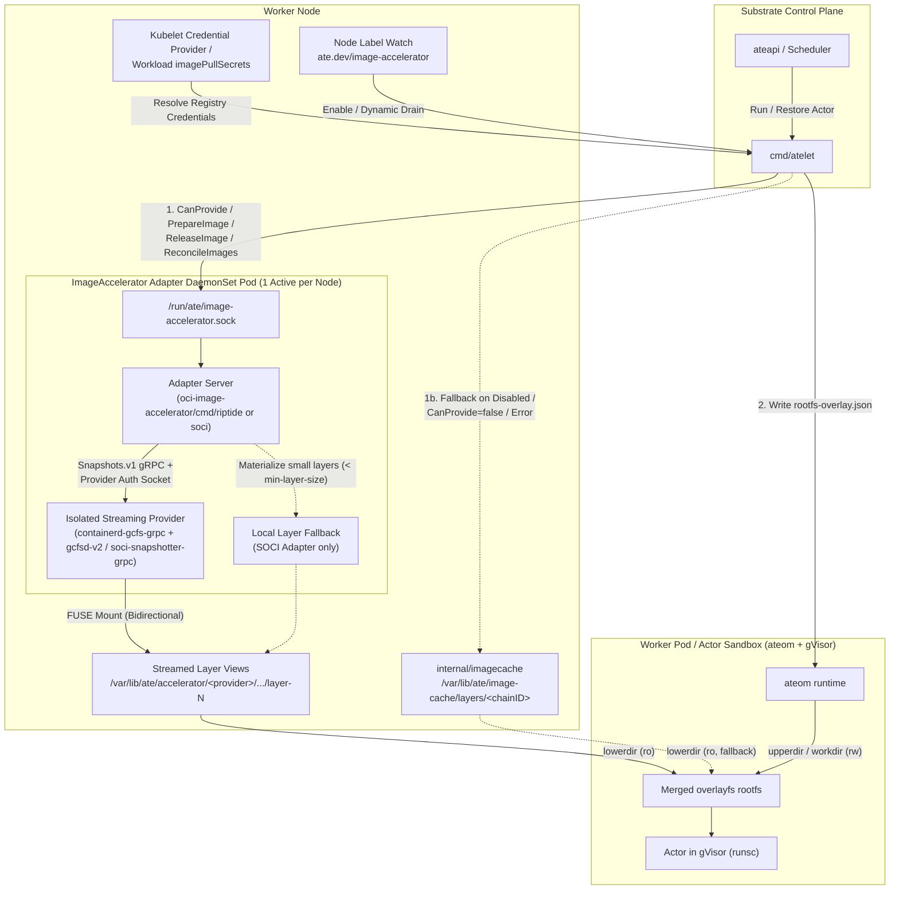

# Image Streaming (`ImageAccelerator`) Detailed Design

## 1. Motivation & Design Goals

In Agent Substrate, cold-node actor startup (`Run`) and cross-node actor migration (`Restore`) are dominated by container image pull and tarball extraction (`~15s–28.5s` for a 1.2 GB compressed / 3.5 GB unpacked agent image). Because Substrate takes the Kubernetes control plane and `containerd` CRI out of the actor critical path—mapping many actors onto pre-warmed worker pods (`ateom` + `gVisor`)—`atelet` manages OCI image layers directly on each node.

Image Streaming eliminates upfront full-image downloads by mounting read-only OCI image layers lazily over FUSE from the container registry, reducing cold-node layer preparation to `~0.5s–1.4s` and warm layer preparation to `<1 ms`.

### Design Goals
1. **Vendor-Agnostic `atelet` Core:** `atelet` must not embed provider-specific snapshotter state machines, auth protocols, or quirks (Google Riptide `gcfs`, AWS SOCI, eStargz, Nydus). Instead, `atelet` communicates over a single high-level gRPC contract: `ImageAccelerator`.
2. **Zero Interference with Host `containerd` Garbage Collection:** Running or garbage-collecting images in host `containerd` (`kubelet` / `crictl` / `ctr`) must never unmount or delete FUSE layers in use by Substrate actors, and vice versa.
3. **Works Identically Whether Host Image Streaming Is Enabled or Disabled:** On GKE, the Riptide v2 adapter must work identically on node pools with GKE Image Streaming disabled (`gcfsConfig: {}`) and on node pools with GKE Image Streaming enabled (`gcfsConfig: {enabled: true}`).
4. **Decoupled Lifecycle & Crash Recovery:** Restarting `atelet` must not sever active FUSE mounts backing running actors. When `atelet` restarts, it reconciles active layer leases (`ReconcileImages`) from surviving on-disk actor bundles (`rootfs-overlay.json`).
5. **Graceful Dynamic Node Drain:** Operators must be able to dynamically disable image streaming on a live node (`ate.dev/image-accelerator=disabled`) so new and restoring actors immediately switch to local `imagecache` layers while currently running streamed actors continue uninterrupted until they finish and drain their FUSE mounts.
6. **Seamless Fallback:** If no adapter socket is present, streaming is disabled on the node, or the adapter declines an image (`CanProvide=false` or `ErrNotSupported`), `atelet` transparently falls back to `internal/imagecache`.

---

## 2. System Architecture



### Component Responsibilities

| Component | Role |
| :--- | :--- |
| **`cmd/atelet`** | Resolves registry credentials via the Kubelet Credential Provider and pod `imagePullSecrets`; watches the node label `ate.dev/image-accelerator`; invokes `ImageAccelerator` (`CanProvide`, `PrepareImage`, `ReleaseImage`, `ReconcileImages`); writes the ordered `LayerDirs` into `rootfs-overlay.json`; falls back to `internal/imagecache` when streaming is disabled or unsupported. |
| **`ateom`** | Unchanged. Reads `rootfs-overlay.json` and mounts the listed `LayerDirs` as read-only `overlayfs` `lowerdir` entries beneath the actor's writable `upperdir`. |
| **`ImageAccelerator` Adapter (`oci-image-accelerator/cmd/*`)** | DaemonSet plugin implementing `substrate.imageaccel.v1.ImageAccelerator`. Resolves image manifests/digests, pushes credentials to the provider's native keychain or snapshot labels, drives the provider's `containerd.services.snapshots.v1.Snapshots` RPCs (`Stat`, `Prepare`, `View`, `Remove`), tracks per-image `refCount` and idle TTL leases, and exposes stable read-only `LayerDirs` to `atelet`. |
| **Streaming Provider (`gcfsd-v2`, `soci-snapshotter-grpc`)** | Runs alongside the adapter in the DaemonSet pod, manages the node-level on-disk chunk cache, and serves read-only layer filesystems over FUSE with `Bidirectional` mount propagation to the host. |

---

## 3. `ImageAccelerator` gRPC Protocol Specification

Why not have `atelet` speak CNCF's `containerd.services.snapshots.v1.Snapshots` directly?
1. **No Standard Credential Passing:** `Snapshots.v1` has no field for `imagePullSecrets`. Riptide requires an out-of-band gRPC call (`Keychain.UpdateCreds`) to `/run/gcfsd/keychain.sock`, whereas AWS SOCI expects `containerd.io/snapshot/remote/soci.basic-auth` or `X-Registry-Auth` labels on `Snapshots.Prepare`.
2. **Unnecessary Snapshot-Tree State Machine:** `Snapshots.v1` requires the caller to walk the OCI layer chain (`diffID` $\to$ `chainID`), issue `Prepare`/`Commit` transitions for every intermediate layer, and create a temporary `View` on top. Because `ateom` already manages the writable `overlayfs` `upperdir`, `atelet` only needs an ordered slice of read-only host directories (`[]string`) for the image's layers.
3. **Provider-Specific Sub-Layer Quirks:** AWS SOCI skips building ztoc indexes for layers smaller than `min-layer-size` (default 10 MiB) and returns `ErrAlreadyExists` without mounting them; Riptide v2 delays populating FUSE view directories briefly after `Snapshots.View` returns. Encapsulating these quirks inside the adapter keeps `atelet` simple and uniform.

### Protobuf Definition (`oci-image-accelerator/proto/v1/accelerator.proto`)

```protobuf
syntax = "proto3";
package substrate.imageaccel.v1;

service ImageAccelerator {
  // Checks whether the underlying provider supports streaming the given image.
  rpc CanProvide(CanProvideRequest) returns (CanProvideResponse);

  // Increments the image's reference count, prepares all OCI layers (from base
  // layer 0 to topmost layer N-1), and returns their host directory paths.
  rpc PrepareImage(PrepareImageRequest) returns (PrepareImageResponse);

  // Decrements the image's reference count and unmounts/cleans up views when
  // the reference count reaches 0 (either after idle TTL or immediately if
  // bypass_ttl is true).
  rpc ReleaseImage(ReleaseImageRequest) returns (ReleaseImageResponse);

  // Called by atelet on startup with the set of images actively used by
  // surviving actor sandboxes on disk. Rebuilds refCounts and unmounts orphans.
  rpc ReconcileImages(ReconcileImagesRequest) returns (ReconcileImagesResponse);
}
```

### Per-Image Contract with Driver-Managed Layer Optimization
`PrepareImage` enforces a clean **per-image** boundary between `atelet` and the adapter driver:
* **Clean Boundary Between `atelet` and OSS Drivers:** Because `atelet` integrates with diverse image-acceleration backends (Riptide, AWS SOCI, Nydus/Dragonfly, Spegel), it is decoupled from backend-specific layer optimizations. Either the adapter returns the complete ordered `LayerDirs` slice in `PrepareImageResponse.layer_dirs` (from base layer `0` to top layer `N-1`), **or** it returns an error (`FailedPrecondition` / `Unimplemented` / error) and cleans up any partial state so `atelet` falls back to `internal/imagecache` for the **entire image**.
* **Hybrid Layer Backing Inside the Driver:** Each adapter driver has full knowledge of its underlying OSS/cloud engine and implements the appropriate per-layer strategy internally. For providers like AWS SOCI (`< min-layer-size`) or Riptide (`< 10 KB`) that skip FUSE-streaming small layers, the driver materializes those layers internally and returns the complete `layer_dirs` slice so `atelet` never has to stitch layers from two subsystems.
* **Simpler Disabling, Fallback, and GC:** Because an image is never split between `atelet`'s local `imagecache` and the adapter, dynamic disabling (`ate.dev/image-accelerator=disabled`), startup reconciliation (`ReconcileImages`), and `atelet`'s local image GC remain isolated and deterministic.

---

## 4. Lifecycle, Reference Counting, Crash Recovery & Dynamic Drain

### 4.1 Per-Image Lease Reference Counting & Cross-Image Layer Deduplication
Inside the shared adapter engine (`oci-image-accelerator/pkg/adapter/server.go`):
* **Image Lease (`imageLease`):** Keyed by normalized `imageRef`. Tracks `refCount`, `imageDigest`, the ordered list of `layerRecord`s, wrapper directory paths (`/var/lib/ate/accelerator/<provider>/<sanitized-imageRef>/layer-<i>`), and an optional idle expiration timer (`idleTimer`).
* **Cross-Image Layer Deduplication (`chainUsers`):** Underlying snapshotter views are keyed by content-addressed `chainID` (`view-<chainID-hex>`). If Image A and Image B share common base layers, both image leases point their respective `layer-<i>` symlinks to the shared FUSE view directory and increment `chainUsers[chainID]`. A `chainID`'s underlying snapshotter view (`Snapshots.Remove("view-<chainID>")`) is only removed when **all** image leases referencing that `chainID` have been torn down.
* **Idle Lease TTL (`--idle-ttl`, default `10m` in DaemonSet / `2m` in library):**
  * When an actor checkpoints or terminates during normal operation (`bypass_idle_ttl = false`), `ReleaseImage` decrements `refCount`.
  * When `refCount` reaches `0`, if `idleTTL > 0`, the adapter starts an `idleTimer` instead of immediately unmounting the FUSE views.
  * If another actor starts or restores with the same image before `idleTimer` fires, `PrepareImage` cancels the timer, increments `refCount`, verifies the directories are still present and listable, and returns in **`<1 ms`** (`0.49 ms – 0.74 ms` measured on GKE).

### 4.2 `atelet` Startup Reconciliation (`ReconcileImages`)
Because the adapter runs in its own DaemonSet pod (`ate-accelerator-<adapter>`), it survives `atelet` restarts. When `atelet` starts up (`cmd/atelet/imageaccel_reconcile.go:reconcileImageAcceleratorOnStartup`):
1. `atelet` scans `/var/lib/ate/actors/*/rootfs-overlay.json` for all surviving actor sandboxes on the node.
2. For each `rootfs-overlay.json` where `OverlaySpec.Streamed` is `true`, `atelet` records the active `ImageRef` and its count of active sandboxes (`activeCount[imageRef]++`).
3. `atelet` calls `ReconcileImages(ctx, &ReconcileImagesRequest{ActiveImages: activeImages})` (repeating for each active sandbox reference or setting the active set).
4. The adapter resets its in-memory `refCount` for every image in `active_images` and immediately tears down any leased or on-disk image directory under `--work-dir` that is not in `active_images`.

### 4.3 Dynamic Node Drain (`ate.dev/image-accelerator=disabled`)
`atelet` watches its own Kubernetes `Node` object via a metadata informer (`cmd/atelet/main.go:watchNodeImageAcceleratorLabel`):
* **Enabled State (`ate.dev/image-accelerator=<adapter>` or unset when socket is present):**
  * `imageAccelClient.SetDraining(false)`
  * `Run` and `Restore` call `CanProvide` $\to$ `PrepareImage`.
  * `ReleaseImage` uses normal idle TTL (`bypass_idle_ttl = false`).
* **Draining / Disabled State (`ate.dev/image-accelerator=disabled`):**
  * `imageAccelClient.SetDraining(true)`
  * **New & Restoring Actors (`Run` / `Restore`):** `atelet` immediately skips `ImageAccelerator` and pulls/unpacks layers into `/var/lib/ate/image-cache/layers/...`. Even an actor that was previously checkpointed while using streamed layers seamlessly restores its writable checkpoint `upperdir` onto local `imagecache` `lowerdir` layers on its next `Restore`.
  * **Existing Running Streamed Actors:** Because the adapter DaemonSet uses `nodeAffinity` matching `ate.dev/image-accelerator In [<adapter>, disabled]`, Kubernetes **does not terminate the adapter pod** when the node is relabeled to `disabled`. Active FUSE mounts stay alive for running actors.
  * **Immediate Lease Eviction on Teardown:** Whenever a running streamed actor checkpoints or terminates while `atelet` is draining (`IsDraining() == true`), `atelet` calls `ReleaseImage` with `bypass_idle_ttl = true`, immediately unmounting the FUSE view as soon as `refCount` reaches `0`.
  * **Full Pod Removal (Optional):** Once all streamed actors have drained (`0` active views), removing the label (`kubectl label node <node> ate.dev/image-accelerator-`) causes Kubernetes to terminate the adapter DaemonSet pod on that node.

---

## 5. Provider Adapter Implementations

### 5.1 Google Riptide v2 Adapter (`oci-image-accelerator/cmd/riptide`)

#### Why Both `containerd-gcfs-grpc` and `gcfsd-v2` Must Be Isolated from Host `containerd`
1. **Why `containerd-gcfs-grpc` Cannot Be Shared (`Snapshots.Walk` / `Snapshots.Remove`):**
   * Host `containerd` and `containerd-gcfs-grpc` maintain two separate BoltDB databases (`/var/lib/containerd/.../meta.db` vs. Riptide's internal `snapshotter/metadata.db`).
   * During host `containerd`'s periodic garbage collection (`core/metadata/snapshot.go:garbageCollect`), `containerd` calls `Snapshots.Walk()` over gRPC to list every snapshot in Riptide's BoltDB, compares that list against `containerd`'s `meta.db`, and calls `Snapshots.Remove(key)` on any snapshot key `containerd` did not create (because Riptide's `snapshots/storage` BoltDB bucket is not partitioned by `containerd-namespace`).
2. **Why `gcfsd-v2` (`--enable-v2`) Also Cannot Be Shared (`CreateView` / `DeleteView` Collisions):**
   * In Riptide v2 (`--enable-v2`), `containerd-gcfs-grpc` delegates `CreateView` and `DeleteView` over `/run/gcfsd/grpc.sock` using the **unscoped layer `chainID` hex** (`views/<chainID>/fs`) as the view key.
   * Sharing the host's `gcfsd-v2` causes `CreateView` collisions (`already exists: view "<chainID>" already exists`) whenever a layer is already mounted by host `containerd`, and causes host `containerd` GC (`DeleteView(<chainID>)`) to unmount `views/<chainID>/fs` out from under Substrate actors.

#### Child Mount Namespace Isolation (`oci-image-accelerator/manifests/riptide.yaml`)
To work identically on both **Case 1 (GKE Image Streaming disabled)** and **Case 2 (GKE Image Streaming enabled)** without touching host `containerd` or host `/run/gcfsd`, the `riptide-provider` container in `ate-accelerator-riptide` runs an isolated `gcfsd-v2` + `containerd-gcfs-grpc` pair using the pre-installed COS binaries (`/home/kubernetes/bin/gcfsd-v2` and `/home/kubernetes/bin/containerd-gcfs-grpc`):
1. Enters a dedicated mount namespace via `unshare -m --propagation unchanged`.
2. Marks `/run` as `mount --make-rslave /run` so private mounts inside `/run` do not propagate back to the host.
3. Bind-mounts `/run/ate-image-streaming/gcfsd` onto `/run/gcfsd` inside the child mount namespace. This satisfies `gcfsd-v2`'s hardcoded `/run/gcfsd/keychain.sock` socket path while keeping the host's `/run/gcfsd` untouched on nodes where host GKE Image Streaming is active, and exposing `/run/ate-image-streaming/gcfsd/keychain.sock` to the sibling `riptide` adapter container.
4. Starts `containerd-gcfs-grpc --enable-v2` (which manages `gcfsd-v2`) rooted at `/var/lib/ate/accelerator/riptide-gcfs` with its FUSE mount at `/var/lib/ate/accelerator/riptide-gcfs/mnt` (`mountPropagation: Bidirectional`), making FUSE layer views at `/var/lib/ate/accelerator/riptide-gcfs/mnt/views/<chainID>/fs` visible to the host and `ateom` pods via `/var/lib/ate`.

#### Credential Push & Layer Preparation Flow
1. `CanProvide`: Checks that the image registry host is Google Artifact Registry (`*.pkg.dev` or `*.gcr.io`) and pings `Snapshots.Stat` on `/run/ate-image-streaming/gcfs-snapshotter.sock`.
2. `PrepareImage`:
   * Resolves the image manifest and layer descriptors (`diffID`s, `chainID`s, compressed sizes) from GAR using the credentials supplied in `PrepareImageRequest` (falling back to the GKE node metadata server token if no pull secret is needed).
   * Pushes credentials to `/run/ate-image-streaming/gcfsd/keychain.sock` via `stream.Keychain/UpdateCreds` (`oci-image-accelerator/internal/proto/riptidekeychain`).
   * For each layer `i = 0 .. N-1`:
     * Ensures the committed parent snapshot `<chainID>` is registered in `containerd-gcfs-grpc` via `Snapshots.Stat` / `Snapshots.Prepare` with Riptide remote snapshot labels (`containerd.io/snapshot.ref`, `containerd.io/snapshot/image-ref`, `containerd.io/snapshot/cri.image-ref`, `containerd.io/snapshot/cri.layer-digest`, `containerd.io/snapshot/gcfs.layer-size`).
     * Creates or reuses the read-only snapshot view `view-<chainID>` via `Snapshots.View` / `Snapshots.Mounts`.
     * Polls until the FUSE view directory (`/var/lib/ate/accelerator/riptide-gcfs/mnt/views/<chainID>/fs`) is mounted and listable.
     * Creates a stable symlink `/var/lib/ate/accelerator/riptide/<sanitized-imageRef>/layer-<i>` $\to$ `/var/lib/ate/accelerator/riptide-gcfs/mnt/views/<chainID>/fs`.

### 5.2 AWS SOCI Adapter (`oci-image-accelerator/cmd/soci`)
* Connects to `soci-snapshotter-grpc` over `/run/soci-snapshotter-grpc/soci-snapshotter-grpc.sock` (isolated root `/var/lib/ate/accelerator/soci-snapshotter` with both `pull_modes.soci_v1` and `pull_modes.soci_v2` enabled).
* Synchronizes resolved registry credentials (`PrepareImageRequest.AuthConfig` or node keychain) to `/run/soci-snapshotter-grpc/docker/config.json` (`DOCKER_CONFIG=/run/soci-snapshotter-grpc/docker`) via `PrePrepareHook` before `Snapshots.Prepare`.
* **Small-Layer Materialization (`materializeSmallLayer`):** When `soci-snapshotter-grpc` skips streaming a small layer (`< min-layer-size`, default `10 MiB`) and returns `codes.OK` with a local active snapshot mount instead of `codes.AlreadyExists`, the SOCI adapter verifies the layer's compressed size is `<= --max-local-layer-size` (default `10 MiB`), downloads and extracts that layer blob into the active snapshot mount directory, and commits it under `<chainID>` (`Snapshots.Commit`), satisfying the `ImageAccelerator` per-image contract while failing fast with `ErrNotSupported` on large unindexed layers.

### 5.3 Nydus RAFS v6 + Kernel EROFS/`fscache` Architecture (`oci-image-accelerator/cmd/nydus-dragonfly`)
* Connects to `containerd-nydus-grpc` (`--fs-driver=fscache --daemon-mode=shared`) over `/run/containerd-nydus/containerd-nydus-grpc.sock`, backed by a singleton `nydusd` daemon (`nydusd singleton --fscache /var/lib/ate/accelerator/nydus-snapshotter/cache`) and a local HTTP range/piece-caching proxy configured via `DRAGONFLY_PROXY_ADDR` (default `http://127.0.0.1:65001`, `fallback: false`, `use_http: true`).
* **Strict No-Fallback Enforcement (`fusedev` Disabled):**
  * At startup, `VerifyKernelEROFSSupport` verifies that `erofs` is registered in `/proc/filesystems` and `/dev/cachefiles` exists, failing fast with an explicit error (`fusedev fallback is disabled`) on non-EROFS kernels such as GKE `COS_CONTAINERD`.
  * On every mounted snapshot view, `verifyMountIsEROFS` verifies via `syscall.Statfs` that `statfs.Type == EROFS_SUPER_MAGIC (0xE0F5E1E2)` and explicitly rejects `FUSE_SUPER_MAGIC (0x65735546)`.
* **Single Merged EROFS Bootstrap Mount (`RAFS v6`):**
  * In Nydus RAFS v6 (`nydusify convert --fs-version 6`), layers `0 .. N-2` are chunked Zstd-compressed data blobs (`containerd.io/snapshot/nydus-blob: "true"`) and the topmost layer `N-1` is the EROFS bootstrap layer (`containerd.io/snapshot/nydus-bootstrap: "true"`, `containerd.io/snapshot/nydus-fs-version: "6"`).
  * `oci-image-accelerator/cmd/nydus-dragonfly` skips intermediate `Snapshots.View` calls on `nydus-blob` layers, unpacks `image/image.boot` from the bootstrap layer when `Snapshots.Prepare` returns `codes.OK`, commits the bootstrap snapshot with Nydus annotations, mounts the resulting `erofs` (`fsid=...`) filesystem, and returns the single merged Kernel EROFS root directory in `PrepareImageResponse.layer_dirs`.

### 5.4 Cross-Node Nydus + Dragonfly v2 P2P Adapter (`oci-image-accelerator/cmd/nydus-dragonfly`)
* Pairs the Nydus RAFS v6 + Kernel EROFS/`fscache` stack with the full cross-node Dragonfly v2 (`d7y`) P2P control plane and data plane (`oci-image-accelerator/manifests/nydus-dragonfly.yaml`):
  * **Control Plane (`ate-system`):** Deploys `dragonfly-mysql`, `dragonfly-redis`, `dragonfly-manager` (`:8080` REST / `:65003` gRPC), and `dragonfly-scheduler` (`:8002` gRPC) to coordinate sub-blob HTTP `Range` piece tasks across worker nodes.
  * **Per-Node Data Plane (`ate-accelerator-nydus-dragonfly` DaemonSet):** Runs `dfdaemon` (`:65001` local proxy for `nydusd`, `:65000` upload server, and `:65002` peer gRPC server over `hostNetwork`), `nydus-snapshotter` (`containerd-nydus-grpc` + `nydusd`), and `nydus-dragonfly` (`provider="nydus-dragonfly"`).
  * **Active Dragonfly Health Probing:** In addition to verifying Kernel EROFS and `/dev/cachefiles`, `nydus-dragonfly` probes `<DRAGONFLY_PROXY_ADDR>/server/ping` during `CanProvide` and `PrepareImage` (`--verify-dragonfly-ping=true`) to ensure the local `dfdaemon` peer is online before mounting RAFS v6 layers.

### 5.5 Stateless Spegel P2P OCI Layer Adapter (`oci-image-accelerator/cmd/spegel`)
* Provides stateless node-to-node P2P OCI layer blob distribution (`oci-image-accelerator/manifests/spegel.yaml`, Mode A) for **100% standard unconverted OCI images** (`tar+gzip`, `tar+zstd`, plain `tar`) on any Linux kernel (including standard GKE `COS_CONTAINERD` and `UBUNTU_CONTAINERD`) with **zero central control plane**:
  * **Stateless Peer Discovery (`spegel-bootstrap` Headless `Service`):** Nodes discover peer Spegel mirrors via the headless `spegel-bootstrap` `Service` in `ate-system` (`:5000` local mirror / `:5001` peer registry) without requiring `mysql`, `redis`, `manager`, or `scheduler` pods.
  * **P2P-First Blob Fetch with Cryptographic Verification & Upstream Fallback:** On `PrepareImage`, `spegel` queries the local Spegel OCI registry mirror (`GET <SPEGEL_MIRROR_ADDR>/v2/<repo>/blobs/sha256:<hex>?ns=<registry>`), which checks the local blob store and fans out `HEAD`/`GET` requests (`X-Spegel-External-Request: true`) across peer nodes. Only on a cluster-cold miss does `spegel` pull the blob from the upstream registry.
  * **Content-Addressed Blob & Unpacked Layer Store (`/var/lib/ate/accelerator/spegel-store`):** Every compressed blob is verified against its expected `sha256:<hex>` digest before being atomically committed to `blobs/sha256/<digestHex>` (making it immediately servable to all peer nodes) and unpacked into `layers/sha256/<chainIDHex>/fs` for instant cross-image layer deduplication and `ateom` bind-mounting.

---

## 6. Decoupled Plugin Architecture, Deployment & Upgrade Workflow

### 6.1 Architectural Boundary & DaemonSet Binary Delivery
Core Substrate (`cmd/atelet`, `cmd/atecontroller`, `internal/nodepath`, `internal/imagecache`, `cmd/ate-setup`, `manifests/ate-install`, `hack/install-ate.sh`) has zero knowledge of any specific image accelerator adapter. `atelet` only knows the socket endpoint (`/run/ate/image-accelerator.sock`) and the `ate.dev/image-accelerator=disabled` node drain label. Because `atelet` and `ateworker` pods already mount `/var/lib/ate` with host-to-container mount propagation, placing all adapter directories under `/var/lib/ate/accelerator/` requires no provider-specific volume mounts in `atecontroller`.

All provider drivers, shared lease management, and DaemonSet manifests live under the self-contained `oci-image-accelerator/` subtree (structured for standalone extraction to `github.com/agent-substrate/oci-image-accelerator`):
```text
oci-image-accelerator/
├── proto/v1/            (ImageAccelerator gRPC service contract)
├── pkg/
│   ├── client/          (Thin gRPC client & fallback helper imported by atelet)
│   └── adapter/         (Shared gRPC server, singleflight, refCount & idleTTL leases)
├── cmd/
│   ├── nydus-dragonfly/
│   ├── riptide/
│   ├── soci/
│   └── spegel/
└── manifests/
    ├── nydus-dragonfly.yaml
    ├── riptide.yaml
    ├── soci.yaml
    └── spegel.yaml
```
Each `ate-accelerator-<provider>` DaemonSet runs a multi-container pod combining the underlying streaming/mirror engine with the Go `ImageAccelerator` adapter—delivering binaries via container images (or pre-installed GKE COS binaries in an isolated mount namespace) without host installer scripts:

| Provider (`manifests/*.yaml`) | Container 1: Engine / Snapshotter | Container 2: `ImageAccelerator` Adapter | `updateStrategy` & Host Volume Contracts |
| :--- | :--- | :--- | :--- |
| **GKE Riptide** (`riptide.yaml`) | `riptide-provider`: Mounts pre-installed `/home/kubernetes/bin/{gcfsd-v2,containerd-gcfs-grpc}` read-only from COS host in an isolated `unshare -m` child mount namespace | `ko://go.ate.dev/substrate/oci-image-accelerator/cmd/riptide` | `RollingUpdate` (`maxUnavailable: 10%`, `SIGTERM` lame-duck drain); `/dev/fuse`, `/run/ate`, `/var/lib/ate` (`Bidirectional`; uses `/var/lib/ate/accelerator/riptide-gcfs` and `/var/lib/ate/accelerator/riptide`) |
| **AWS SOCI** (`soci.yaml`) | `soci-snapshotter-grpc` FUSE snapshotter | `ko://go.ate.dev/substrate/oci-image-accelerator/cmd/soci` | `RollingUpdate` (`maxUnavailable: 10%`, `SIGTERM` lame-duck drain); `/dev/fuse`, `/run/ate`, `/var/lib/ate` (`Bidirectional`; uses `/var/lib/ate/accelerator/soci-snapshotter` and `/var/lib/ate/accelerator/soci`) |
| **Nydus + Dragonfly** (`nydus-dragonfly.yaml`) | `dfdaemon` P2P peer + `nydus-snapshotter` (`containerd-nydus-grpc` + `nydusd` with Kernel EROFS/`fscache`) | `ko://go.ate.dev/substrate/oci-image-accelerator/cmd/nydus-dragonfly` | `RollingUpdate` (`maxUnavailable: 10%`, `SIGTERM` lame-duck drain); `/dev/cachefiles`, `/run/ate`, `/var/lib/ate` (`Bidirectional`; uses `/var/lib/ate/accelerator/nydus-snapshotter` and `/var/lib/ate/accelerator/nydus-dragonfly`) |
| **Spegel P2P** (`spegel.yaml`) | Built-in Spegel-compatible OCI registry mirror (`:5000`) + peer router | `ko://go.ate.dev/substrate/oci-image-accelerator/cmd/spegel` | `RollingUpdate`; `/run/ate`, `/var/lib/ate` (uses `/var/lib/ate/accelerator/spegel-store` and `/var/lib/ate/accelerator/spegel`) |

Because `go run ./cmd/ate-setup deploy ate-system` only applies `manifests/ate-install/*.yaml`, **a cluster installation never deploys an image-accelerator DaemonSet**.

### 6.2 End-to-End Operator Workflow

#### Step 1: Default Cluster Install (Image Acceleration Off by Default)
```bash
go run ./cmd/ate-setup deploy ate-system
```
* Deploys `atelet` configured with `--image-accelerator-socket=/run/ate/image-accelerator.sock`.
* Since no adapter DaemonSet is installed, `/run/ate/image-accelerator.sock` does not exist and `atelet` uses `internal/imagecache` (`0` overhead).

#### Step 2: Separately Deploy and Enable an Accelerator Plugin
Installing an image accelerator is always a separate step outside Substrate's installer:
```bash
ko resolve -f oci-image-accelerator/manifests/riptide.yaml | kubectl apply -f -
kubectl label nodes --all ate.dev/image-accelerator=riptide --overwrite
```
* Builds `oci-image-accelerator/cmd/riptide` with `ko` (or applies a pre-built release manifest) and deploys `ate-accelerator-riptide`.
* Labels target nodes `ate.dev/image-accelerator=riptide` so the DaemonSet schedules onto them.
* Once each pod creates `/run/ate/image-accelerator.sock`, `atelet` automatically begins streaming eligible images on that node without restarting `atelet`.

#### Step 3: Dynamically Disable / Drain Image Acceleration on a Node (or Re-Enable)
```bash
kubectl label node <node-name> ate.dev/image-accelerator-
```
* Removing the `ate.dev/image-accelerator` node label causes Kubernetes to send `SIGTERM` to the adapter pod on `<node-name>`.
* On `SIGTERM`, the adapter immediately enters lame-duck mode (`driver.Drain`): `CanProvide` returns `false`, `PrepareImage` returns `ErrNotSupported` (`codes.FailedPrecondition`) so all new (`Run`) and restoring (`Restore`) actors immediately use `/var/lib/ate/image-cache/layers/...`, and idle cached leases (`refCount == 0`) are unmounted immediately.
* The provider container (`riptide-provider`, `soci-snapshotter`, `nydus-snapshotter`) holds a `lifecycle.preStop` hook (`while [ ! -f /run/ate/drain-complete ]; do sleep 0.5; done`) so the FUSE daemon stays running while active actors finish reading their FUSE mounts and unmounts each streamed image immediately (auto-bypassing `idleTTL`) when its `refCount` reaches `0` (up to `--drain-timeout=30m`).
* Re-enable on a node anytime via `kubectl label node <node-name> ate.dev/image-accelerator=riptide --overwrite`.

### 6.3 Out-of-Tree & Custom Customer Adapter Extensibility
Because `atelet` only knows the socket endpoint (`/run/ate/image-accelerator.sock`) and has zero K8s API or node-label coupling, any out-of-tree or customer-built `ImageAccelerator` DaemonSet works without modifying Substrate:
```bash
kubectl apply -f https://internal.example.com/manifests/mycompany-accelerator.yaml
kubectl label node <node-name> ate.dev/image-accelerator=mycompany --overwrite
```

### 6.4 Upgrade & Version-Skew Lifecycle ([`docs/upgrade.md`](upgrade.md) & [`docs/version-skew-policy.md`](version-skew-policy.md))

1. **Upgrading Agent Substrate (`deploy atelet`):**
   * Like CSI drivers ([`docs/version-skew-policy.md`](version-skew-policy.md)), `ate-accelerator-<provider>` is an external node add-on outside the Substrate release upgrade.
   * During [`docs/upgrade.md`](upgrade.md) Step 2 (`go run ./cmd/ate-setup deploy atelet`), `ds/atelet` rolls in-place node by node while running actors and `ate-accelerator-<provider>` pods stay up untouched. When the new `atelet` pod starts on a node, it calls `ReconcileImages` over `/run/ate/image-accelerator.sock` to synchronize active leases.
   * The `substrate.imageaccel.v1.ImageAccelerator` gRPC protocol evolves via additive optional protobuf fields so `atelet` and `ate-accelerator-<provider>` can be upgraded in either order.
2. **Upgrading a FUSE-Backed Adapter DaemonSet (`RollingUpdate` + `SIGTERM` Lame-Duck Drain):**
   * Stopping a userspace FUSE daemon (`gcfsd-v2`, `soci-snapshotter-grpc`, `nydusd`) while an actor's `overlayfs` `lowerdir` is reading from `/dev/fuse` causes reads to fail with `ENOTCONN`. FUSE-backed DaemonSets therefore combine `updateStrategy.type: RollingUpdate` (`maxUnavailable: 10%`, `terminationGracePeriodSeconds: 3600`) with `SIGTERM` lame-duck self-draining (`--drain-timeout=30m`) and `/run/ate/drain-complete` `preStop` synchronization:
     1. **Apply the updated DaemonSet manifest:** `ko resolve -f oci-image-accelerator/manifests/<provider>.yaml | kubectl apply -f -`.
     2. **Lame-duck drain on `SIGTERM`:** When `kubelet` terminates an adapter pod on `<node>`, the adapter container receives `SIGTERM` and immediately enters lame-duck mode (`CanProvide=false`, `PrepareImage=ErrNotSupported`, idle `refCount == 0` leases evicted). `atelet` automatically falls back to local `imagecache` for new and restoring actors on `<node>` while `/run/ate/image-accelerator.sock` remains open for `ReleaseImage` calls from running streamed actors.
     3. **`preStop` synchronization & replacement:** The provider container's `lifecycle.preStop` hook waits for `/run/ate/drain-complete` before `kubelet` sends `SIGTERM` to the FUSE daemon. Once active leases reach `refCount == 0` (or `--drain-timeout=30m` elapses, matching `ateworker`'s 30-minute workload grace period), the adapter stops its gRPC server, writes `/run/ate/drain-complete`, and Kubernetes starts the new adapter pod on `<node>`.
3. **Upgrading Non-FUSE Providers (`ate-accelerator-spegel`):**
   * Because Spegel unpacks standard files onto the host filesystem rather than holding open `/dev/fuse` mounts, `ate-accelerator-spegel` uses `updateStrategy.type: RollingUpdate` (`terminationGracePeriodSeconds: 5`) and rolls in-place immediately.

---

## 7. Observability & Telemetry

`atelet` emits OpenTelemetry metrics defined in `docs/metrics/registry/metrics.yaml` (`cmd/atelet/metrics.go`):

| Instrument | Type | Unit | Attributes | Description |
| :--- | :--- | :--- | :--- | :--- |
| `ate.image_accelerator.requests` | Counter | `{request}` | `operation` (`can_provide`, `prepare_layers`, `release_layers`, `reconcile_layers`), `status` (`ok`, `declined`, `error`, `fallback`) | Count of `ImageAccelerator` RPC operations and fallbacks to `imagecache`. |
| `ate.image_accelerator.duration` | Histogram | `s` | `operation`, `status` | Latency distribution of `ImageAccelerator` RPC calls from `atelet`. |

Additionally, the adapter logs structured per-stage latency breakdowns on every cold `PrepareImage` call (`resolve_ms`, `stat_ms`, `prepare_ms`, `view_ms`, `listable_ms`, `wrapper_ms`, `total_ms`).

---

## 8. Live GKE Cluster Verification Summary

### 8.1 Google Riptide v2 (`ate-accelerator-riptide`)

| Verification Scenario | Case 1: GKE Image Streaming Disabled (`no-stream-pool`) | Case 2: GKE Image Streaming Enabled (`e2-std32-ssd-pool`) |
| :--- | :--- | :--- |
| **Host `gcfsd.service` / Snapshotter** | `inactive` (`overlayfs`) | `active` (`gcfs`) |
| **Cold `PrepareImage` — 3-Layer, 52 MB Image (`image-a:latest`)** | **`543.24 ms`** (`resolve=268.9ms`, `prepare=242.0ms`, `view=24.2ms`) | **`612.16 ms`** (`resolve=281.1ms`, `prepare=304.2ms`, `view=12.9ms`) |
| **Cold `PrepareImage` — 9-Layer, 1.19 GB Image (`sandbox-04176181...`)** | **`1,347.40 ms`** (`resolve=261.3ms`, `prepare=1029.3ms`, `view=39.7ms`) | **`1,226.61 ms`** (`resolve=272.1ms`, `prepare=876.8ms`, `view=49.2ms`) |
| **Warm `PrepareImage` Latency (3 & 9 layers)** | **`0.49 – 0.69 ms`** | **`0.74 – 0.94 ms`** |
| **Host `containerd` Pull + Sync GC (`ctr -n k8s.io images rm --sync`)** | **0 interference** (`6/6` Substrate snapshots & `3/3` FUSE views intact) | **0 interference** (host `gcfs` `313 -> 314 -> 313`; Substrate `6/6` intact) |
| **`ReleaseImage (bypass_idle_ttl=true)`** | `6.20 ms` (3 layers) / `31.48 ms` (9 layers) | `12.42 ms` (3 layers) / `30.97 ms` (9 layers) |

### 8.2 AWS SOCI v0.15.0 (`ate-accelerator-soci`, 9-Layer 1.19 GB Image)

| Verification Scenario | Node 1 (`no-stream-pool`, `p1tz`) | Node 2 (`e2-std32-ssd-pool`, `bpft`) |
| :--- | :--- | :--- |
| **Layer Mounting Strategy** | All `9/9` layers FUSE-streamed (`fuse.rawBridge`) | All `9/9` layers FUSE-streamed (`fuse.rawBridge`) |
| **Cold `CanProvide` Latency** | `3.55 ms` | `5.27 ms` |
| **Cold `PrepareImage` Latency (9 layers, 1.19 GB)** | **`3,874.12 ms`** (`resolve=368.2ms`, `prepare=3434.1ms`, `view=46.0ms`) | **`6,537.03 ms`** (`resolve=263.5ms`, `prepare=6158.7ms`, `view=90.3ms`) |
| **Warm `PrepareImage` Latency (9 layers)** | **`0.56 ms`** | **`0.90 ms`** |
| **Small-Layer Local Materialization + Unindexed Decline (`image-a:latest`)** | Layer 0 (`< 10 MiB`) materialized & committed locally; Layer 1 (`52.4 MB`) fails fast with `ErrNotSupported` + cached in `declineTTL` (`1.98 ms`) | Same (`ErrNotSupported` + cached in `declineTTL`) |
| **`ReleaseImage (bypass_idle_ttl=true)`** | `35.42 ms` (all 9 views & wrapper dir removed) | `35.42 ms` (all 9 views & wrapper dir removed) |

### 8.3 Nydus + Dragonfly (`ate-accelerator-nydus-dragonfly`, Kernel EROFS + `fscache`, 9-Layer 1.19 GB Image)

| Verification Scenario | Ubuntu EROFS Node (`erofs-ubuntu-pool`, `fkxc` & `49x6`, `c3-standard-4`) | GKE COS Node (`bpft`) |
| :--- | :--- | :--- |
| **Kernel EROFS + `fscache` Check (`fusedev` Disabled)** | Passed (`erofs` + `cachefiles` `ONDEMAND` loaded; `Magic=0xe0f5e1e2`) | Failed fast (`Exit Code 1`: `'erofs' filesystem not registered in /proc/filesystems; fusedev fallback is disabled`) |
| **Cold `PrepareImage` Latency (RAFS v6, 9 layers)** | **`645.85 – 736.87 ms`** (Single-Node) / **`996.46 – 1,081.49 ms`** (Multi-Node Dragonfly v2) | N/A |
| **Warm `PrepareImage` Latency (Lease Hit)** | **`0.451 – 0.659 ms`** | N/A |
| **Demand-Paging Sequential Read — Cold GAR vs. Cross-Node Dragonfly P2P** | **`6.91 MiB/s`** (Cold GAR) $\to$ **`121.48 – 131.24 MiB/s`** (`17.6x – 19.0x` speedup with Dragonfly P2P, `261 MiB` across `60+` pieces, `0` back-to-source misses on Node B) | N/A |
| **Warm In-Kernel EROFS Read (Disk `fscache` / Page Cache)** | **`180.20 MiB/s`** (Disk `fscache`) / **`5,227.60 – 5,813.32 MiB/s`** (`p50 = 7.45 – 10.4 µs`, Kernel Page Cache) | N/A |
| **`ReleaseImage (bypass_idle_ttl=true)`** | `0.22 – 2.36 ms` | N/A |

### 8.4 Stateless Spegel P2P OCI Layer Adapter (`ate-accelerator-spegel`, Mode A, 4-Node `COS_CONTAINERD` + `UBUNTU_CONTAINERD`)

| Verification Scenario | Node 1 (`65vz`, `COS_CONTAINERD` Seeder) | Nodes 2, 3 & 4 (`p1tz` COS, `fkxc` & `49x6` Ubuntu P2P Receivers) |
| :--- | :--- | :--- |
| **Control Plane & Image Format** | `0` control-plane pods (`spegel-bootstrap` headless DNS); 100% standard `tar+gzip` OCI images | `3/3` remote peers auto-discovered on `:5000`; works identically on `COS_CONTAINERD` and `UBUNTU_CONTAINERD` |
| **3-Layer, 56.3 MB Image (`image-a:latest`) `PrepareImage`** | **`2,027.69 ms`** (`prepare=1,659.0ms`, Cold GAR) | **`440.77 – 498.30 ms`** (`prepare=202.1 – 228.5ms`, **`4.1x – 4.6x` total / `7.3x – 8.2x` prepare speedup**, `0` GAR blob fetches) |
| **Cross-Image Shared Layer Deduplication (`sandbox-...:latest`)** | Layer 0 deduplicated on disk (`0 ms`); 2 delta layers (`6.02 MB`) from GAR in `1,006.29 ms` (`prepare=709.2ms`) | Layer 0 deduplicated on disk (`0 ms`); 2 delta layers via P2P in **`328.30 – 353.22 ms`** (`prepare=83.4 – 84.4ms`, **`8.5x` prepare speedup**) |
| **Warm `PrepareImage` Latency (Lease Hit, 3 & 9 layers)** | **`0.455 – 0.586 ms`** | **`0.481 – 0.517 ms`** |
| **Native Unpacked Layer Read (`STATFS_TYPE=0xEF53`, 22,092 files)** | **`181.83 – 194.41 MiB/s`** (Cold Disk, `p50 = 372.5 µs`) | **`4,137.90 – 4,810.04 MiB/s`** (Warm Page Cache, `p50 = 7.96 µs`) |
| **`ReleaseImage (bypass_idle_ttl=true)`** | `0.44 – 0.61 ms` | `0.46 – 2.05 ms` |
