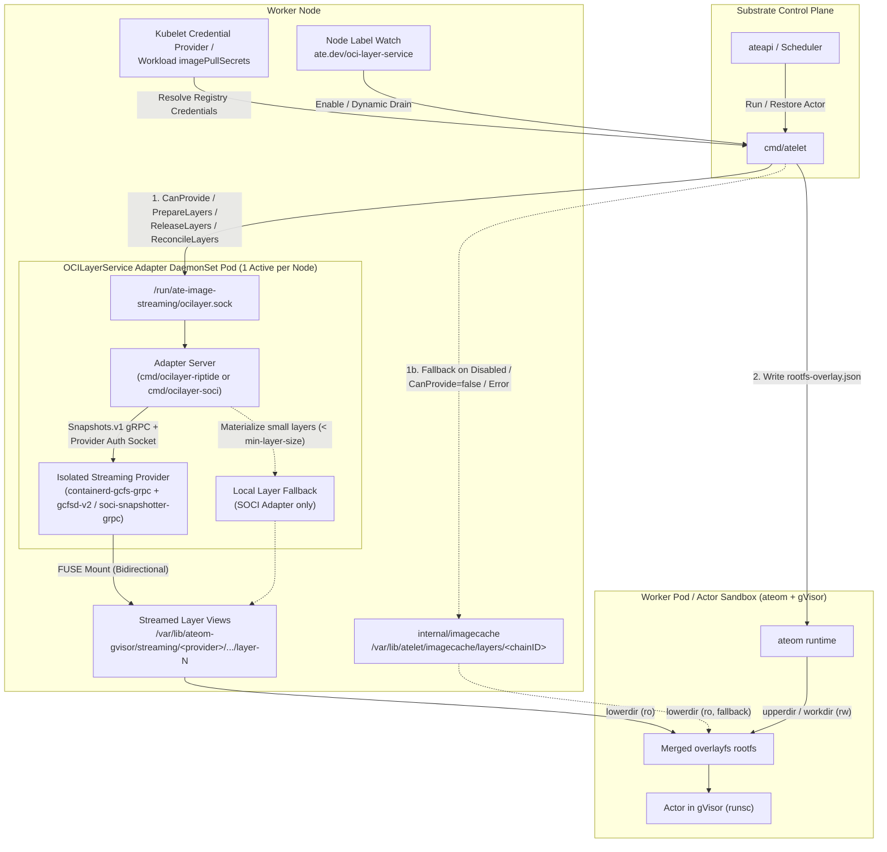

# Image Streaming (`OCILayerService`) Detailed Design

## 1. Motivation & Design Goals

In Agent Substrate, cold-node actor startup (`Run`) and cross-node actor migration (`Restore`) are dominated by container image pull and tarball extraction (`~15s–28.5s` for a 1.2 GB compressed / 3.5 GB unpacked agent image). Because Substrate takes the Kubernetes control plane and `containerd` CRI out of the actor critical path—mapping many actors onto pre-warmed worker pods (`ateom` + `gVisor`)—`atelet` manages OCI image layers directly on each node.

Image Streaming eliminates upfront full-image downloads by mounting read-only OCI image layers lazily over FUSE from the container registry, reducing cold-node layer preparation to `~0.5s–1.4s` and warm layer preparation to `<1 ms`.

### Design Goals
1. **Vendor-Agnostic `atelet` Core:** `atelet` must not embed provider-specific snapshotter state machines, auth protocols, or quirks (Google Riptide `gcfs`, AWS SOCI, eStargz, Nydus). Instead, `atelet` communicates over a single high-level gRPC contract: `OCILayerService`.
2. **Zero Interference with Host `containerd` Garbage Collection:** Running or garbage-collecting images in host `containerd` (`kubelet` / `crictl` / `ctr`) must never unmount or delete FUSE layers in use by Substrate actors, and vice versa.
3. **Works Identically Whether Host Image Streaming Is Enabled or Disabled:** On GKE, the Riptide v2 adapter must work identically on node pools with GKE Image Streaming disabled (`gcfsConfig: {}`) and on node pools with GKE Image Streaming enabled (`gcfsConfig: {enabled: true}`).
4. **Decoupled Lifecycle & Crash Recovery:** Restarting `atelet` must not sever active FUSE mounts backing running actors. When `atelet` restarts, it reconciles active layer leases (`ReconcileLayers`) from surviving on-disk actor bundles (`rootfs-overlay.json`).
5. **Graceful Dynamic Node Drain:** Operators must be able to dynamically disable image streaming on a live node (`ate.dev/oci-layer-service=disabled`) so new and restoring actors immediately switch to local `imagecache` layers while currently running streamed actors continue uninterrupted until they finish and drain their FUSE mounts.
6. **Seamless Fallback:** If no adapter socket is present, streaming is disabled on the node, or the adapter declines an image (`CanProvide=false` or `ErrNotSupported`), `atelet` transparently falls back to `internal/imagecache`.

---

## 2. System Architecture



### Component Responsibilities

| Component | Role |
| :--- | :--- |
| **`cmd/atelet`** | Resolves registry credentials via the Kubelet Credential Provider and pod `imagePullSecrets`; watches the node label `ate.dev/oci-layer-service`; invokes `OCILayerService` (`CanProvide`, `PrepareLayers`, `ReleaseLayers`, `ReconcileLayers`); writes the ordered `LayerDirs` into `rootfs-overlay.json`; falls back to `internal/imagecache` when streaming is disabled or unsupported. |
| **`ateom`** | Unchanged. Reads `rootfs-overlay.json` and mounts the listed `LayerDirs` as read-only `overlayfs` `lowerdir` entries beneath the actor's writable `upperdir`. |
| **`OCILayerService` Adapter (`cmd/ocilayer-*`)** | DaemonSet plugin implementing `ate.io.ocilayer.v1.OCILayerService`. Resolves image manifests/digests, pushes credentials to the provider's native keychain or snapshot labels, drives the provider's `containerd.services.snapshots.v1.Snapshots` RPCs (`Stat`, `Prepare`, `View`, `Remove`), tracks per-image `refCount` and idle TTL leases, and exposes stable read-only `LayerDirs` to `atelet`. |
| **Streaming Provider (`gcfsd-v2`, `soci-snapshotter-grpc`)** | Runs alongside the adapter in the DaemonSet pod, manages the node-level on-disk chunk cache, and serves read-only layer filesystems over FUSE with `Bidirectional` mount propagation to the host. |

---

## 3. `OCILayerService` gRPC Protocol Specification

Why not have `atelet` speak CNCF's `containerd.services.snapshots.v1.Snapshots` directly?
1. **No Standard Credential Passing:** `Snapshots.v1` has no field for `imagePullSecrets`. Riptide requires an out-of-band gRPC call (`Keychain.UpdateCreds`) to `/run/gcfsd/keychain.sock`, whereas AWS SOCI expects `containerd.io/snapshot/remote/soci.basic-auth` or `X-Registry-Auth` labels on `Snapshots.Prepare`.
2. **Unnecessary Snapshot-Tree State Machine:** `Snapshots.v1` requires the caller to walk the OCI layer chain (`diffID` $\to$ `chainID`), issue `Prepare`/`Commit` transitions for every intermediate layer, and create a temporary `View` on top. Because `ateom` already manages the writable `overlayfs` `upperdir`, `atelet` only needs an ordered slice of read-only host directories (`[]string`) for the image's layers.
3. **Provider-Specific Sub-Layer Quirks:** AWS SOCI skips building ztoc indexes for layers smaller than `min-layer-size` (default 10 MiB) and returns `ErrAlreadyExists` without mounting them; Riptide v2 delays populating FUSE view directories briefly after `Snapshots.View` returns. Encapsulating these quirks inside the adapter keeps `atelet` simple and uniform.

### Protobuf Definition (`internal/proto/ocilayer/v1/ocilayer.proto`)

```protobuf
syntax = "proto3";
package ate.io.ocilayer.v1;

service OCILayerService {
  // Checks whether the underlying provider supports streaming the given image.
  rpc CanProvide(CanProvideRequest) returns (CanProvideResponse);

  // Increments the image's reference count, prepares all OCI layers (from base
  // layer 0 to topmost layer N-1), and returns their host directory paths.
  rpc PrepareLayers(PrepareLayersRequest) returns (PrepareLayersResponse);

  // Decrements the image's reference count and unmounts/cleans up views when
  // the reference count reaches 0 (either after idle TTL or immediately if
  // bypass_idle_ttl is true).
  rpc ReleaseLayers(ReleaseLayersRequest) returns (ReleaseLayersResponse);

  // Called by atelet on startup with the set of images actively used by
  // surviving actor sandboxes on disk. Rebuilds refCounts and unmounts orphans.
  rpc ReconcileLayers(ReconcileLayersRequest) returns (ReconcileLayersResponse);
}
```

### All-or-Nothing Contract
`PrepareLayers` enforces a strict **all-or-nothing** contract per image:
* Either the adapter returns **all** `N` layers of the image in `PrepareLayersResponse.layer_dirs` (ordered from base layer `0` to top layer `N-1`), **or** it returns an error (`FailedPrecondition` / `Unimplemented` / error) and cleans up any partial state.
* When `CanProvide` returns `false` or `PrepareLayers` fails, `atelet` falls back to `internal/imagecache` for the **entire image**.
* For providers like AWS SOCI that do not stream small layers (`< min-layer-size`), the SOCI adapter downloads and unpacks those small layers internally into its work directory and returns the complete `layer_dirs` slice so `atelet` never has to stitch layers from two subsystems.

---

## 4. Lifecycle, Reference Counting, Crash Recovery & Dynamic Drain

### 4.1 Per-Image Lease Reference Counting & Cross-Image Layer Deduplication
Inside the shared adapter engine (`internal/ocilayer/adapter/server.go`):
* **Image Lease (`imageLease`):** Keyed by normalized `imageRef`. Tracks `refCount`, `imageDigest`, the ordered list of `layerRecord`s, wrapper directory paths (`/var/lib/ateom-gvisor/streaming/<provider>/<sanitized-imageRef>/layer-<i>`), and an optional idle expiration timer (`idleTimer`).
* **Cross-Image Layer Deduplication (`chainUsers`):** Underlying snapshotter views are keyed by content-addressed `chainID` (`view-<chainID-hex>`). If Image A and Image B share common base layers, both image leases point their respective `layer-<i>` symlinks to the shared FUSE view directory and increment `chainUsers[chainID]`. A `chainID`'s underlying snapshotter view (`Snapshots.Remove("view-<chainID>")`) is only removed when **all** image leases referencing that `chainID` have been torn down.
* **Idle Lease TTL (`--idle-ttl`, default `10m` in DaemonSet / `2m` in library):**
  * When an actor checkpoints or terminates during normal operation (`bypass_idle_ttl = false`), `ReleaseLayers` decrements `refCount`.
  * When `refCount` reaches `0`, if `idleTTL > 0`, the adapter starts an `idleTimer` instead of immediately unmounting the FUSE views.
  * If another actor starts or restores with the same image before `idleTimer` fires, `PrepareLayers` cancels the timer, increments `refCount`, verifies the directories are still present and listable, and returns in **`<1 ms`** (`0.49 ms – 0.74 ms` measured on GKE).

### 4.2 `atelet` Startup Reconciliation (`ReconcileLayers`)
Because the adapter runs in its own DaemonSet pod (`ate-ocilayer-<adapter>`), it survives `atelet` restarts. When `atelet` starts up (`cmd/atelet/oci.go:reconcileOCILayerServiceOnStartup`):
1. `atelet` scans `/var/lib/ateom-gvisor/sandboxes/*/rootfs-overlay.json` for all surviving actor sandboxes on the node.
2. For each `rootfs-overlay.json` whose `LayerDirs` reside under the streaming root (`/var/lib/ateom-gvisor/streaming/`) rather than `/var/lib/atelet/imagecache/layers/`, `atelet` records the active `ImageRef` and its count of active sandboxes (`activeCount[imageRef]++`).
3. `atelet` calls `ReconcileLayers(ctx, &ReconcileLayersRequest{ActiveImages: activeImages})` (repeating for each active sandbox reference or setting the active set).
4. The adapter resets its in-memory `refCount` for every image in `active_images` and immediately tears down any leased or on-disk image directory under `--work-dir` that is not in `active_images`.

### 4.3 Dynamic Node Drain (`ate.dev/oci-layer-service=disabled`)
`atelet` watches its own Kubernetes `Node` object via a metadata informer (`cmd/atelet/main.go:watchNodeOCILayerServiceLabel`):
* **Enabled State (`ate.dev/oci-layer-service=<adapter>` or unset when socket is present):**
  * `ociClient.SetDraining(false)`
  * `Run` and `Restore` call `CanProvide` $\to$ `PrepareLayers`.
  * `ReleaseLayers` uses normal idle TTL (`bypass_idle_ttl = false`).
* **Draining / Disabled State (`ate.dev/oci-layer-service=disabled`):**
  * `ociClient.SetDraining(true)`
  * **New & Restoring Actors (`Run` / `Restore`):** `atelet` immediately skips `OCILayerService` and pulls/unpacks layers into `/var/lib/atelet/imagecache/layers/...`. Even an actor that was previously checkpointed while using streamed layers seamlessly restores its writable checkpoint `upperdir` onto local `imagecache` `lowerdir` layers on its next `Restore`.
  * **Existing Running Streamed Actors:** Because the adapter DaemonSet uses `nodeAffinity` matching `ate.dev/oci-layer-service In [<adapter>, disabled]`, Kubernetes **does not terminate the adapter pod** when the node is relabeled to `disabled`. Active FUSE mounts stay alive for running actors.
  * **Immediate Lease Eviction on Teardown:** Whenever a running streamed actor checkpoints or terminates while `atelet` is draining (`IsDraining() == true`), `atelet` calls `ReleaseLayers` with `bypass_idle_ttl = true`, immediately unmounting the FUSE view as soon as `refCount` reaches `0`.
  * **Full Pod Removal (Optional):** Once all streamed actors have drained (`0` active views), removing the label (`kubectl label node <node> ate.dev/oci-layer-service-`) causes Kubernetes to terminate the adapter DaemonSet pod on that node.

---

## 5. Provider Adapter Implementations

### 5.1 Google Riptide v2 Adapter (`cmd/ocilayer-riptide`)

#### Why Both `containerd-gcfs-grpc` and `gcfsd-v2` Must Be Isolated from Host `containerd`
1. **Why `containerd-gcfs-grpc` Cannot Be Shared (`Snapshots.Walk` / `Snapshots.Remove`):**
   * Host `containerd` and `containerd-gcfs-grpc` maintain two separate BoltDB databases (`/var/lib/containerd/.../meta.db` vs. Riptide's internal `snapshotter/metadata.db`).
   * During host `containerd`'s periodic garbage collection (`core/metadata/snapshot.go:garbageCollect`), `containerd` calls `Snapshots.Walk()` over gRPC to list every snapshot in Riptide's BoltDB, compares that list against `containerd`'s `meta.db`, and calls `Snapshots.Remove(key)` on any snapshot key `containerd` did not create (because Riptide's `snapshots/storage` BoltDB bucket is not partitioned by `containerd-namespace`).
2. **Why `gcfsd-v2` (`--enable-v2`) Also Cannot Be Shared (`CreateView` / `DeleteView` Collisions):**
   * In Riptide v2 (`--enable-v2`), `containerd-gcfs-grpc` delegates `CreateView` and `DeleteView` over `/run/gcfsd/grpc.sock` using the **unscoped layer `chainID` hex** (`views/<chainID>/fs`) as the view key.
   * Sharing the host's `gcfsd-v2` causes `CreateView` collisions (`already exists: view "<chainID>" already exists`) whenever a layer is already mounted by host `containerd`, and causes host `containerd` GC (`DeleteView(<chainID>)`) to unmount `views/<chainID>/fs` out from under Substrate actors.

#### Child Mount Namespace Isolation (`cmd/ocilayer-riptide/ocilayer-riptide.yaml`)
To work identically on both **Case 1 (GKE Image Streaming disabled)** and **Case 2 (GKE Image Streaming enabled)** without touching host `containerd` or host `/run/gcfsd`, the `riptide-provider` container in `ate-ocilayer-riptide` runs an isolated `gcfsd-v2` + `containerd-gcfs-grpc` pair using the pre-installed COS binaries (`/home/kubernetes/bin/gcfsd-v2` and `/home/kubernetes/bin/containerd-gcfs-grpc`):
1. Enters a dedicated mount namespace via `unshare -m --propagation unchanged`.
2. Marks `/run` as `mount --make-rslave /run` so private mounts inside `/run` do not propagate back to the host.
3. Bind-mounts `/run/ate-image-streaming/gcfsd` onto `/run/gcfsd` inside the child mount namespace. This satisfies `gcfsd-v2`'s hardcoded `/run/gcfsd/keychain.sock` socket path while keeping the host's `/run/gcfsd` untouched on nodes where host GKE Image Streaming is active, and exposing `/run/ate-image-streaming/gcfsd/keychain.sock` to the sibling `ocilayer-riptide` container.
4. Starts `containerd-gcfs-grpc --enable-v2` (which manages `gcfsd-v2`) rooted at `/var/lib/substrate/gcfs` with its FUSE mount at `/var/lib/substrate/gcfs/mnt` (`mountPropagation: Bidirectional`), making FUSE layer views at `/var/lib/substrate/gcfs/mnt/views/<chainID>/fs` visible to the host and `ateom` pods.

#### Credential Push & Layer Preparation Flow
1. `CanProvide`: Checks that the image registry host is Google Artifact Registry (`*.pkg.dev` or `*.gcr.io`) and pings `Snapshots.Stat` on `/run/ate-image-streaming/gcfs-snapshotter.sock`.
2. `PrepareLayers`:
   * Resolves the image manifest and layer descriptors (`diffID`s, `chainID`s, compressed sizes) from GAR using the credentials supplied in `PrepareLayersRequest` (falling back to the GKE node metadata server token if no pull secret is needed).
   * Pushes credentials to `/run/ate-image-streaming/gcfsd/keychain.sock` via `stream.Keychain/UpdateCreds` (`internal/proto/ocilayer/riptide/keychain`).
   * For each layer `i = 0 .. N-1`:
     * Ensures the committed parent snapshot `<chainID>` is registered in `containerd-gcfs-grpc` via `Snapshots.Stat` / `Snapshots.Prepare` with Riptide remote snapshot labels (`containerd.io/snapshot.ref`, `containerd.io/snapshot/image-ref`, `containerd.io/snapshot/cri.image-ref`, `containerd.io/snapshot/cri.layer-digest`, `containerd.io/snapshot/gcfs.layer-size`).
     * Creates or reuses the read-only snapshot view `view-<chainID>` via `Snapshots.View` / `Snapshots.Mounts`.
     * Polls until the FUSE view directory (`/var/lib/substrate/gcfs/mnt/views/<chainID>/fs`) is mounted and listable.
     * Creates a stable symlink `/var/lib/ateom-gvisor/streaming/riptide/<sanitized-imageRef>/layer-<i>` $\to$ `/var/lib/substrate/gcfs/mnt/views/<chainID>/fs`.

### 5.2 AWS SOCI Adapter (`cmd/ocilayer-soci`)
* Connects to `soci-snapshotter-grpc` over `/run/soci-snapshotter-grpc/soci-snapshotter-grpc.sock` (isolated root `/var/lib/soci-snapshotter-grpc` with both `pull_modes.soci_v1` and `pull_modes.soci_v2` enabled).
* Synchronizes resolved registry credentials (`PrepareLayersRequest.AuthConfig` or node keychain) to `/run/soci-snapshotter-grpc/docker/config.json` (`DOCKER_CONFIG=/run/soci-snapshotter-grpc/docker`) via `PrePrepareHook` before `Snapshots.Prepare`.
* **Small-Layer Materialization (`materializeSmallLayer`):** When `soci-snapshotter-grpc` skips streaming a small layer (`< min-layer-size`, default `10 MiB`) and returns `codes.OK` with a local active snapshot mount instead of `codes.AlreadyExists`, the SOCI adapter verifies the layer's compressed size is `<= --max-local-layer-size` (default `10 MiB`), downloads and extracts that layer blob into the active snapshot mount directory, and commits it under `<chainID>` (`Snapshots.Commit`), satisfying the `OCILayerService` all-or-nothing contract while failing fast with `ErrNotSupported` on large unindexed layers.

### 5.3 Nydus + Dragonfly Adapter (`cmd/ocilayer-nydus`, Kernel EROFS + `fscache`)
* Connects to `containerd-nydus-grpc` (`--fs-driver=fscache --daemon-mode=shared`) over `/run/containerd-nydus/containerd-nydus-grpc.sock`, backed by a singleton `nydusd` daemon (`nydusd singleton --fscache /var/lib/containerd-nydus/cache`) and a Dragonfly P2P HTTP range/piece-caching proxy configured via `DRAGONFLY_PROXY_ADDR` (default `http://127.0.0.1:65001`, `fallback: false`, `use_http: true`).
* **Strict No-Fallback Enforcement (`fusedev` Disabled):**
  * At startup, `VerifyKernelEROFSSupport` verifies that `erofs` is registered in `/proc/filesystems` and `/dev/cachefiles` exists, failing fast with an explicit error (`fusedev fallback is disabled`) on non-EROFS kernels such as GKE `COS_CONTAINERD`.
  * On every mounted snapshot view, `verifyMountIsEROFS` verifies via `syscall.Statfs` that `statfs.Type == EROFS_SUPER_MAGIC (0xE0F5E1E2)` and explicitly rejects `FUSE_SUPER_MAGIC (0x65735546)`.
* **Single Merged EROFS Bootstrap Mount (`RAFS v6`):**
  * In Nydus RAFS v6 (`nydusify convert --fs-version 6`), layers `0 .. N-2` are chunked Zstd-compressed data blobs (`containerd.io/snapshot/nydus-blob: "true"`) and the topmost layer `N-1` is the EROFS bootstrap layer (`containerd.io/snapshot/nydus-bootstrap: "true"`, `containerd.io/snapshot/nydus-fs-version: "6"`).
  * `cmd/ocilayer-nydus` skips intermediate `Snapshots.View` calls on `nydus-blob` layers (`WithSkipLayerView`), unpacks `image/image.boot` from the bootstrap layer when `Snapshots.Prepare` returns `codes.OK`, commits the bootstrap snapshot with Nydus annotations, mounts the resulting `erofs` (`fsid=...`) filesystem, and returns the single merged Kernel EROFS root directory in `PrepareLayersResponse.layer_dirs`.

---

## 6. Deployment Workflow & Adapter Extensibility

### 6.1 Directory Layout & Decoupled Manifests
Adapter DaemonSet manifests live in a dedicated subdirectory `manifests/ate-install/ocilayer/`:
```text
manifests/ate-install/
├── atelet.yaml
├── ateapi.yaml
├── ...
└── ocilayer/
    ├── ocilayer-nydus.yaml
    ├── ocilayer-riptide.yaml
    └── ocilayer-soci.yaml
```
Because `./hack/install-ate.sh --deploy-ate-system` only applies `manifests/ate-install/*.yaml` at the top level, **a default cluster installation does not deploy any image-streaming adapter DaemonSet**.

### 6.2 End-to-End Operator Workflow

#### Step 1: Default Cluster Install (Image Streaming Off by Default)
```bash
./hack/install-ate.sh --deploy-ate-system
```
* Deploys `atelet` configured with `--oci-layer-service-socket=/run/ate-image-streaming/ocilayer.sock`.
* Since no adapter DaemonSet is installed and no node is labeled, `/run/ate-image-streaming/ocilayer.sock` does not exist and `atelet` uses `internal/imagecache` (`0` overhead).

#### Step 2: Deploy and Auto-Enable the Desired Adapter DaemonSet (`--setup-image-streaming`)
```bash
# Deploy and auto-enable alongside ate-system or standalone on an existing cluster:
./hack/install-ate.sh --deploy-ate-system --setup-image-streaming=riptide
# or:
./hack/install-ate.sh --setup-image-streaming=riptide
```
* Builds `cmd/ocilayer-riptide` with `ko` (when using the in-tree manifest) and applies `cmd/ocilayer-riptide/ocilayer-riptide.yaml`.
* Automatically labels all cluster nodes `ate.dev/oci-layer-service=riptide` and waits for the `ate-ocilayer-riptide` DaemonSet rollout.
* Once each pod creates `/run/ate-image-streaming/ocilayer.sock`, `atelet` automatically begins streaming eligible images on that node.

#### Step 3: Dynamically Disable / Drain Image Streaming on a Node (or Re-Enable)
```bash
# Drain and disable streaming on a specific node:
kubectl label node <node-name> ate.dev/oci-layer-service=disabled --overwrite

# Or drain across all nodes via install-ate.sh:
./hack/install-ate.sh --setup-image-streaming=disabled
```
* `atelet`'s node-label watcher immediately marks the `OCILayerService` client as draining (`SetDraining(true)`).
* All new (`Run`) and restoring (`Restore`) actors immediately use `/var/lib/atelet/imagecache/layers/...`.
* Because the DaemonSet's `nodeAffinity` matches `ate.dev/oci-layer-service In [<adapter>, disabled]`, the adapter pod stays running while active actors finish reading their FUSE mounts and unmounts each streamed image immediately (`bypass_idle_ttl=true`) when its `refCount` reaches `0`.
* Re-enable on a node anytime via `kubectl label node <node-name> ate.dev/oci-layer-service=riptide --overwrite`, or remove the label (`kubectl label node <node-name> ate.dev/oci-layer-service-`) to terminate the adapter pod.

### 6.3 Out-of-Tree & Custom Customer Adapter Extensibility
Neither `atelet` nor `hack/install-ate.sh` hardcodes a closed list of adapter names:
* **`atelet`** checks only whether `ate.dev/oci-layer-service` is `"disabled"` (draining) vs. any other value (enabled whenever `/run/ate-image-streaming/ocilayer.sock` exists).
* **`hack/install-ate.sh --setup-image-streaming=<adapter>`** resolves the adapter manifest using a 3-tier lookup and fails fast with a clear error if none is found:
  1. **`ATE_OCILAYER_ADAPTER_MANIFEST`** — an explicit file path or HTTPS URL (e.g., a release YAML from `github.com/agent-substrate/image-streaming-adapters` or a customer's internal repository).
  2. **`ATE_OCILAYER_ADAPTER_PATH`** — a local checkout of an external adapter repository containing `manifests/ocilayer-${adapter}.yaml` and `cmd/ocilayer-${adapter}` (built via `ko resolve`).
  3. **In-tree fallback** — `cmd/ocilayer-${adapter}/ocilayer-${adapter}.yaml`.

This allows a customer to implement their own `OCILayerService` adapter in their own repository and deploy and auto-enable it via:
```bash
ATE_OCILAYER_ADAPTER_MANIFEST=https://internal.example.com/manifests/ocilayer-mycompany.yaml \
  ./hack/install-ate.sh --setup-image-streaming=mycompany
```
without forking or modifying `substrate`.

---

## 7. Observability & Telemetry

`atelet` emits OpenTelemetry metrics defined in `docs/metrics/registry/metrics.yaml` (`cmd/atelet/metrics.go`):

| Instrument | Type | Unit | Attributes | Description |
| :--- | :--- | :--- | :--- | :--- |
| `ate.imagestreaming.requests` | Counter | `{request}` | `operation` (`can_provide`, `prepare_layers`, `release_layers`, `reconcile_layers`), `status` (`ok`, `declined`, `error`, `fallback`) | Count of `OCILayerService` RPC operations and fallbacks to `imagecache`. |
| `ate.imagestreaming.duration` | Histogram | `s` | `operation`, `status` | Latency distribution of `OCILayerService` RPC calls from `atelet`. |

Additionally, the adapter logs structured per-stage latency breakdowns on every cold `PrepareLayers` call (`resolve_ms`, `stat_ms`, `prepare_ms`, `view_ms`, `listable_ms`, `wrapper_ms`, `total_ms`).

---

## 8. Live GKE Cluster Verification Summary

Full test logs, command transcripts, and side-by-side benchmarks are documented in:
* [`docs/image-streaming-riptide-e2e-test-report.md`](image-streaming-riptide-e2e-test-report.md)
* [`docs/image-streaming-soci-e2e-test-report.md`](image-streaming-soci-e2e-test-report.md)
* [`docs/image-streaming-nydus-e2e-test-report.md`](image-streaming-nydus-e2e-test-report.md)
* [`docs/image-streaming-riptide-vs-soci-performance-report.md`](image-streaming-riptide-vs-soci-performance-report.md)

### 8.1 Google Riptide v2 (`ate-ocilayer-riptide`)

| Verification Scenario | Case 1: GKE Image Streaming Disabled (`no-stream-pool`) | Case 2: GKE Image Streaming Enabled (`e2-std32-ssd-pool`) |
| :--- | :--- | :--- |
| **Host `gcfsd.service` / Snapshotter** | `inactive` (`overlayfs`) | `active` (`gcfs`) |
| **Cold `PrepareLayers` — 3-Layer, 52 MB Image (`image-a:latest`)** | **`543.24 ms`** (`resolve=268.9ms`, `prepare=242.0ms`, `view=24.2ms`) | **`612.16 ms`** (`resolve=281.1ms`, `prepare=304.2ms`, `view=12.9ms`) |
| **Cold `PrepareLayers` — 9-Layer, 1.19 GB Image (`sandbox-04176181...`)** | **`1,347.40 ms`** (`resolve=261.3ms`, `prepare=1029.3ms`, `view=39.7ms`) | **`1,226.61 ms`** (`resolve=272.1ms`, `prepare=876.8ms`, `view=49.2ms`) |
| **Warm `PrepareLayers` Latency (3 & 9 layers)** | **`0.49 – 0.69 ms`** | **`0.74 – 0.94 ms`** |
| **Host `containerd` Pull + Sync GC (`ctr -n k8s.io images rm --sync`)** | **0 interference** (`6/6` Substrate snapshots & `3/3` FUSE views intact) | **0 interference** (host `gcfs` `313 -> 314 -> 313`; Substrate `6/6` intact) |
| **`ReleaseLayers (bypass_idle_ttl=true)`** | `6.20 ms` (3 layers) / `31.48 ms` (9 layers) | `12.42 ms` (3 layers) / `30.97 ms` (9 layers) |

### 8.2 AWS SOCI v0.15.0 (`ate-ocilayer-soci`, 9-Layer 1.19 GB Image)

| Verification Scenario | Node 1 (`no-stream-pool`, `p1tz`) | Node 2 (`e2-std32-ssd-pool`, `bpft`) |
| :--- | :--- | :--- |
| **Layer Mounting Strategy** | All `9/9` layers FUSE-streamed (`fuse.rawBridge`) | All `9/9` layers FUSE-streamed (`fuse.rawBridge`) |
| **Cold `CanProvide` Latency** | `3.55 ms` | `5.27 ms` |
| **Cold `PrepareLayers` Latency (9 layers, 1.19 GB)** | **`3,874.12 ms`** (`resolve=368.2ms`, `prepare=3434.1ms`, `view=46.0ms`) | **`6,537.03 ms`** (`resolve=263.5ms`, `prepare=6158.7ms`, `view=90.3ms`) |
| **Warm `PrepareLayers` Latency (9 layers)** | **`0.56 ms`** | **`0.90 ms`** |
| **Small-Layer Local Materialization + Unindexed Decline (`image-a:latest`)** | Layer 0 (`< 10 MiB`) materialized & committed locally; Layer 1 (`52.4 MB`) fails fast with `ErrNotSupported` + cached in `declineTTL` (`1.98 ms`) | Same (`ErrNotSupported` + cached in `declineTTL`) |
| **`ReleaseLayers (bypass_idle_ttl=true)`** | `35.42 ms` (all 9 views & wrapper dir removed) | `35.42 ms` (all 9 views & wrapper dir removed) |

### 8.3 Nydus + Dragonfly (`ate-ocilayer-nydus`, Kernel EROFS + `fscache`, 9-Layer 1.19 GB Image)

| Verification Scenario | Ubuntu EROFS Node (`erofs-ubuntu-pool`, `fkxc`, `c3-standard-4`) | GKE COS Node (`bpft`) |
| :--- | :--- | :--- |
| **Kernel EROFS + `fscache` Check (`fusedev` Disabled)** | Passed (`erofs` + `cachefiles` `ONDEMAND` loaded; `Magic=0xe0f5e1e2`) | Failed fast (`Exit Code 1`: `'erofs' filesystem not registered in /proc/filesystems; fusedev fallback is disabled`) |
| **Cold `PrepareLayers` Latency (RAFS v6, 9 layers)** | **`645.85 – 736.87 ms`** (`resolve=256.8ms`, `prepare=28.4ms`, `view=38.7ms`) | N/A |
| **Warm `PrepareLayers` Latency (Lease Hit)** | **`0.451 ms`** | N/A |
| **Demand-Paging Sequential Read — Cold GAR vs. Warm Dragonfly P2P** | **`6.91 MiB/s`** (Cold GAR) $\to$ **`131.24 MiB/s`** (`19.0x` speedup with Warm Dragonfly P2P) | N/A |
| **Warm In-Kernel EROFS Read (Disk `fscache` / Page Cache)** | **`180.20 MiB/s`** (Disk `fscache`) / **`5,813.32 MiB/s`** (`p50 = 10.4 µs`, Kernel Page Cache) | N/A |
| **`ReleaseLayers (bypass_idle_ttl=true)`** | `2.36 ms` | N/A |
