# Actor lifecycle & image-streaming profiling

Scripts that measure where time goes in an actor's cold boot, suspend, and
resume—comparing GKE Image Streaming (`gcfsd` + Image Streaming snapshotter) against
`atelet`'s baseline registry pull (`internal/imagecache`) using structured logs
from `ate-api-server`, `atelet`, and `ateom` worker pods.

## Contents

| file | purpose |
|---|---|
| `deploy-pool.sh` | Creates the `ate-profiling` namespace, WorkerPool, and atespace for single-pool runs |
| `profiling-pool.yaml.tmpl` | The WorkerPool manifest template rendered by `deploy-pool.sh` and `repeat_matplotlib.sh` |
| `swebench-template.sh` | Creates an ActorTemplate from a mirrored SWE-bench image, pinned by digest, and waits for its golden snapshot. With `ACTOR_SCRIPT` set, the container runs that script instead of `sleep infinity` |
| `profile_coldboot.py` | Profiles **template creation**: cold registry pull or streaming `PrepareLayers`, boot from spec, golden checkpoint, and workload TTCE from `Picked worker` |
| `profile_lifecycle.py` | Profiles **one actor**: create → initial activation → suspend → resume, with workload TTCE per resume (supports `--step-gap`, `--settle` and `--workload-timeout`) |
| `workloads/file-read.sh` | Actor workload: reads one file (`READ_FILE`, default `pyplot.py`) at boot and after every restore, logging `workload start` / `workload end` |
| `workloads/compile.sh` | Actor workload: runs `compileall` on `COMPILE_DIR` (default `/testbed/lib/matplotlib`) at boot and after every restore, logging the same records |
| `workloads/read-all.sh` | Actor workload: reads every regular file on the rootfs (`READ_ROOT`, default `/`) with `find -xdev -type f \| xargs cat \| wc -c` at boot and after every restore, logging the same records plus `bytes` and `rc`. `cat` reads every path in full, so a pulled and a streamed rootfs of the same image read the same bytes (tar does not: it reads a hardlink group once only where the rootfs shows it as one inode) |
| `repeat_matplotlib.sh` | Runs the N-rep paired `stream` vs. `pull` benchmark on freshly recreated node pools per repetition, with the actor running `workloads/$ACTOR_WORKLOAD.sh` |
| `aggregate_repeats.py` | Aggregates `repeat_matplotlib.sh` output directories (`rep-01..rep-N`) into median / min / max markdown tables (does not read the `workload` key yet) |
| [`log-sources.md`](log-sources.md) | Which log record each reported number comes from, how it is tied to the actor, and how the TTCE rows are computed |
| [`log-appendix.md`](log-appendix.md) | Example raw lines for every record in `log-sources.md`, plus findings from the live cluster samples |

## What each script measures

```mermaid
flowchart LR
    subgraph C["profile_coldboot.py"]
        T["create ActorTemplate"] --> R["≤20 s resync tick"]
        R --> G["reconciler creates golden actor<br/>in ate-golden"]
        G --> B["boot from spec<br/>+ cold pull OR stream PrepareLayers"]
        B --> W["20 s warmup"]
        W --> K["checkpoint → golden tag<br/>golden actor deleted"]
    end
    subgraph L["profile_lifecycle.py"]
        A1["1 · CreateActor<br/>record only"] --> A2["2 · ResumeActor<br/>restore from golden"]
        A2 --> A3["3 · SuspendActor<br/>writes actor's own snapshot"]
        A3 --> A4["4 · ResumeActor<br/>restore from own snapshot"]
    end
    K -. "golden tag" .-> A1
```



**`profile_coldboot.py` never calls `CreateActor`.** It creates a template.
`ateapi`'s template reconciler then creates, boots, checkpoints, and deletes a
golden actor by itself (`cmd/ateapi/internal/controlapi/template_reconciler.go`).
That golden actor is the only thing in either script that boots from spec
(`Actor has no snapshot; Booting from ActorTemplate spec`).

**`profile_lifecycle.py` never boots from spec.** Every actor it creates starts
out holding the template's golden tag, so step 2 is a restore. Steps 2 and 4 run
the same code path (`Actor has durable snapshot; Restoring from snapshot`). The
only difference is which snapshot they read. Step 2 pays a cold image fetch on a
node only when the scheduler places the actor on a node that has not seen the
image yet.

Neither script exercises `onResume` / `ResumeSource`. The template uses `FULL`
snapshots, and `from_data` applies only to `DATA`-scope snapshots.

### Workloads and time to command execution (TTCE)

With `ACTOR_SCRIPT=<path>`, `swebench-template.sh` runs that script as the
container command (`/bin/bash -c`). The scripts in `workloads/` do their work
once at boot, then idle in a polling loop.

A `FULL` restore resumes the frozen process; it does not re-run the command, and
a resumed process gets no new input. So the loop detects a restore itself: it
reads bash's built-in `EPOCHREALTIME` after every `sleep 0.05`, and a wall-clock
jump of more than 1 s means the sandbox was checkpointed and restored. It then
repeats the work. The loop used to wait with `read -t 0.01`, but a checkpoint
taken during that timed read could leave bash blocked in it after every later
restore, so it now uses `sleep` (about 5% of a CPU while idle).

Each run prints two JSON lines to stdout, which ateom copies into the worker
pod's log with its own `time` and the actor's labels:

```json
{"msg":"workload start","workload":"readfile","trigger":"boot|resume","file":"..."}
{"msg":"workload end","workload":"readfile","trigger":"boot|resume","file":"...","bytes":112924,"elapsed_us":20779}
```

The profilers report each line's time relative to a start point:

| script | step | start point | rows |
|---|---|---|---|
| `profile_coldboot.py` | golden actor boot | `Picked worker` | `picked worker -> workload start/end (boot)` |
| `profile_lifecycle.py` | resume #1 and #2 | `Picked worker` | `picked worker -> workload start/end (resume)` |
| `profile_lifecycle.py` | resume #1 and #2 | `Handle RPC` time − `elapsed-time` (handler start) | `rpc start -> workload start/end (resume)` |

`workload elapsed in sandbox` is the script's own measurement of the work
(`elapsed_us`), on the sandbox clock.

**Use `Picked worker` to compare steps.** It is the one start point that cold
boots, resume #1 (restore from the golden snapshot) and resume #2 (restore from
the actor's own snapshot) all have, so TTCE summaries measure every row from it,
and resumes #1 and #2 can be pooled. `rpc start` is supplementary: cold boots
have no `Handle RPC` record (the reconciler calls `ResumeActor` inside
ate-api-server), and for resumes it adds the actor lookup, lease and
scheduling before `Picked worker`, a few milliseconds in these runs.

### Where each number comes from

| component | log record | field |
|---|---|---|
| `ate-api-server` | `Handle RPC` | `elapsed-time` (Go duration string); its timestamp minus `elapsed-time` is the `rpc start` origin |
| `ate-api-server` | `Picked worker` | worker pod and node; its timestamp is the `picked worker` origin |
| `ate-api-server` | `FinalizeSuspended store call durations` | per-store-call durations (int64 ns) |
| `atelet` (pull arm) | `Image cache hit` / `Image cache miss` | per image reference |
| `atelet` (pull arm) | `Image pulled into layer cache` | `took` (int64 ns): registry download + gunzip + untar |
| OCILayerService adapter (stream arm) | `PrepareImage timing breakdown` (Go log text, 1 s timestamps, no trace ID) | `resolve`, `stat`, `prepare`, `view`, `listable`, `wrapper`, `total` |
| `atelet` (restore) | `Restore timing breakdown` | `ate.actor.restore.duration.<phase>` (float **seconds**; emitted on `Restore`, not cold `Run`) |
| `ateom` | `Actor starting/started`, `restoring/restored`, `checkpointing/checkpointed` | lifecycle envelope timestamps |
| `ateom` | `About to run runsc <verb>` | per-container step markers |
| actor stdout (via `ateom`) | `workload start` / `workload end` | `time` (stamped by ateom), `trigger`, `elapsed_us` |

## Machine and environment assumptions

| | value | why it matters |
|---|---|---|
| cluster | GKE Standard cluster in `us-west1-c`, Substrate installed with `--setup-image-streaming=riptide` | The Riptide OCILayerService adapter runs its own `gcfsd`, so GKE Image Streaming is not needed |
| paired node pools (`repeat_matplotlib.sh`) | `pool-stream` (`ate.dev/oci-layer-service=riptide`) and `pool-pull` (`ate.dev/oci-layer-service=none`, which matches no adapter), both `--no-enable-image-streaming`, 2 nodes each (`c3-standard-4`, 100 GB `pd-balanced` by default; overridable via `MACHINE_TYPE`, `DISK_TYPE`, `DISK_SIZE`) | Isolates streaming vs. baseline pull on freshly created nodes every repetition. Pull nodes run no adapter, so atelet finds no socket and pulls through its image cache, and no `gcfsd` runs on them; `install-ate.sh` only labels nodes that exist when it runs |
| sandbox | gVisor (`SANDBOX_CLASS_GVISOR`, config `gvisor-default`) | |
| registry | Artifact Registry, `us-west1-docker.pkg.dev/<project>/swebench-mirror/swebench-verified`, **same region as the cluster** | Riptide (`gcfsd`) only streams from Artifact Registry in the same region/multi-region (not Docker Hub) |
| snapshot store | GCS bucket `snapshot-substrate-test-<project>` | `manifest_fetch` and `download` are GCS reads, not registry reads |

Local tools: `go`, `kubectl`, `kubectl-ate`, `crane`, `jq`, `gcloud`, and
`python3` (standard library only).

## Setup

Run each step once per cluster, from the repo root.

**1. Environment.** Copy `hack/ate-dev-env.sh.example` to `.ate-dev-env.sh`,
set `PROJECT_ID`, `CLUSTER_LOCATION=us-west1-c`,
`NODE_MACHINE_TYPE=c3-standard-4`, and `KO_DOCKER_REPO`, then:

```bash
source .ate-dev-env.sh
export PATH="$HOME/go/bin:$PATH"   # kubectl-ate and crane live here
```

**2. GCP resources and cluster.** `bootstrap` creates the cluster, the snapshot
bucket, and the IAM bindings (including `roles/artifactregistry.reader` for the
`atelet` Workload Identity principal):

```bash
go run ./tools/setup-gcp bootstrap
```

**3. Deploy Substrate.** This deploys `ate-system`, labels the nodes with
`ate.dev/substrate-version`, and deploys the Riptide OCILayerService adapter
that the stream arm streams through.

```bash
./hack/install-ate.sh --deploy-ate-system --setup-image-streaming=riptide
kubectl create namespace ate-profiling 
```

**4. CLI.** Build `kubectl-ate` and copy it to your `PATH`. Rebuild it after
switching branches: an older binary rejects fields the template manifest uses
(for example `unknown field "snapshotsConfig"`).

```bash
make build-atectl && cp bin/kubectl-ate ~/go/bin/kubectl-ate
go install github.com/google/go-containerregistry/cmd/crane@latest
```

**5. Create and populate the regional Artifact Registry mirror** (`crane copy`
preserves digests without requiring a local Docker daemon):

```bash
gcloud artifacts repositories create swebench-mirror \
  --repository-format=docker --location=us-west1 || true
export REPO=us-west1-docker.pkg.dev/${PROJECT_ID}/swebench-mirror/swebench-verified
export BUCKET_NAME=snapshot-substrate-test-${PROJECT_ID}
crane copy swebench/sweb.eval.x86_64.matplotlib__matplotlib-23476:latest \
  ${REPO}:sweb.eval.x86_64.matplotlib__matplotlib-23476
```

## Running

### Paired N-rep Stream vs. Pull Benchmark (Recommended)

`repeat_matplotlib.sh` recreates both `pool-stream` and `pool-pull` before every
repetition (evicting both `gcfsd` and `atelet` node caches), alternates arm execution
order (`stream pull` on odd reps, `pull stream` on even reps), runs coldboot then
lifecycle per arm with the actor executing `workloads/$ACTOR_WORKLOAD.sh`, and
saves JSON telemetry + node pool configuration under `OUT`.

| variable | default | meaning |
|---|---|---|
| `N` | `15` | repetitions |
| `ACTOR_WORKLOAD` | `file-read` | `file-read`, `compile` or `read-all` (a script in `workloads/`) |
| `GAP` | `0` | seconds between coldboot and lifecycle, and `--step-gap` between lifecycle steps. `0` gives `gcfsd` no idle time to finish background layer downloads, so stream reads see the real cost of streaming |
| `SETTLE` | `3` | lifecycle `--settle`: seconds before each step's logs are scraped, after the workload wait on resumes |
| `WORKLOAD_TIMEOUT` | `600` | lifecycle `--workload-timeout`: after each resume, wait up to this many seconds for the actor's `workload end` before settling, so a long workload is never suspended mid-run. A timeout adds a note to the step |
| `OUT` | `profiling/results/workload/$ACTOR_WORKLOAD` | output directory |
| `MACHINE_TYPE`, `DISK_TYPE`, `DISK_SIZE` | `c3-standard-4`, `pd-balanced`, `100` | node pool shape |

```bash
export CLUSTER=<cluster-name>
export ZONE=us-west1-c
export NODE_VERSION=$(gcloud container clusters describe "$CLUSTER" --zone "$ZONE" --format='value(currentNodeVersion)')
export DS=$(kubectl get ds -n ate-system -l app=atelet -o jsonpath='{.items[0].metadata.name}')
export VER=$(kubectl get ds -n ate-system "$DS" -o jsonpath='{.metadata.labels.ate\.dev/substrate-version}')
export REPO=us-west1-docker.pkg.dev/${PROJECT_ID}/swebench-mirror/swebench-verified
export BUCKET_NAME=snapshot-substrate-test-${PROJECT_ID}

# 15 paired cold repetitions of the file-read workload:
N=15 ACTOR_WORKLOAD=file-read profiling/repeat_matplotlib.sh

# The compile workload; each resume waits for its workload end:
N=15 ACTOR_WORKLOAD=compile profiling/repeat_matplotlib.sh
```

To benchmark an alternate VM or disk shape (for example `e2-standard-32` + `pd-ssd`),
override `MACHINE_TYPE`, `DISK_TYPE`, and `DISK_SIZE`:

```bash
MACHINE_TYPE=e2-standard-32 DISK_TYPE=pd-ssd DISK_SIZE=300 \
  N=15 ACTOR_WORKLOAD=file-read profiling/repeat_matplotlib.sh
```

The earlier `results/v3*` runs used an idle actor (`sleep infinity`), `GAP=90`,
and an extra wait for `gcfsd` background downloads to finish before the
lifecycle. That wait has been removed, so those runs can't be reproduced exactly
with the current script. `aggregate_repeats.py` still summarizes their fields.

### Single-Arm / Interactive Profiling

Deploy the standalone profiling WorkerPool:

```bash
profiling/deploy-pool.sh
```

Run a single cold boot + lifecycle measurement. `--env` passes `ACTOR_SCRIPT`
through to `swebench-template.sh`; leave it out for an idle actor:

```bash
python3 profiling/profile_coldboot.py \
  --instance matplotlib__matplotlib-23476 \
  --env "ACTOR_SCRIPT=$PWD/profiling/workloads/file-read.sh" \
  --json profiling/run-coldboot-matplotlib__matplotlib-23476.json

python3 profiling/profile_lifecycle.py \
  --atespace ate-profiling \
  --template swebench-matplotlib-matplotlib-23476 \
  --worker-namespace ate-profiling --worker-pool profiling \
  --settle 3 \
  --json profiling/run-lifecycle-matplotlib__matplotlib-23476.json
```

## Reading the results correctly

- **Both node caches persist across template recreation.** Deleting or recreating an
  `ActorTemplate` does not evict `atelet`'s layer cache (`/var/lib/ateom-gvisor/image-cache`)
  or `gcfsd`'s node content cache. True cold pulls and cold streams require fresh nodes
  (as `repeat_matplotlib.sh` enforces per repetition).
- **Say which boundary a number is from.** `ateapi_rpc_total` is the server's
  handler time. `client_wall` adds ~420 ms of `kubectl-ate` process startup and mTLS.
- **Cold-boot `atelet` vs. restore `atelet`.** Cold boot invokes `AteomHerder.Run`
  (reporting `pull took` on the pull arm or `PrepareLayers` phases on the stream arm),
  whereas snapshot resume invokes `AteomHerder.Restore` (reporting `Restore timing breakdown`).
- **Warm path vs. cold miss path.** On `matplotlib__matplotlib-23476` (`3,073 MB`,
  10 layers), GKE Image Streaming cuts cold `atelet` image preparation from ~`51 s`
  (`c3-standard-4`) / ~`70 s` (`e2-standard-32`) down to ~`2.3–2.5 s` (`PrepareLayers.total`),
  while warm resumes (`stat-hit` / layer cache `HIT`) complete in ~`225–245 ms` (`ateapi_rpc_total`).
- **Classify each resume as cold or warm before comparing TTCE.** Placement is
  the scheduler's choice, so a resume is cold only if it lands on a node that has
  not fetched the image. Use `streaming["swebench-verified path"]` (`STREAMED cold`
  vs. `stat hit`) on the stream arm and `images["swebench-verified"]` (`MISS` vs.
  `HIT`) on the pull arm. With `GAP=0`, resume #2 usually lands on the other node.
- **`workload start` trails the restore by up to ~50 ms** (one `sleep 0.05` pass of the loop;
  ~10 ms in runs before the loop switched from `read -t` to `sleep`),
  and its `time` is when ateom read the line, not when bash printed it.
- **`workload end` includes the `stat` in `file-read.sh`'s end marker**, which
  starts a process after the read. `workload elapsed in sandbox` excludes it.
- **The TTCE start point and the workload lines use different clocks**
  (ate-api-server node vs. worker node), so cross-node clock skew enters every
  TTCE row.
