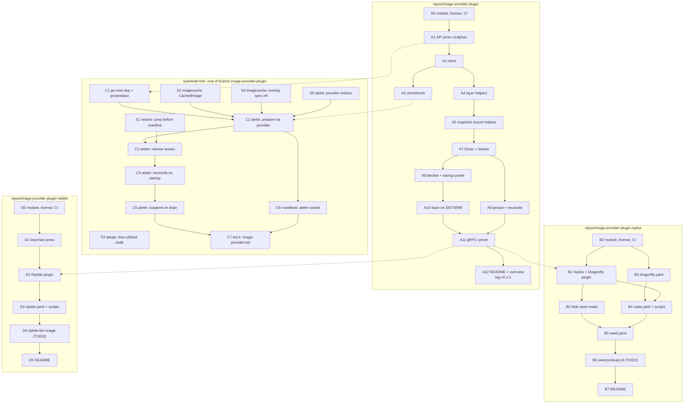
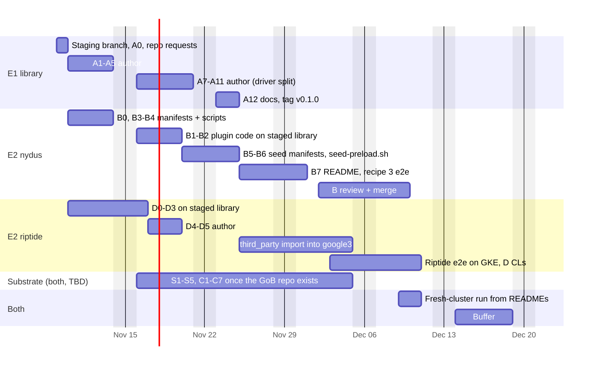

# Image provider plugin: check-in plan (rev 5)

Source: `oci-image-plugin-bench` @ `07d01f3c5` (prototype, untouched). Base: `upstream/main`.

## Decisions so far

| Topic | Decision |
|---|---|
| ateapi less-utilized placement | Stays in the substrate fork (S3). |
| Proto | Keep `LayerForm` and the EROFS fields. Rename only. atelet requests `LAYER_FORM_DIRS`. |
| Names | Rename to `image-provider` everywhere (table below). |
| Snapshots API | Import `github.com/containerd/containerd/api/services/snapshots/v1`. |
| Nydus | Recipe 3 only: seed HTTP with stock nydusd. Keep `seed-preload.sh` with GCE credentials. The commit message has a TODO to settle this in review. |
| Riptide | Basic prod version. Node-preloaded binaries are the default. `RIPTIDE_BIN_DIR` and `CLEAR_CACHE_ON_START` are configurable. `riptide-bin-image` is kept. The commit message has a TODO to decide in review. |
| Docs | Keep the README plus setup and run instructions for each repo, the API overview, and the substrate docs. Drop benchmark docs and results. |
| Staging | One branch, **`image-provider-plugin`**, with one folder per target repo. |
| Manifests | Split by component. Shell moves into `.sh` files that kustomize turns into ConfigMaps. |
| Quality bar | Prod code. The substrate `AGENTS.md` rules apply to the new repos too. |
| Library scope | `image-provider-plugin` holds only code that every plugin can use. Plugin-specific code lives in the plugin's repo. |
| Proto layers | `PrepareImageResponse.layers` is a oneof with one arm per `LayerForm`: `LayerDirs`, `ErofsLayers`, and `Rootfs` for `LAYER_FORM_ROOTFS` (Ray). |
| Parallel work | Nydus and Riptide build against the staged library through `replace`, so they don't wait for library review. Every library commit keeps Nydus and Riptide building and passing tests. If a change breaks them, its author fixes them in the same change. |

## Staging layout

Branch **`image-provider-plugin`**, based on `upstream/main`:

```
/                                    -> ai-on-gke/substrate, branch image-provider-plugin
repos/image-provider-plugin/         -> github.com/ai-on-gke/image-provider-plugin
repos/image-provider-plugin-nydus/   -> github.com/ai-on-gke/image-provider-plugin-nydus
repos/image-provider-plugin-riptide/ -> google3 riptide/image_provider_plugin (path TBD)
```

- Each commit touches one target only: either the root or one `repos/<x>`.
- `git subtree split -P repos/<x>` exports each repo's history. Substrate commits are cherry-picked onto the fork with `repos/` left out.
- Each `repos/<x>` has its own `go.mod`.
  - Nydus, Riptide and the substrate root use `replace github.com/ai-on-gke/image-provider-plugin => <relative path>` while staging.
  - On export, the `replace` becomes the `v0.1.0` tag.
  - Riptide's module path, `github.com/ai-on-gke/image-provider-plugin-riptide`, is a placeholder.
- The staging branch stays local, or goes to a personal remote. It shares a name with the fork branch but lives in a different remote.

## Prod rules applied to the new repos

- Every file has an Apache 2.0 header, and every repo has a `LICENSE`.
- Shell lives only in `.sh` files under `hack/`, `manifests/scripts/` or `.github/`. Each must pass `shellcheck`. None is inlined in YAML.
- CI in each repo runs `go test -race ./...`, `golangci-lint` (same config as substrate), `shellcheck`, a boilerplate check, a `go mod tidy` diff, and a kustomize build of the manifests.
- Images are pinned by digest, checked with `crane digest`.
- Options, flags and hooks with no caller after the cuts are deleted.
- Each new test must fail without its change. Run new tests with `-count=3 -shuffle=on`.
- Comments and docs describe the final code. Benchmark and experiment narration comes out.
- Each repo set gets an adversarial review in a fresh session before export.

## Renames

| Prototype | New |
|---|---|
| `api/imageplugin/v1/imageplugin.proto`, `substrate.imageplugin.v1`, `ImagePlugin` | `api/imageprovider/v1alpha1/image_provider.proto`, `imageprovider.v1alpha1`, `ImageProviderPlugin` |
| `internal/imagepluginclient` (+`mock`) | `github.com/ai-on-gke/image-provider-plugin/client` (+`client/mock`) |
| `image-plugin/pkg/plugin` | `github.com/ai-on-gke/image-provider-plugin/plugin` |
| `cmd/nydus-dragonfly-preload` | `image-provider-plugin-nydus/cmd/image-provider-nydus` |
| `cmd/riptide`, `cmd/riptide-bin-image` | `image-provider-plugin-riptide/cmd/image-provider-riptide`, `.../cmd/riptide-bin-image` |
| atelet `--image-plugin-socket`, `/run/ate/image-plugin.sock` | `--image-provider-socket`, `/run/ate/image-provider.sock` |
| metrics/attrs `ate.imageplugin.*` | `ate.imageprovider.*` |
| `imageplugin_reconcile.go`, `oci_imageplugin_test.go` | `imageprovider_reconcile.go`, `oci_imageprovider_test.go` |
| `docs/image-plugin-overview.md` | `repos/image-provider-plugin/docs/overview.md` |
| labels `app: ate-image-plugin`, `ate.dev/image-plugin` | `app: ate-image-provider`, `ate.dev/image-provider` |

## Commits, in landing order

### Phase S: substrate, no dependencies

| # | Commit | Source | Size |
|---|---|---|---|
| S1 | `atelet: start image prep before the snapshot manifest fetch` | `6f86db2fc`, without the lease-release defer | 140 |
| S2 | `imagecache: add CachedImage for digest refs already on disk` | `imagecache.go` | 30 |
| S3 | `ateapi: place actors on the less-utilized node` | `71d93a4d9` | 185 |
| S4 | `imagecache: record the image ref and provider-prepared layers in the overlay spec` | `spec.go`, `Image.Streamed` | 25 |
| S5 | `atelet: add image provider metrics` (with the `docs/observability.md` rows) | `metrics.yaml`, `ateattr`, `metrics.go`, `observability.md` | 140 |

### Phase A: `repos/image-provider-plugin`

| # | Commit | Source | Size | Deps |
|---|---|---|---|---|
| A0 | `Add module, license, lint config and CI` | new | 150 | – |
| A1 | `api: add the imageprovider.v1alpha1 ImageProviderPlugin API` (proto, generated code, `buf.gen.yaml` + `go:generate`, CI check that generated code is current) | `api/imageplugin/v1` | 180 + gen | A0 |
| A2 | `client: add a gRPC client for ImageProviderPlugin` | `imagepluginclient/client*.go` | 625 | A1 |
| A3 | `client/mock: add a configurable mock client` | `imagepluginclient/mock` | 130 | A2 |
| A4 | `plugin: add layer helpers` | `helpers.go` part | 150 | A2 |
| A5 | `plugin: add containerd snapshot mount helpers` | `helpers.go` part | 185 | A4 |
| A7 | `plugin: add Driver with ref-counted image leases` | `driver.go` part, tests | 900 + tests | A5 |
| A8 | `plugin: decline unstreamable images and probe the provider at startup` | `driver.go` part | 250 + tests | A7 |
| A9 | `plugin: persist leases and reconcile them after a restart` | `driver.go` part | 300 + tests | A7 |
| A10 | `plugin: drain leases on SIGTERM` | `driver.go`, `server.go` parts | 200 + tests | A8 |
| A11 | `plugin: add the gRPC server and unix socket helpers` | `server.go`, tests | 300 + 400 tests | A10 |
| A12 | `docs: add the README and the API overview` | new README. `docs/overview.md` from `docs/image-plugin-overview.md`, trimmed to the API, plugin DaemonSet model, on-disk layout and upgrade/drain contract. | 250 | A11 |

The A12 README covers what the repo is, the API in brief, how to write a plugin on `plugin.Driver`, and how to build, test and regenerate code. Tag `v0.1.0` after A12.

The library holds only code that every plugin can use. Code that only one plugin needs lives in that plugin's repo. A6 (`DockerConfigSyncer`) is retired for that reason, and its number is not reused. `DockerConfigSyncer`, `UnpackLayerTarToDir` and `ExtractActiveMountDir` moved into B1.

### Phase B: `repos/image-provider-plugin-nydus` (recipe 3)

| # | Commit | Source | Size | Deps |
|---|---|---|---|---|
| B0 | `Add module, license, lint config and CI` | new | 150 | – |
| B1 | `nydus: add the Nydus and Dragonfly plugin` | preload `nydusdragonfly.go`, `main.go`, tests, without layered/warm/read-ahead/pprof/timing. `dockerconfig.go` and `unpack.go` from the library helpers. | 1000 + 850 tests | A11, B0 |
| B2 | `nydus: read images, manifests and bootstraps from the blob seeds` | `seed.go`, `seed_test.go` | 330 | B1 |
| B3 | `manifests: add the Dragonfly v2.5 control plane` → `manifests/dragonfly.yaml` | seedhttp yaml part | 450 | B0 |
| B4 | `manifests: add the node DaemonSet` → `manifests/node.yaml` + `manifests/scripts/*.sh` | seedhttp yaml part | 500 | B1, B3 |
| B5 | `manifests: add the seed nodes` → `manifests/seed.yaml` | seedhttp yaml part | 170 | B2, B4 |
| B6 | `hack: add seed-preload.sh to fill the blob seeds` | `seed-preload.sh`, made prod-ready | 120 | B5 |
| B7 | `docs: add the README with setup and run instructions` | new. Facts from `deploy-nydus-recipe.sh` and the manifest header comments. | 150 | B6 |

The B7 README covers:
- How recipe 3 works: seed HTTP, then dfdaemon, then the registry.
- Prerequisites: a kernel with EROFS and on-demand fscache (or the module build), seed nodes labeled `ate.dev/dragonfly-seed=true`, and Substrate with the atelet socket from C6.
- Deploy: `kustomize build manifests | ko resolve -f - | kubectl apply -f -`.
- Preload the seeds with `hack/seed-preload.sh`.
- Verify through plugin logs and the `ate.imageprovider.*` metrics.
- Uninstall.

B6 commit message draft:

```
hack: add seed-preload.sh to fill the blob seeds

nydus-blob-seed serves Nydus blobs and manifests from
/var/lib/ate/nydus-seed-blobs on each seed node. seed-preload.sh reads
image refs, one per line, and has every seed node fetch their blobs and
manifests into that directory through its local dfdaemon.

TODO: The script gets registry credentials from the GCE metadata
server, so it only works for Artifact Registry and GCR on GCE. Settle
the credential source in review.
```

### Phase C: substrate fork client side

| # | Commit | Source | Size | Deps |
|---|---|---|---|---|
| C1 | `go.mod: depend on image-provider-plugin`, pin its redacted fields in `protoredact_test.go` | | 10 | A1 |
| C2 | `atelet: prepare images through the image provider plugin` | `main.go`, `oci.go`, tests | 450 + 190 tests | A3, S2, S4, S5, C1 |
| C3 | `atelet: release provider leases on checkpoint, terminate and failed restore` | `main.go`, `oci.go` parts | 120 | S1, C2 |
| C4 | `atelet: reconcile provider leases on startup` | `imageplugin_reconcile.go` | 250 + 150 tests | C3 |
| C5 | `atelet: suspend actors on a draining image provider plugin` | `5882c44bd`, net of EvictWorkload | 100 + 80 tests | C4 |
| C6 | `manifests: mount the image provider socket into atelet` | `atelet.yaml` | 10 | C2 |
| C7 | `docs: describe how atelet uses an image provider plugin` → `docs/image-provider.md` | atelet parts of `image-plugin-overview.md` | 80 | C6 |

C7 covers `--image-provider-socket`, the fallback to imagecache, lease release and reconcile, and suspend on drain. It links to the A repo for the API.

### Phase D: `repos/image-provider-plugin-riptide`

| # | Commit | Source | Size | Deps |
|---|---|---|---|---|
| D0 | `Add module, license, lint config and CI` | new | 150 | – |
| D1 | `proto: add the gcfsd keychain client proto` | `riptidekeychain` | 60 + gen | D0 |
| D2 | `riptide: add the Riptide plugin` | `cmd/riptide` @ HEAD | 530 + 400 tests | A11, D1 |
| D3 | `manifests: add the Riptide DaemonSet` → `manifests/riptide.yaml` + `manifests/scripts/{start-riptide,run-gcfs}.sh` | `riptide.yaml` | 330 | D2 |
| D4 | `riptide: add riptide-bin-image to package custom binaries` | `cmd/riptide-bin-image`. The patch output becomes a kustomize patch. | 290 + 215 tests | D3 |
| D5 | `docs: add the README with setup and run instructions` | new. Facts from the `riptide.yaml` header. | 120 | D4 |

D3 runs Riptide as one DaemonSet with its own gcfsd and `containerd-gcfs-grpc`, separate from the host's. It doesn't branch on host state.

- The `systemctl is-active gcfsd.service` check and its two log messages come out of `start-riptide.sh`.
- The manifest header describes only the DaemonSet and the binary source.

D3 settings (DaemonSet env vars):
- `RIPTIDE_BIN_DIR`: unset means `${KUBE_HOME}/bin`, the binaries GKE preloads on the node. Set it to use custom binaries.
- `CLEAR_CACHE_ON_START`: default `false`.
- `ENABLE_GCFS_V2_API`, `ENABLE_GCFS_LAYER_CACHING`, `ENABLE_USERNAMESPACE_SUPPORT` and `GCFSD_CACHE_SIZE_MIB`: as in the prototype.

The D5 README covers:
- How it runs:
  - A DaemonSet with its own gcfsd and snapshotter.
  - It uses the binaries on the node by default.
  - Custom binaries can replace them.
  - It keeps its state under `/var/lib/ate/image-plugin-cache/riptide-gcfs`, apart from host containerd.
- Prerequisites.
- Deploy.
- The env settings.
- Custom binaries with `RIPTIDE_BIN_DIR` and `riptide-bin-image`.
- Verify.

D4 commit message draft:

```
riptide: add riptide-bin-image to package custom binaries

The DaemonSet runs the gcfsd and containerd-gcfs-grpc binaries that GKE
preloads under /home/kubernetes/bin, or the ones in RIPTIDE_BIN_DIR if
set. riptide-bin-image packs custom builds into an image and writes a
kustomize patch that installs them into RIPTIDE_BIN_DIR with an init
container.

TODO: Decide in review whether to keep both RIPTIDE_BIN_DIR and
riptide-bin-image, or only RIPTIDE_BIN_DIR and leave installing custom
binaries to the user.
```

## Dependency graph

Each box is one target repo. Solid arrows mean "must land first" inside a repo. Dashed arrows cross repos and need the upstream commits staged, or tagged when exported.



Review waves (commits in a wave don't depend on each other):

| Wave | Commits |
|---|---|
| 1 | S1, S2, S3, S4, S5, A0, B0, D0 |
| 2 | A1, B3, D1 |
| 3 | A2, C1 |
| 4 | A3, A4 |
| 5 | A5, C2 |
| 6 | A7, C3, C6 |
| 7 | A8, A9, C4 |
| 8 | A10, C5 |
| 9 | A11, C7 |
| 10 | A12, B1, D2 |
| 11 | B2, B4, D3 |
| 12 | B5, D4 |
| 13 | B6, D5 |
| 14 | B7 |

## Timeline (two engineers)

Start Mon Nov 9. Target: everything merged by Fri Dec 11, leaving Dec 14–18 as a full week of buffer before mid-December.

Assumptions:
- Two engineers write the commits full time.
- Each is the first reviewer on the other's PRs. A maintainer gives final approval within 1–2 business days.
- Nov 26–27 is a US holiday.
- Commits go out as small PR stacks, so writing runs ahead of review.

### Who owns what

| Engineer | Owns | Why |
|---|---|---|
| E1 | A0–A12 (library) and the `v0.1.0` tag | One owner for the shared API. |
| E2 | B0–B7 (Nydus), D0–D5 (Riptide), the google3 `third_party` import, e2e for recipe 3 and Riptide | Both plugins build against the staged library, so E2 doesn't wait for A review. Only B1, B2 and D2 wait for `v0.1.0` to merge. |
| Both | S1–S5, C1–C7 (substrate) | Waiting for the GoB repo. The split is decided later. |



| Milestone | Date | Done when |
|---|---|---|
| M0 Kickoff | Tue Nov 10 | Staging branch `image-provider-plugin` exists with `repos/` skeletons. GitHub repo requests are filed. |
| M1 Base | Fri Nov 13 | A1–A5 are staged. B3–B4 and D0–D3 are staged on the staged library. |
| M2 Library core | Fri Nov 20 | A7–A11 are staged and A1–A5 are merged. B1–B2 and D4–D5 are staged. |
| M3 Library done | Wed Nov 25 | A7–A12 are merged and `v0.1.0` is tagged. The google3 `third_party` import is filed. All of B and D is staged. |
| M4 Plugins staged | Fri Dec 4 | Recipe 3 passes e2e on the exported repos, compared against the Nov 6 results. Riptide passes e2e on GKE. |
| M5 Plugins merged | Thu Dec 10 | B1–B7 are merged on GitHub. The D CLs are submitted in google3. The TODOs in B6 and D4 are settled. |
| M6 Complete | Fri Dec 11 | READMEs are verified on a fresh cluster. Dec 14–18 are buffer. |

Substrate milestones are set once the GoB repo exists. The schedule still depends on the library: B1, B2 and D2 can't merge before the `v0.1.0` tag.

Risks to the date:
- **Public GitHub repos:** creating them under `ai-on-gke` may need an open-source release approval. File the request on day 1. Until then, review can run on the staging branch.
- **google3 import:** Riptide needs `image-provider-plugin` in `third_party` first, and the import has its own review. If it isn't through by Dec 4, the D CLs are the first item to slip into the buffer.
- **`driver.go` split (A7–A11):** E1's biggest step, and it gates merging B1, B2 and D2. If it slips, send A7–A11 as one PR with several commits.
- **Library API churn:** a change to the exported `plugin` API during A review also changes B and D. Its author fixes them in the same change, so E2 keeps a working build.
- **Substrate repo:** S and C wait for the GoB repo. If it arrives late, S and C land after the plugins. Nothing in A, B or D depends on them.
- **Review latency:** cross-review between E1 and E2 keeps first-pass review fast. Maintainer approval is still the bottleneck, so send two or three waves per PR stack.

## Excluded

- **Other plugins:** SOCI and Spegel (all variants), `cmd/nydus-dragonfly`, and every Nydus manifest except seedhttp.
- **Riptide extras:** `riptide-ms.yaml` (Memorystore arm).
- **Benchmarks:** all of `benchmarking/`, including its README, results, scripts, `loader/` and the nydusd patches.
- **Scripts:** every `*.sh` except `seed-preload.sh` and the new `manifests/scripts/*.sh`.
- **Prototype-only edits:** `.ko.yaml` (Spegel), the `verify-boilerplate.py` tweak, the `installdefaults` guard entry, and `EvictWorkload`.

## Open questions

- Who writes S1–S5 and C1–C7. Decided once the GoB repo exists.
