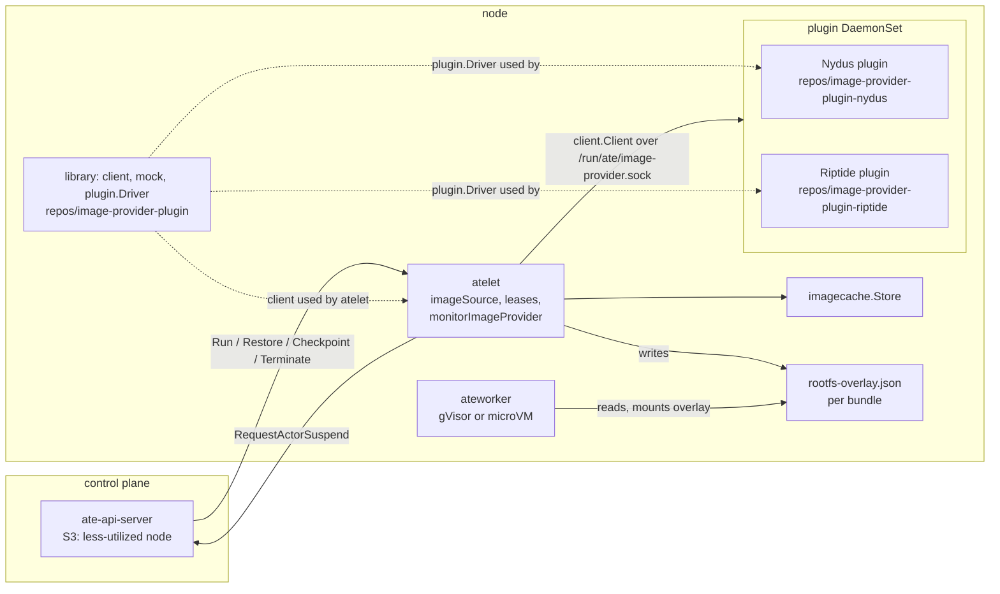
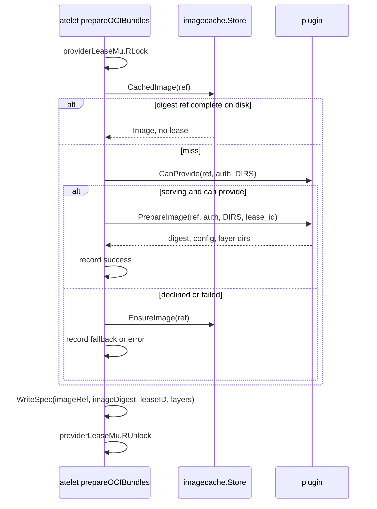
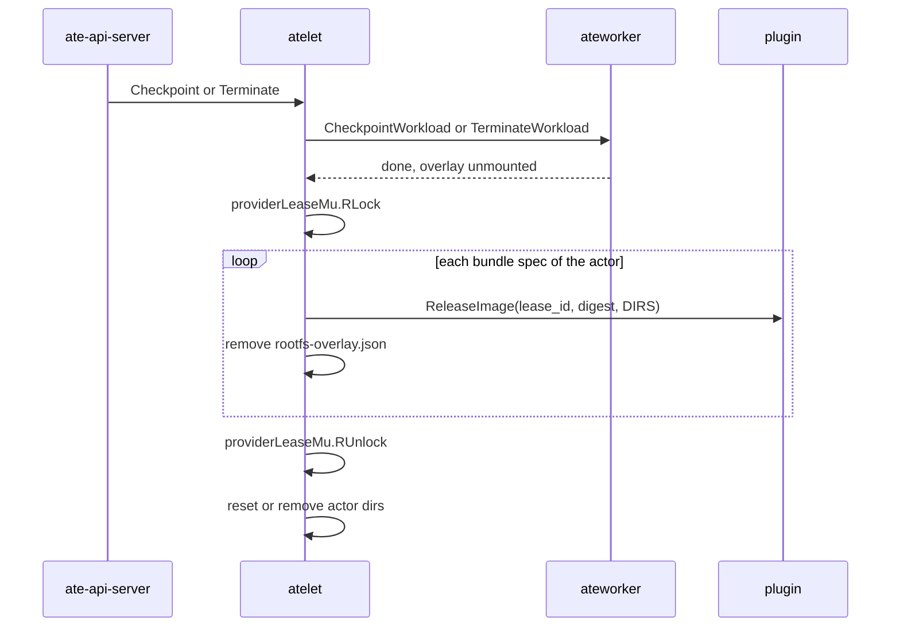
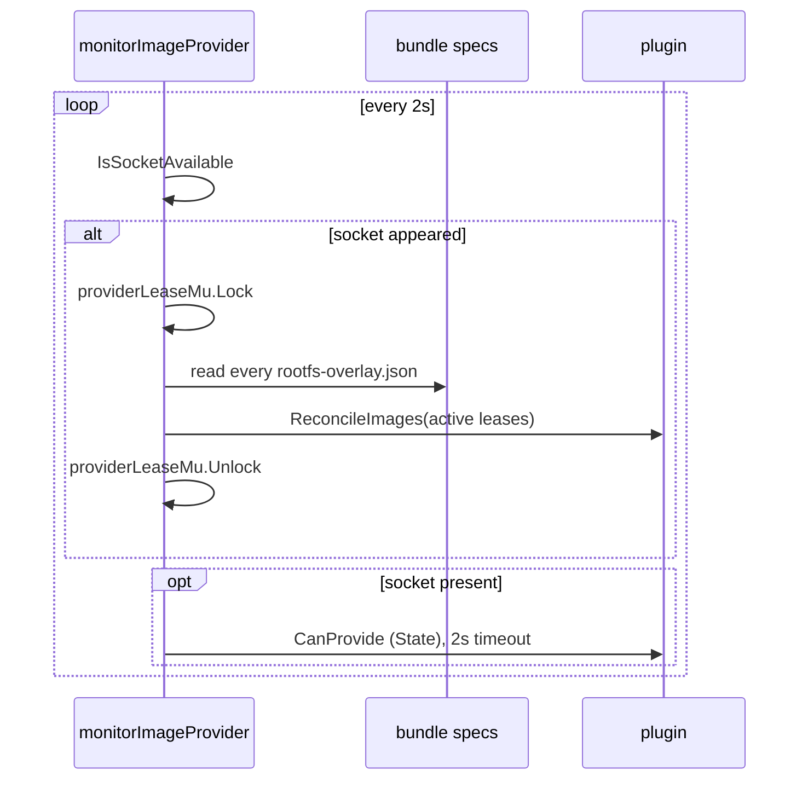
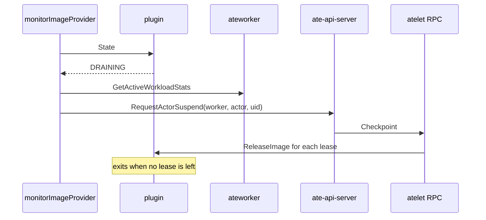

# Design: atelet client for the image provider plugin (Phase S and C)

Branch `image-provider-plugin`, commits S1 to S5 and C1 to C7. Scope is everything outside `repos/` and `vendor/`:

```
git diff upstream/main...HEAD -- . ':!repos' ':!vendor'
```

## 1. Summary

atelet can now ask a node-local image provider plugin to prepare container and image volume images, instead of pulling and unpacking them into the image cache. The plugin is optional. atelet uses it only while its Unix socket exists, and falls back to the image cache when the plugin declines or fails. Each prepared image is held under a lease that atelet names, records in the bundle's overlay spec, releases on checkpoint, terminate and failed activation, and reports back to the plugin with `ReconcileImages` when the socket appears. While the plugin drains, atelet asks the control plane to suspend actors that still hold leases. The block also changes ateapi placement to prefer the less-utilized node.

## 2. Background and motivation

Today atelet pulls every image into the node-local cache in [`internal/imagecache`](../../internal/imagecache/imagecache.go) and the worker composes the rootfs from the unpacked layers. On a cold node the pull and unpack dominate Run and Restore latency.

Lazy-loading stacks such as Nydus with Dragonfly, or Riptide (GCFS), can expose image layers as directories before the data is local. They need node daemons, so they ship as separate plugins behind a small gRPC API. The API, client, mock and plugin library live in the `image-provider-plugin` repo. See [overview.md](../../repos/image-provider-plugin/docs/overview.md) and [image_provider.proto](../../repos/image-provider-plugin/api/imageprovider/v1alpha1/image_provider.proto).

This block is the Substrate side: the atelet client, the lease bookkeeping, metrics, manifest and docs. The user-facing guide is [docs/guides/image-provider.md](../../docs/guides/image-provider.md).

## 3. Goals / Non-goals

Goals:
- Prepare images through a plugin when one is installed, with no atelet restart to add or remove it.
- Keep the image cache as the fallback for every image, so a missing, declining or broken plugin never fails an activation that the cache could serve.
- Never let the plugin drop layers a running actor uses, across atelet and plugin restarts.
- Let the plugin drain on upgrade without stranding running actors.
- Work the same on gVisor and microVM. atelet hands both runtimes the same overlay spec.

Non-goals:
- A plugin implementation. Nydus and Riptide are separate repos.
- `LAYER_FORM_EROFS` and `LAYER_FORM_ROOTFS`. atelet asks only for `LAYER_FORM_DIRS`.
- Per-template or per-actor plugin choice. One plugin per node.
- Passing `imagePullSecrets` to the plugin. atelet passes only what its node keychain resolves.
- Changing the worker side. The worker reads the overlay spec as before.

## 4. Design overview



atelet depends on the library only through `client` and the generated API package (C1, C2). One plugin listens on the socket at a time. The worker is unaware of the plugin. It mounts whatever layer directories the spec lists, so the atelet/worker contract (`ateworkerpb` and `nodepath`) does not change.

## 5. Detailed design

### 5.1 Flag, client and wiring (C2, C6)

- `--image-provider-socket` defaults to `client.DefaultSocketPath`, `/run/ate/image-provider.sock` ([main.go#L123](../../cmd/atelet/main.go#L123)). Empty disables the plugin.
- When set, `main` builds a `client.GRPCClient` ([main.go#L297-L305](../../cmd/atelet/main.go#L297-L305)). It connects lazily, so atelet starts with no plugin.
- `Atelet` gains `imageProvider`, `imageKeychain`, `providerLeaseMu`, `drainSuspended` and `workers` ([main.go#L741-L756](../../cmd/atelet/main.go#L741-L756)). `imageKeychain` is the same `imageCredsKeychain` the image cache uses.
- `monitorImageProvider` starts only when the client exists ([main.go#L462-L464](../../cmd/atelet/main.go#L462-L464)).
- C6 mounts the host `/run/ate` into atelet as a `DirectoryOrCreate` hostPath ([atelet.yaml#L367-L372](../../manifests/ate-install/atelet.yaml#L367-L372), [#L402-L405](../../manifests/ate-install/atelet.yaml#L402-L405)).

### 5.2 imageSource: plugin first, cache fallback (S2, C2)

[`imageSource`](../../cmd/atelet/oci.go#L63-L70) wraps the cache, the client, the keychain and the instruments. [`ensure`](../../cmd/atelet/oci.go#L75-L99) resolves one image:

1. No client: `cache.EnsureImage`, as before.
2. [`Store.CachedImage`](../../internal/imagecache/imagecache.go#L442) (S2) serves a digest ref that is complete on disk, with no network I/O. Tag refs and unparsable refs return `(nil, nil)`. No provider metric is recorded.
3. [`prepare`](../../cmd/atelet/oci.go#L104-L129) calls `CanProvide`, then `PrepareImage` with `lease_id`. `CanProvide` returns false when the socket is missing or the plugin is not `PLUGIN_STATE_SERVING`. `ErrNotSupported` (gRPC `FailedPrecondition` or `Unimplemented`) counts as a decline.
4. [`streamedImage`](../../cmd/atelet/oci.go#L133-L145) rejects a result with no layer dirs, no config or a bad digest. `prepare` then releases the lease it just took.
5. On a decline or any error, `cache.EnsureImage`. Errors other than a decline are logged at warn.



[`prepareOCIDirectory`](../../cmd/atelet/oci.go#L211) and [`resolveImageVolumes`](../../cmd/atelet/oci.go#L316) now take an `imageSource`. Each releases the leases it took if it fails, for example on a relative `WORKDIR` or a failed `WriteSpec`. `resolveImageVolumes` releases its own leases and returns nil, so `prepareOCIDirectory` does not release them twice.

### 5.3 lease_id format

[`providerLeaseID`](../../cmd/atelet/oci.go#L161-L167):

- container image: `<actor UID>/<container>`
- image volume: `<actor UID>/<container>/<volume>`

The ID does not change across runs of one actor, so a retried `PrepareImage` takes no second lease. The proto says a reused `lease_id` with a different `image_ref` or form returns `AlreadyExists` ([proto#L47-L50](../../repos/image-provider-plugin/api/imageprovider/v1alpha1/image_provider.proto#L47-L50)). atelet treats that as a plugin failure and falls back to the cache. Two containers that share an image hold separate leases.

### 5.4 Overlay spec records the lease (S4)

`OverlaySpec` and `ImageVolumeOverlay` gain `imageRef` and `leaseID`, both `omitempty` ([spec.go#L54-L61](../../internal/imagecache/spec.go#L54-L61), [#L86-L89](../../internal/imagecache/spec.go#L86-L89)). `imagecache.Image` gains `LeaseID` ([imagecache.go#L307](../../internal/imagecache/imagecache.go#L307)). An empty `leaseID` means the layers came from the cache.

The spec is atelet's only record of leases. There is no separate lease file, so the spec on disk is the source of truth for release, reconcile and drain.

### 5.5 Release on checkpoint, terminate and failed activation (C3)

[`releaseProviderLeases`](../../cmd/atelet/main.go#L2351-L2398) reads every bundle spec under `ateletpath.OCIBundleDir(actorUID)`. It calls `ReleaseImage` for each recorded lease, with the digest, then removes the spec file so a second call releases nothing. It is a no-op with no client. `release` runs on a detached context with a 30s timeout (`providerReleaseTimeout`) and only logs a failure ([oci.go#L149-L156](../../cmd/atelet/oci.go#L149-L156)).

Call sites:

| Path | Where | When |
|---|---|---|
| Checkpoint | [`cleanUpAfterCheckpoint`](../../cmd/atelet/main.go#L1289) | After the snapshot commits, before the actor dirs reset. |
| Terminate | [`Terminate`](../../cmd/atelet/main.go#L2116) | After the worker tears the workload down. |
| Run failure | [`Run` defer](../../cmd/atelet/main.go#L944-L951) | Any error after the actor dirs reset. |
| Restore failure | [`Restore` defer](../../cmd/atelet/main.go#L1776-L1789) | Any error, after the prep leg is joined. |



### 5.6 Restore starts image prep first (S1)

`Restore` used to fetch the snapshot manifest, then run the download and the prep legs together. S1 starts the prep leg (sandbox assets, `systemInfoVolumes.Register`, `prepareOCIBundles`) before the manifest fetch, because only the download needs the manifest ([main.go#L1790-L1834](../../cmd/atelet/main.go#L1790-L1834)). On a manifest failure, `stopPrep` cancels the prep leg and waits for it, so the C3 defer sees every lease the prep took. The register-undo defer moved up with it. The phase metrics keep their meaning.

### 5.7 Reconcile when the socket appears (C4)

[`monitorImageProvider`](../../cmd/atelet/imageprovider_reconcile.go#L238-L260) polls every 2s (`imageProviderMonitorPeriod`). When the socket goes from absent to present, including at atelet startup, it calls [`reconcileProviderLeases`](../../cmd/atelet/imageprovider_reconcile.go#L115-L128). A failed reconcile leaves `available` false, so the next tick retries.

[`activeProviderLeases`](../../cmd/atelet/imageprovider_reconcile.go#L92-L110) walks `nodepath.ActorsDir/<uid>/bundles/*/rootfs-overlay.json` and returns one `ActiveLease` per recorded lease, sorted by ID. The plugin drops every lease not in the list.

`providerLeaseMu` closes the race between taking a lease and recording it. `prepareOCIBundles` and `releaseProviderLeases` hold it for reading. The reconcile holds it for writing. So the plugin never sees a lease set that misses a lease taken but not yet in a spec.



### 5.8 Suspend actors while the plugin drains (C5)

A plugin that gets SIGTERM reports `PLUGIN_STATE_DRAINING` and waits for its leases to go. When [`imageProviderDraining`](../../cmd/atelet/imageprovider_reconcile.go#L264-L269) is true, [`suspendStreamedActors`](../../cmd/atelet/imageprovider_reconcile.go#L148-L231):

1. Finds actors whose specs record a lease (`streamedActorUIDs`).
2. Lists running actors per worker with `GetActiveWorkloadStats`.
3. For each running actor that holds a lease, calls `WorkerService.RequestActorSuspend` with the worker pod UID, actor ref and UID. Each runs in its own goroutine with a 10 minute timeout (`drainSuspendTimeout`).
4. Records the actor in `drainSuspended` so it is asked once. A failed request clears the entry so the next tick retries. Entries for actors with no leases left are pruned.

The suspend checkpoints the actor through atelet, which runs C3 and releases the leases. No actor lock is held during the RPC, because the control plane calls back into atelet. `RequestActorSuspend` already exists, and its authz entry already allows atelet on the worker's node ([registry.go#L330](../../cmd/ateapi/internal/authz/registry.go#L330)). Before this change atelet only forwarded it for workers.

New activations already avoid a draining plugin, because `CanProvide` returns false unless the state is `SERVING`.



### 5.9 Metrics (S5)

| Instrument | Type | Labels |
|---|---|---|
| `ate.imageprovider.requests` | counter, `{request}` | `ate.imageprovider.provider`, `ate.imageprovider.outcome` |
| `ate.imageprovider.duration` | histogram, `s`, `snapshotPhaseBuckets` | same |

Outcomes are `success`, `fallback` (plugin declined or failed, cache served it) and `error` (both failed). The provider label is the name the plugin reports in `CanProvide` or `PrepareImage`, `image-provider` until it reports one. Code: [metrics.go#L71-L109](../../cmd/atelet/metrics.go#L71-L109), [ateattr.go#L164-L165](../../internal/ateattr/ateattr.go#L164-L165), [#L244-L251](../../internal/ateattr/ateattr.go#L244-L251), registry [metrics.yaml#L586](../../docs/metrics/registry/metrics.yaml#L586) and [#L1408](../../docs/metrics/registry/metrics.yaml#L1408), rows in [observability.md](../../docs/guides/observability.md).

The duration covers the whole `ensure` call after the cache check. For `fallback` and `error` it includes the cache pull. See section 11.

### 5.10 Less-utilized node placement in ateapi (S3)

[`Schedule`](../../cmd/ateapi/internal/scheduling/scheduling.go#L125) still samples two candidates. When they are on different nodes, it now picks the one whose node has lower summed utilization, from [`nodeLoads`](../../cmd/ateapi/internal/scheduling/scheduling.go#L188). Node load is the higher of summed slot and summed compute utilization over every worker on the node, full ones included. Slot utilization breaks a tie. Equal node loads fall back to the per-worker `lessLoaded`.

`BindActorToWorker` now also returns the updated `Worker`. `assignWorkerAttempt` passes it to the new [`workercache.Cache.Observe`](../../cmd/ateapi/internal/workercache/workercache.go#L154) ([workflow_resume.go#L519](../../cmd/ateapi/internal/controlapi/workflow_resume.go#L519)), so concurrent resumes see each other's binds before the watch event. `Observe` ignores an older version. The store contract test checks that the returned Worker matches the stored one.

This change is independent of the plugin. It spreads cold starts across nodes so one node's plugin and disk do not take the whole burst.

### 5.11 Dependency, redaction and docs (C1, C7)

- `go.mod` requires `github.com/ai-on-gke/image-provider-plugin` at a zero pseudo-version, with `replace => ./repos/image-provider-plugin`. The used packages are vendored, and its license is added under `_LICENSES/`.
- `protoredact_test` lists the imageprovider proto and pins the four `debug_redact` fields of `RegistryAuth` ([protoredact_test.go#L373](../../internal/protoredact/protoredact_test.go#L373), [#L416-L419](../../internal/protoredact/protoredact_test.go#L416-L419)).
- C7 adds [docs/guides/image-provider.md](../../docs/guides/image-provider.md) and a README link.

## 6. Failure modes and recovery

| Failure | Behavior |
|---|---|
| No plugin installed | `CanProvide` sees no socket and returns false. Every non-cached image falls back to the cache. A `fallback` sample is recorded per image. |
| Plugin declines, errors, or returns a bad result | Cache pull. A bad result's lease is released. |
| Plugin hangs in `CanProvide` or `PrepareImage` | No per-call timeout. The activation waits until the caller's context ends, then falls back to the cache on that dead context and fails. |
| Plugin restarts | If the socket disappears for at least one 2s tick, atelet reconciles when it returns. A faster restart is not seen. The plugin is expected to persist leases (library A9). |
| atelet restarts | Specs survive on disk. The monitor sees the socket as new and reconciles. |
| `ReleaseImage` fails | Logged. The spec is still removed, so the lease stays in the plugin until the next reconcile. |
| `ReconcileImages` fails | Retried every tick. Prepares and releases still run between attempts. |
| `ReconcileImages` hangs | No timeout. It holds `providerLeaseMu` for writing, which blocks every `prepareOCIBundles` on the node, cache-only ones included. |
| Run or Restore fails after the worker call | The defers release leases. If the worker still has the overlay mounted, for example after a worker-side `DeadlineExceeded`, the plugin may remove layers in use. |
| Run resets actor dirs | `ResetActorDirsKeepingVolumes` deletes old specs without releasing. The same `lease_id` is reused, so a plugin that still holds it returns the old image if the ref matches, or `AlreadyExists` if not (cache fallback). |
| Drain with a stale spec | An actor with a lease in its spec but no running workload is never suspended. The plugin waits on that lease until the next Run, Terminate or reconcile. |
| Drain suspend fails | Retried on the next tick. Each attempt blocks the monitor loop for up to `drainSuspendTimeout`. |
| Manifest fetch fails during Restore | `stopPrep` cancels and joins the prep leg, then the defer releases what it took. |

## 7. Security considerations

- **Socket trust.** Anything that can create `/run/ate/image-provider.sock` on the host serves every actor's rootfs layers on that node. The connection is plain gRPC over a Unix socket with no peer check. The plugin is part of the node's trusted base, like the objectstore plugin. atelet mounts host `/run/ate` read-write.
- **Layer paths.** atelet does not check the `LayerDirs` a plugin returns. The worker mounts `<dir>/fs` as a read-only lowerdir. The worker pod only sees `/var/lib/ate`, which bounds the damage, but other actors' data lives there too. See section 11.
- **Actor isolation.** Lease IDs embed the actor UID, and leases are released before the actor dirs are reused. Layers are read-only lowers. Each actor still writes only to its own upper dir. Actors never reach the socket.
- **Credentials.** atelet passes credentials from the node keychain (`imageCredsKeychain`) in `RegistryAuth`. The password, auth, identity token and registry token fields are `debug_redact`, and `protoredact_test` pins them. atelet logs refs, lease IDs and provider names, never auth.
- **Drain suspend.** `RequestActorSuspend` uses the actor list the worker reports. ateapi still checks that the actor is assigned to that worker, and the RPC already has an authz entry, so no new permission is added.

## 8. Compatibility and version skew

Read against [version-skew-policy.md](../../docs/reference/version-skew-policy.md).

- **No plugin socket.** Behavior matches upstream except for two things. Each non-cached image records a `fallback` sample, and a 2s socket stat loop runs. `--image-provider-socket=""` removes both.
- **Overlay spec (node data).** `imageRef` and `leaseID` are new, optional fields. `ReadSpec` uses `json.Unmarshal` and ignores unknown fields, so an N worker or N atelet reads an N+1 spec. An N+1 atelet reads an N spec as "no lease". `version` stays 1.
- **atelet rollback.** An N atelet ignores `leaseID`, so it never releases or reconciles. Leases leak in the plugin until an N+1 atelet reconciles. Drain no longer suspends. Roll the plugin back or remove it before rolling atelet back past this change.
- **atelet/plugin skew.** The API is `v1alpha1` and the client always sends `LAYER_FORM_DIRS`. The client treats an unknown `PluginState` as not serving. A plugin that lacks an RPC returns `Unimplemented`, which `PrepareImage` maps to a decline. A missing `ReleaseImage` or `ReconcileImages` is only logged.
- **ateworker.** Not changed. The worker composes the same spec, so gVisor and microVM both work unchanged.
- **RPCs and CRDs.** No new atelet, worker or ateapi RPC fields. `BindActorToWorker` is an internal store interface. No CRD or migration.
- **Manifest.** A new hostPath mount. It ships with the atelet step of the upgrade.

## 9. Testing

Unit tests:

| Test | Covers |
|---|---|
| [`TestImageSourceEnsure`](../../cmd/atelet/oci_imageprovider_test.go#L83) | No client, plugin serves, cached digest skips plugin, decline, `CanProvide` error, `ErrNotSupported`, `PrepareImage` error, missing config released. Checks prepare and release counts and the outcome label. |
| [`TestPrepareOCIDirectoryProviderLeases`](../../cmd/atelet/oci_imageprovider_test.go#L219) | Lease IDs and refs in the spec for rootfs and volume, two containers. A bad `WORKDIR` releases both leases. |
| [`TestReleaseProviderLeases`](../../cmd/atelet/oci_imageprovider_test.go#L279) | Releases only leased entries, once. |
| [`TestReconcileProviderLeases`](../../cmd/atelet/imageprovider_reconcile_test.go#L53) | Sends every recorded lease, sorted, and no cache images. |
| [`TestSuspendStreamedActors`](../../cmd/atelet/imageprovider_reconcile_test.go#L114) | Suspends only running leased actors, once, and retries a failed request. |
| `TestRecordImageProvider` | Both instruments and labels. |
| `TestCachedImage` | Digest hit, tag, uncached digest, unparsable ref, registry down. |
| `TestOverlaySpecRoundTrip` | New fields round-trip. |
| `TestSchedule` rows, `TestCache_Observe`, store contract | S3 placement, `Observe` version check, returned Worker. |
| `lifecycle_test.go` changes | S1: tests that fail on the manifest join the detached asset fetch. |

Gaps:
- No test drives `Run`, `Restore`, `Checkpoint` or `Terminate` with a client and checks the release. Only `releaseProviderLeases` is tested directly.
- No test for `monitorImageProvider` (edge detection, retry), the `providerLeaseMu` ordering, or the `error` outcome.
- No e2e on gVisor or microVM. CI installs no plugin, so the default config only exercises the "no socket" path. AGENTS.md asks for e2e coverage on both runtimes. A fake plugin built on `client/mock` or `plugin.Driver` in e2e would close this.

## 10. Commit map

| # | SHA | Commit | Sections | Review order |
|---|---|---|---|---|
| S1 | `b357766fb` | atelet: start image prep before the snapshot manifest fetch | 5.6 | 4 |
| S2 | `1d70ff72b` | imagecache: add CachedImage for digest refs already on disk | 5.2 | 1 |
| S3 | `1934e6f2f` | ateapi: place actors on the less-utilized node | 5.10 | separate, ateapi owners |
| S4 | `8d202339e` | imagecache: record the image ref and provider lease in the overlay spec | 5.4, 8 | 2 |
| S5 | `2ecdf686a` | atelet: add image provider metrics | 5.9 | 3 |
| C1 | `d15db7faf` | go.mod: depend on image-provider-plugin | 5.11, 7 | 5 |
| C2 | `d8f0b29df` | atelet: prepare images through the image provider plugin | 5.1, 5.2, 5.3 | 6 |
| C3 | `462d28d8e` | atelet: release provider leases on checkpoint, terminate and failed restore | 5.5, 6 | 7 |
| C4 | `9edbeb8bb` | atelet: reconcile provider leases on startup | 5.7, 6 | 8 |
| C5 | `053ebe991` | atelet: suspend actors on a draining image provider plugin | 5.8, 7 | 9 |
| C6 | `9023c2319` | manifests: mount the image provider socket into atelet | 5.1, 7 | 10 |
| C7 | `135c16c07` | docs: describe how atelet uses an image provider plugin | 5.11 | 11 |

Read S2, S4 and S5 first. They are small and only add types and instruments. Read S1 before C3, because C3 edits the defer S1 moves. S3 touches only ateapi and can be reviewed in parallel.

## 11. Open questions / review TODOs

1. **Fallback metric with no plugin.** With the default flag, every node records `fallback` for each non-cached image, labeled `image-provider`. Should `ensure` skip the plugin path and the metric when the socket is absent?
2. **Duration meaning.** `ate.imageprovider.duration` includes the cache pull on `fallback` and `error`, but the registry brief says "time the plugin takes". Measure only the plugin call, or fix the brief.
3. **Timeouts.** Add per-call timeouts to `CanProvide`, `PrepareImage` and `ReconcileImages`. A hung reconcile blocks all bundle prep on the node while it holds the write lock.
4. **Release on failed worker call.** Should the Run and Restore defers skip the release when the worker call may have left the overlay mounted?
5. **Spec removed after a failed release.** Keep the spec, or queue a retry, so the lease is not lost until the next reconcile?
6. **Run reset drops specs without release.** Release before `ResetActorDirsKeepingVolumes`, or document reliance on `lease_id` reuse.
7. **Restart detection.** A plugin restart shorter than 2s is not reconciled. Use a plugin-reported instance ID or always reconcile after a failed RPC?
8. **Layer path check.** Reject `LayerDirs` outside an expected root, for example under `/var/lib/ate`.
9. **Mount mode.** Can the `/run/ate` mount be `readOnly`? atelet only connects to the socket.
10. **Hard-coded path.** `forEachOverlaySpec` builds `<actorsDir>/<uid>/bundles` by hand. Share it with `ateletpath.OCIBundleDir`.
11. **Comment placement.** In `lifecycle_test.go`, `waitAssetFetch` sits between `testSandboxRecord` and its doc comment.
12. **Provider label cardinality.** The value comes from the plugin. Bound it, or add it to the cardinality rules in `docs/metrics/substrate.yaml`.
13. **e2e.** Decide on a fake-plugin e2e for gVisor and microVM before merge, or scope the PR description.
14. **S3 scope.** Placement is not plugin-specific. Confirm it belongs in this series.
