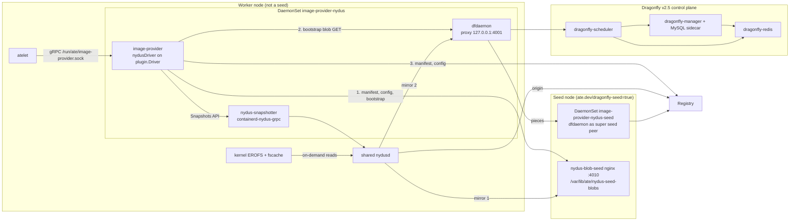
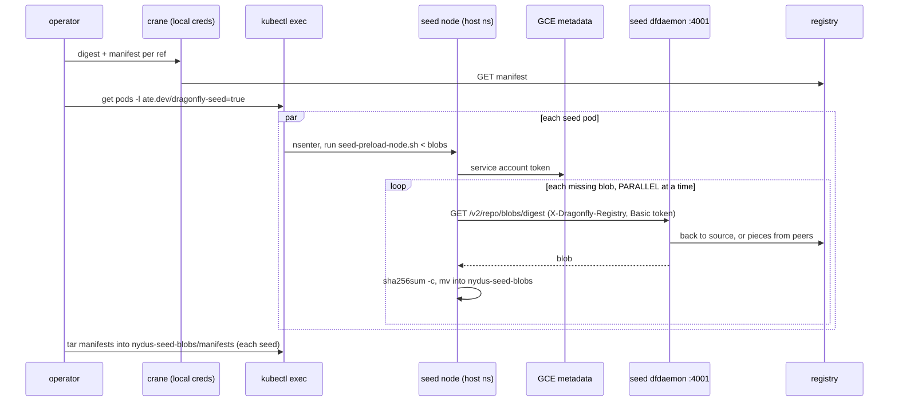
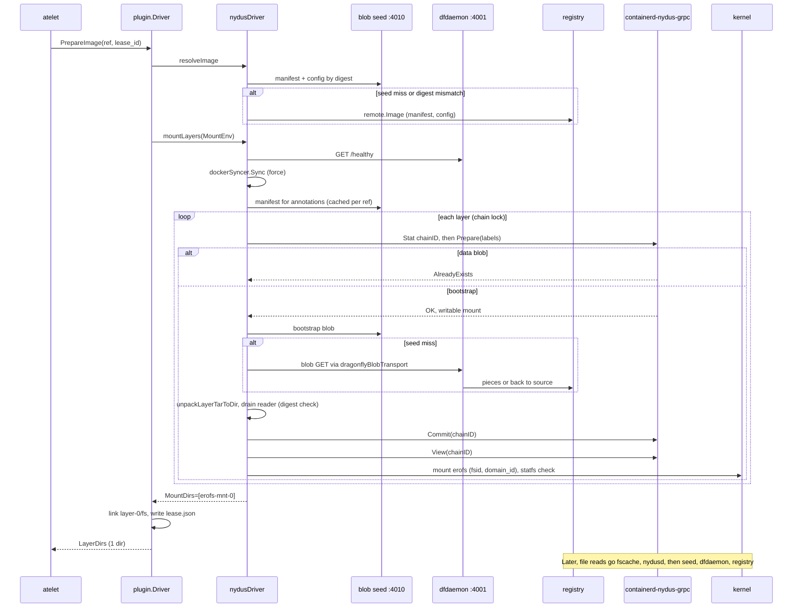

# Design: image-provider-plugin-nydus (Phase B, recipe 3)

Staging path: `repos/image-provider-plugin-nydus` on branch `image-provider-plugin`.
Target: `github.com/ai-on-gke/image-provider-plugin-nydus`.
Related docs: [README.md](../../repos/image-provider-plugin-nydus/README.md), [library overview.md](../../repos/image-provider-plugin/docs/overview.md), [CHECKIN_PLAN.md](../../repos/CHECKIN_PLAN.md).

## 1. Summary

`image-provider-nydus` is an image provider plugin that serves Nydus RAFS v6 images lazily to atelet. It runs on each node in a DaemonSet with containerd-nydus-grpc, one shared nydusd in EROFS over fscache mode, and a Dragonfly dfdaemon. For each image, the plugin registers the data blob layers with the snapshotter, unpacks and commits the bootstrap layer, and mounts it as one EROFS layer directory. Image data comes from three sources in order: seed HTTP servers on labeled seed nodes, then dfdaemon (peers and seed peers), then the registry. The repo also ships the Dragonfly v2.5 control plane manifests and `hack/seed-preload.sh`, which fills the seeds.

## 2. Background and motivation

Actors are idle most of the time. When one starts or restores, a full image pull is on the critical path. Nydus RAFS v6 splits an image into a small bootstrap (an EROFS metadata image) and data blobs. With EROFS over fscache, the kernel asks nydusd for chunks only when a file is read. An actor can start before its image is on the node.

Lazy reads multiply small range requests to the registry across many nodes. Dragonfly turns each blob into a P2P task, so nodes fetch pieces from each other and from seed peers.

Recipe 3 adds a plain HTTP tier in front of Dragonfly. Seed nodes keep whole blobs and manifests on local disk, preloaded by `seed-preload.sh`, and serve them with nginx. nydusd lists the seed Service as its first mirror, and the plugin reads manifests, configs and bootstraps from it. Stock nydusd works with this layout, so recipe 3 needs no nydusd patches. The plan picked recipe 3 over the other prototype variants for that reason (CHECKIN_PLAN "Decisions so far", row Nydus).

## 3. Goals / Non-goals

Goals:
- Serve Nydus RAFS v6 images to atelet through the library `plugin.Driver`, as one EROFS layer directory per image.
- Read in the order seed HTTP, then dfdaemon, then registry, and check digests of everything the plugin reads from the seeds.
- Decline non-Nydus and RAFS v5 images with `client.ErrNotSupported`, so atelet falls back to its image cache.
- Ship manifests that deploy the whole stack into `ate-system` with `kustomize build manifests | ko resolve -f - | kubectl apply -f -`.
- Meet the prod rules in the plan: headers, shellcheck, digest-pinned images, CI.

Non-goals (excluded by the plan, "Excluded" section):
- Other plugins: SOCI and Spegel (all variants) and `cmd/nydus-dragonfly`.
- Every Nydus manifest except seedhttp. No layered, warm, read-ahead, pprof or timing variants of the plugin.
- Patched nydusd, and everything under `benchmarking/` (README, results, scripts, `loader/`, nydusd patches).
- Every prototype `*.sh` except `seed-preload.sh` and the new `manifests/scripts/*.sh`.
- A FUSE fallback. The plugin fails without EROFS and `/dev/cachefiles`.
- Re-documenting the library. See [overview.md](../../repos/image-provider-plugin/docs/overview.md) for leases, drain and reconcile.

## 4. Design overview



atelet talks only to the plugin socket. The library `plugin.Driver` owns the gRPC server, leases, decline cache, drain and reconcile. The Nydus repo adds a `nydusDriver` that plugs into the driver through options, plus the snapshotter, Dragonfly and seed manifests.

## 5. Detailed design

### 5.1 Plugin Driver implementation

[`main`](../../repos/image-provider-plugin-nydus/cmd/image-provider-nydus/main.go#L31-L99) parses flags, builds a [`config`](../../repos/image-provider-plugin-nydus/cmd/image-provider-nydus/nydus.go#L96-L114), and calls `plugin.ServeUnixSocket`. `--probe` runs `plugin.ProbeUnixSocket` for the readiness probe.

[`newNydusDriver`](../../repos/image-provider-plugin-nydus/cmd/image-provider-nydus/nydus.go#L172-L251):
- Fills defaults: snapshotter socket `/run/containerd-nydus/containerd-nydus-grpc.sock`, Docker config `/run/containerd-nydus/docker/config.json`, proxy `http://127.0.0.1:4001`, health `http://127.0.0.1:4003/healthy`.
- Validates the proxy, health and seed URLs with `httpURL`.
- Runs [`verifyKernelSupport`](../../repos/image-provider-plugin-nydus/cmd/image-provider-nydus/nydus.go#L149-L170): `erofs` must be in `/proc/filesystems` and `/dev/cachefiles` must exist. Otherwise startup fails.
- Wires these library hooks ([nydus.go:230-238](../../repos/image-provider-plugin-nydus/cmd/image-provider-nydus/nydus.go#L230-L238)):

| Library option | nydusDriver method | Purpose |
|---|---|---|
| `WithLayerMounter` | [`mountLayers`](../../repos/image-provider-plugin-nydus/cmd/image-provider-nydus/nydus.go#L284-L336) | Prepares snapshots and mounts the bootstrap. |
| `WithWarmHitHook` | [`onWarmHit`](../../repos/image-provider-plugin-nydus/cmd/image-provider-nydus/nydus.go#L278-L282) | Refreshes credentials for a reused image, unforced. |
| `WithWorkDirTeardownHook` | [`unmountWorkDir`](../../repos/image-provider-plugin-nydus/cmd/image-provider-nydus/nydus.go#L487-L498) | Unmounts the EROFS mounts it made, newest first, with `MNT_DETACH`. |
| `WithProbeHook` | [`probeDragonfly`](../../repos/image-provider-plugin-nydus/cmd/image-provider-nydus/nydus.go#L271-L276) | Adds a dfdaemon health check to the library probe when `--verify-dragonfly-ping` (default true). |
| `WithImageResolver` | [`resolveImage`](../../repos/image-provider-plugin-nydus/cmd/image-provider-nydus/seed.go#L155-L190) | Only when `--blob-seed-url` is set. Otherwise the library resolver reads the registry. |

`config` also carries `LayerReader`, `LayerAnnotations`, `Mount`, `Unmount` and `StatFS`. They default to the registry readers, `syscall.Mount`, `syscall.Unmount` and `statfs`. Tests replace them through the constructor.

[`mountLayers`](../../repos/image-provider-plugin-nydus/cmd/image-provider-nydus/nydus.go#L287-L336) does, per `plugin.MountEnv`:
1. Pings dfdaemon when ping is on, and fails the prepare if it is down.
2. Calls `dockerSyncer.Sync(..., force=true)`.
3. For each layer, builds labels: `plugin.StandardCRILayerLabels` plus [`layerLabels`](../../repos/image-provider-plugin-nydus/cmd/image-provider-nydus/nydus.go#L532-L553), which adds the manifest annotations, `cri.image-ref`, `cri.layer-digest` and `containerd.io/distribution.source.<registry>`.
4. [`prepareLayer`](../../repos/image-provider-plugin-nydus/cmd/image-provider-nydus/nydus.go#L338-L376) takes `AcquireChainLock(chainID)` and skips committed chains. On `Prepare`:
   - `AlreadyExists`: the snapshotter registered a data blob itself. The plugin checks the chain exists.
   - `OK`: [`commitLayer`](../../repos/image-provider-plugin-nydus/cmd/image-provider-nydus/nydus.go#L378-L417) fills and commits it. A layer with neither the blob nor the bootstrap label returns `ErrNotSupported`.
   - Any other error removes the prep snapshot.
5. Data blob layers stop there. They only join the parent chain.
6. For the bootstrap layer, `plugin.ViewLayerMounts` gets the view, and [`mountEROFS`](../../repos/image-provider-plugin-nydus/cmd/image-provider-nydus/nydus.go#L438-L485) mounts it.

`mountEROFS` handles two shapes of View response:
- An `erofs` mount: it mounts it read-only at `<imageWorkDir>/erofs-mnt-<i>`, drops `ro`, `rw`, `nosuid` and `nodev` from the data, and keeps options like `fsid=` and `domain_id=`.
- No `erofs` mount: it uses `plugin.ExtractMountDir`. A `fuse*` mount is an error.

Either way it checks `statfs` for `erofsSuperMagic` (0xE0F5E1E2). The result is one `MountDirs` entry per image, since the bootstrap holds the whole tree.

[`imageAnnotations`](../../repos/image-provider-plugin-nydus/cmd/image-provider-nydus/nydus.go#L500-L530) declines an image with `client.ErrNotSupported` unless one layer has `containerd.io/snapshot/nydus-bootstrap=true` with fs version empty or `6`. It caches annotations per image ref in `nd.annotations`. [`manifestAnnotations`](../../repos/image-provider-plugin-nydus/cmd/image-provider-nydus/nydus.go#L581-L594) marks layers of media type `application/vnd.oci.image.layer.nydus.blob.v1` with `nydus-blob=true`.

### 5.2 Fetch order: seed, then dfdaemon, then registry

| What | Who reads it | Order |
|---|---|---|
| Manifest + config (resolve) | plugin, [`resolveImage`](../../repos/image-provider-plugin-nydus/cmd/image-provider-nydus/seed.go#L155-L190) | seed ([`seedImage`](../../repos/image-provider-plugin-nydus/cmd/image-provider-nydus/seed.go#L192-L221)), then registry direct |
| Manifest (annotations) | plugin, [`registryLayerAnnotations`](../../repos/image-provider-plugin-nydus/cmd/image-provider-nydus/nydus.go#L555-L579) | seed, then registry direct |
| Bootstrap layer | plugin, [`registryLayerReader`](../../repos/image-provider-plugin-nydus/cmd/image-provider-nydus/nydus.go#L596-L619) | seed ([`seedLayer`](../../repos/image-provider-plugin-nydus/cmd/image-provider-nydus/seed.go#L89-L122)), then dfdaemon proxy, which goes to registry |
| Data blob chunks | nydusd | seed mirror, then dfdaemon mirror, then registry origin ([nydus-snapshotter.sh:141-176](../../repos/image-provider-plugin-nydus/manifests/scripts/nydus-snapshotter.sh#L141-L176)) |

Seed reads ([seed.go](../../repos/image-provider-plugin-nydus/cmd/image-provider-nydus/seed.go)):
- [`seedGet`](../../repos/image-provider-plugin-nydus/cmd/image-provider-nydus/seed.go#L42-L61) GETs `<seed>/v2/<repo>/{blobs,manifests}/<digest>` without auth, with a 30s `seedTimeout`. Non-200 is a miss.
- `seedManifest` needs a `name.Digest` ref. A tag ref always misses. It hashes the body and compares it with the ref digest.
- `seedImage` also hashes the config blob against `m.Config.Digest`.
- `seedLayer` accepts only sha256. It wraps the body in [`digestReader`](../../repos/image-provider-plugin-nydus/cmd/image-provider-nydus/seed.go#L124-L141), which returns an error instead of `io.EOF` on mismatch. It sniffs the gzip magic and gunzips if present.
- Every miss logs `Blob seed miss, falling back to the registry` at Warn ([`logSeedMiss`](../../repos/image-provider-plugin-nydus/cmd/image-provider-nydus/seed.go#L150-L153)).

The bootstrap fallback goes through [`dragonflyBlobTransport`](../../repos/image-provider-plugin-nydus/cmd/image-provider-nydus/nydus.go#L621-L639). It sends only `GET .../blobs/sha256:...` to the proxy, with `X-Dragonfly-Registry: <scheme>://<host>`. Pings, tokens and manifests go to the registry. [`commitLayer`](../../repos/image-provider-plugin-nydus/cmd/image-provider-nydus/nydus.go#L401-L404) drains the reader after unpack, so the digest check runs.

The seed fallback happens only when the seed request fails up front. A digest mismatch on a seed layer shows up at EOF, after the unpack. It fails the prepare and does not fall back (see section 6).

### 5.3 Docker config sync

containerd-nydus-grpc reads registry credentials from `DOCKER_CONFIG=/run/containerd-nydus/docker` ([nydus-snapshotter.sh:128-132](../../repos/image-provider-plugin-nydus/manifests/scripts/nydus-snapshotter.sh#L128-L132)). The plugin keeps that file current with [`dockerConfigSyncer.Sync`](../../repos/image-provider-plugin-nydus/cmd/image-provider-nydus/dockerconfig.go#L74-L114):
- [`resolveDockerAuth`](../../repos/image-provider-plugin-nydus/cmd/image-provider-nydus/dockerconfig.go#L149-L199) uses the request's `AuthConfig` if it has any secret, else `Driver.Keychain()`. Anonymous means no write. It fills `auth` from username and password.
- It skips a write when the same credentials for the registry were written less than `dockerCredsCacheTTL` (5 min) ago, unless `force`. Cold prepares force. Warm hits don't.
- [`write`](../../repos/image-provider-plugin-nydus/cmd/image-provider-nydus/dockerconfig.go#L116-L147) merges the entry into `auths`, keeps other registries, and renames a `0600` temp file into place. The directory is created `0700` if missing.
- Failures are logged, not returned. A missing credential shows up as a pull error in the snapshotter.

This code moved from library A6 into B1 because only Nydus needs it (plan, Phase A note).

### 5.4 Layer unpack

[`unpackLayerTarToDir`](../../repos/image-provider-plugin-nydus/cmd/image-provider-nydus/unpack.go#L66-L180) writes the bootstrap tar into the snapshot's writable dir. That dir comes from [`extractActiveMountDir`](../../repos/image-provider-plugin-nydus/cmd/image-provider-nydus/unpack.go#L32-L46): the overlay `upperdir=`, or the bind source.
- It opens the target with `os.OpenRoot`, so no entry writes outside it.
- [`validateLayerTarPath`](../../repos/image-provider-plugin-nydus/cmd/image-provider-nydus/unpack.go#L53-L64) rejects non-local paths and hardlink targets.
- It applies `.wh.` whiteouts and drops opaque markers.
- It handles regular files, dirs, symlinks and hardlinks. Other types, such as devices and FIFOs, are skipped.
- It restores directory modes last, deepest first.
- It does not set owners or xattrs. For a Nydus bootstrap this is fine: the layer holds `image/image.boot`.

### 5.5 On-disk layout

```
/run/ate/image-provider.sock                     plugin socket (library default)
/run/ate/drain-complete                          written after drain, read by wait-drain.sh
/run/containerd-nydus/
├── containerd-nydus-grpc.sock
└── docker/config.json                           registry creds for nydusd (0600)
/var/lib/ate/image-plugin-cache/
├── nydus/<image key>/                           library work dir (see overview.md)
│   ├── lease.json, layer-0/fs -> erofs-mnt-0
│   └── erofs-mnt-0/                             EROFS mount made by the plugin
└── nydus-snapshotter/                           --root of containerd-nydus-grpc
    ├── snapshots/, mnt/, cache/ (fscache work dir), cache/metadata/
    ├── nydusd-config.json
    └── config.toml                              threads_number = 64, metrics :9110
/home/kubernetes/bin/                            nydusd, nydus-image, nydusify, nydusctl,
├── containerd-nydus-grpc, nydus-overlayfs       from the pinned release tarballs
└── modules/<uname -r>/{erofs,cachefiles}.ko     built by build-erofs-modules.sh
/var/lib/dragonfly/                              dfdaemon piece storage (taskTTL 24h)
/var/lib/ate/nydus-seed-blobs/                   seed nodes only
├── <hex digest>                                 config and layer blobs
└── manifests/<hex digest>
```

The plugin and snapshotter mount `/var/lib/ate` with `mountPropagation: Bidirectional`, so EROFS mounts reach the host and atelet.

### 5.6 Manifests

[kustomization.yaml](../../repos/image-provider-plugin-nydus/manifests/kustomization.yaml) sets namespace `ate-system` and label `ate.dev/image-provider: nydus`. Resources are `dragonfly.yaml`, `node/`, `seed.yaml` and `seed-node/`. It generates:
- `image-provider-nydus-config` with `REGISTRY_URL` (default `https://us-central1-docker.pkg.dev`). nydusd and dfdaemon mirror this registry.
- `image-provider-nydus-scripts` from `manifests/scripts/*.sh`, mounted at `/scripts` with mode `0555`.

[dragonfly.yaml](../../repos/image-provider-plugin-nydus/manifests/dragonfly.yaml) (B3, plus one policy from B4):
- `dragonfly-redis` Deployment and Service, with password `dragonfly`.
- `dragonfly-manager` (v2.5.3) with MySQL 8.0 as a native sidecar (`restartPolicy: Always` init container) on an `emptyDir`. The comment says the manager creates its tables only at startup, so the database lives with the pod. `wait-for.sh` waits for Redis.
- `dragonfly-scheduler` (v2.5.3): `backToSourceCount: 3`, `retryBackToSourceLimit: 1`. It waits for the manager's gRPC port.
- NetworkPolicies: `dragonfly-backing-stores` (Redis only from manager and scheduler), `dragonfly-controlplane` (ports 8080, 65003, 8002, 8000 from anywhere), and `image-provider-nydus-peers` (dfdaemon 4000, 4002, 4005/tcp, 4006/udp). The last one's comment notes that most implementations don't apply policy to hostNetwork pods.
- Every pod tolerates `ate.dev/sandboxClass`.

[node/node.yaml](../../repos/image-provider-plugin-nydus/manifests/node/node.yaml) (B4) is DaemonSet `image-provider-nydus`, on nodes without `ate.dev/dragonfly-seed=true`:
- `hostPID`, `hostNetwork`, `ClusterFirstWithHostNet`. `terminationGracePeriodSeconds: 3600`, longer than the library's 30 min drain default. `maxUnavailable: 10%`.
- Init [`build-erofs-modules.sh`](../../repos/image-provider-plugin-nydus/manifests/scripts/build-erofs-modules.sh) (ubuntu:24.04):
  - Exits early if `/boot/config-$(uname -r)` has both `*_ONDEMAND=y`, or if modules are already built.
  - Otherwise reads `/proc/version_signature` and fetches the exact Ubuntu kernel source from launchpad or the archive pool, checked against the `.dsc` sha256 list.
  - Builds only `fs/erofs` and `fs/cachefiles` with on-demand turned on, checks vermagic, and installs into `${KUBE_HOME}/bin/modules/<kver>` atomically.
- `dfdaemon` (dragonflyoss/client v1.5.10), [`dfdaemon.sh`](../../repos/image-provider-plugin-nydus/manifests/scripts/dfdaemon.sh):
  - The proxy listens on `127.0.0.1:4001`, with `schedulingPolicy: always` for `blobs/sha256.*` and `enableTaskIDBasedBlobDigest: true`.
  - Prefetch is off.
  - `seedPeer.enable` comes from the pod label `ate.dev/dragonfly-seed` through the downward API.
  - It runs privileged.
- `nydus-snapshotter` (debian:13-slim), [`nydus-snapshotter.sh`](../../repos/image-provider-plugin-nydus/manifests/scripts/nydus-snapshotter.sh):
  - Re-execs itself in the host's mount, UTS, IPC and net namespaces with `nsenter -t 1`.
  - Loads the built modules with `insmod`, or the stock ones with `modprobe`. It checks for on-demand symbols in `/proc/kallsyms`.
  - Downloads nydus v2.3.0 and nydus-snapshotter v0.15.0 with pinned sha256 for amd64 and arm64.
  - Waits for dfdaemon health.
  - Lazily unmounts every `erofs` mount on the host, and wipes its root and the plugin work dir.
  - Writes `nydusd-config.json`. The seed mirror is added only if `NYDUS_BLOB_SEED_SERVICE_HOST` is set.
  - Execs `containerd-nydus-grpc --fs-driver=fscache --daemon-mode=shared`.
- `image-provider` (ko image) runs `--blob-seed-url=http://nydus-blob-seed.ate-system.svc.cluster.local:4010` (added in B5). Readiness is `--probe`. It runs privileged as root.
- dfdaemon and nydus-snapshotter have a `preStop` [`wait-drain.sh`](../../repos/image-provider-plugin-nydus/manifests/scripts/wait-drain.sh) that waits for `/run/ate/drain-complete`. They keep serving until the plugin has drained.

[seed-node/kustomization.yaml](../../repos/image-provider-plugin-nydus/manifests/seed-node/kustomization.yaml) (B5) reuses `../node` with `nameSuffix: -seed`. It sets the selector label `ate.dev/dragonfly-seed: "true"`, flips the affinity operator to `In`, and replaces the update strategy with the default `RollingUpdate`, so seed pods update one at a time.

[seed.yaml](../../repos/image-provider-plugin-nydus/manifests/seed.yaml) (B5) is `nydus-blob-seed`: an nginx 1.27 DaemonSet on seed nodes, plus a Service on port 4010. It is hostNetwork and mounts `/var/lib/ate/nydus-seed-blobs` read-only.
- `/v2/.+/blobs/sha256:<hex>` serves `/blobs/<hex>`.
- `/v2/.+/manifests/sha256:<hex>` serves `/blobs/manifests/<hex>`.
- Everything else, and every missing file, returns 503. The comment says nydusd moves to the next mirror only on 5xx.

### 5.7 seed-preload.sh

[`seed-preload.sh`](../../repos/image-provider-plugin-nydus/hack/seed-preload.sh) reads fully qualified refs from stdin:
1. For each ref, `crane digest` and `crane manifest` run with the operator's local credentials. It rejects non-image manifests, such as indexes, and collects unique `(registry, repo, digest)` for the config and layers.
2. It finds seed pods with `-l app=ate-image-provider,ate.dev/dragonfly-seed=true`.
3. In parallel per seed, it runs `kubectl exec -c nydus-snapshotter -- nsenter -t 1 -m -n -- bash -c <seed-preload-node.sh>`, with the blob list on stdin.
4. [`seed-preload-node.sh`](../../repos/image-provider-plugin-nydus/hack/seed-preload-node.sh) gets the node service account token from the GCE metadata server and sends it as `Basic oauth2accesstoken:<token>`. It fetches each missing blob through `127.0.0.1:4001` with `X-Dragonfly-Registry`, `PARALLEL` at a time. It checks sha256, then `chmod 644` and `mv` into place.
5. It tars the manifests to every seed's `<dir>/manifests`. This step runs even if some blob fetches failed. The exit code is 1 if any step failed.



### 5.8 PrepareImage sequence



## 6. Failure modes and recovery

| Failure | What happens | Recovery |
|---|---|---|
| Kernel lacks EROFS or `/dev/cachefiles` | `newNydusDriver` fails and the plugin exits. `nydus-snapshotter.sh` exits FATAL. | No socket, so atelet uses its image cache. Fix the kernel or the module build. |
| Module build fails (no egress, secure boot on, non-Ubuntu kernel without `*_ONDEMAND`) | Init container fails. The pod never starts. | Same fallback. Logs name the step. |
| dfdaemon unhealthy | With ping on, `CanProvide` returns false and `mountLayers` fails. nydusd marks the mirror failed after `failure_limit: 5`. | atelet falls back for new images. kubelet restarts dfdaemon. |
| Control plane down | dfdaemon has `enableBackToSource: true`, so it reads from the registry. The manager's MySQL is on `emptyDir`, so state resets with the pod. | Manager recreates tables at startup. |
| Seed miss | Plugin logs a Warn and reads dfdaemon or the registry. nginx returns 503, so nydusd tries the next mirror. | Run `seed-preload.sh`. |
| Corrupt seed manifest or config | Digest mismatch counts as a miss. Falls back to the registry. | Covered by `TestBlobSeedReads`. |
| Corrupt seed layer | Mismatch shows up at EOF after unpack. Prepare fails, the prep snapshot is removed, and there is no fallback. | Each retry fails the same way until the seed file is fixed. See open questions. |
| Non-Nydus or RAFS v5 image | `ErrNotSupported`. The library remembers the decline for `--decline-ttl`. | atelet uses its image cache. |
| Credential write fails | Logged. Shows as a snapshotter pull error. | Next cold prepare forces a write. |
| nydus-snapshotter container restarts | Script lazily unmounts all host `erofs` mounts and wipes the snapshotter root and plugin work dir. Running actors lose their rootfs data path. | Library sees missing layers on the next request and prepares again. Running actors are not recovered. |
| Plugin container restarts | Library reconciles leases from `lease.json` (A9). `nd.mountedDirs` is in memory, so mounts from the old process are not unmounted by `unmountWorkDir`. | See open questions. |
| Rolling update | Plugin drains for up to `--drain-timeout`. dfdaemon and snapshotter `preStop` wait for `drain-complete`. Grace period 3600s. | Library removes a stale `drain-complete` at startup. |

## 7. Security considerations

- **Privileged pods.** All three node containers are `privileged`. The pod uses `hostPID` and `hostNetwork`. The snapshotter script and `seed-preload.sh` enter PID 1's namespaces and run as host root. They load kernel modules with `insmod`, and `build-erofs-modules.sh` builds unsigned ones. This needs secure boot off. dfdaemon's need for `privileged` is not explained in the manifest.
- **Host mounts.** `/home/kubernetes` (binaries and modules), `/var/lib/ate` (Bidirectional), `/run/ate`, `/run/containerd-nydus`, `/var/lib/dragonfly`, plus `/boot`, `/lib/modules` and `/usr/src` read-only for the build. The snapshotter script unmounts every `erofs` mount on the host, not only its own.
- **Downloads.** The Nydus and snapshotter tarballs are sha256-pinned. Kernel sources are checked against the `.dsc`, which comes from launchpad over HTTPS. The archive pool is plain HTTP, but each file is checked against the `.dsc`. All images are pinned by digest except the ko plugin image.
- **Registry credentials.**
  - The plugin writes per-registry creds to `/run/containerd-nydus/docker/config.json` (0600, tmpfs).
  - Entries are never removed. One entry per registry means the last writer wins when requests carry different creds for the same registry.
  - Creds go to the local dfdaemon proxy only for blob GETs on the bootstrap fallback.
- **GCE metadata credential (B6 TODO).** `seed-preload-node.sh` uses the seed node's default service account token. It works only for Artifact Registry and GCR on GCE, and it gives seeds the node SA's read scope. The B6 commit message carries the TODO to settle the source in review, as the plan says.
- **Seed HTTP trust.**
  - `nydus-blob-seed` serves every preloaded blob and manifest without auth, on hostNetwork port 4010, with no NetworkPolicy.
  - Anyone who can reach a seed node IP can read private image content by digest. dfdaemon's upload ports are similar.
  - The plugin checks digests on all seed reads.
  - `nydusd-config.json` does not turn on chunk digest validation. nydusd trusts bytes from the seed and dfdaemon mirrors as far as this config goes.
- **Control plane secrets.** Redis and MySQL passwords are the literal `dragonfly`. The manager JWT key is fixed in the ConfigMap, and `console: true`. `dragonfly-controlplane` allows ingress from any pod on its ports.
- **Tar unpack.** `os.OpenRoot` plus `filepath.IsLocal` checks block path escapes. Tested in `TestUnpackLayerTarToDirRejectsEscapes`.

## 8. Compatibility and version skew

- **Kernel.** Needs EROFS with `CONFIG_EROFS_FS_ONDEMAND` and `CONFIG_CACHEFILES_ONDEMAND`. The module build path supports only Ubuntu kernels (`/proc/version_signature`, Ubuntu source, `gcc-13`). It is skipped when `/boot/config-*` already has both options.
- **Platform assumptions.**
  - `hostPath /home/kubernetes` is `type: Directory`, and `/boot` and `/usr/src` must exist. This is GKE-shaped and does not run on kind as is.
  - `seed-preload-node.sh` needs `bash`, `curl`, `sha256sum` and `base64` on the host.
  - AGENTS.md asks not to assume GKE. The README scopes prerequisites to this.
- **Pinned versions.** Dragonfly manager and scheduler v2.5.3, dfdaemon (dragonflyoss/client) v1.5.10, nydus v2.3.0, nydus-snapshotter v0.15.0, MySQL 8.0, Redis 7, nginx 1.27. amd64 and arm64.
- **Library.** `go.mod` uses `github.com/ai-on-gke/image-provider-plugin v0.0.0-...` with `replace => ../image-provider-plugin`. It switches to the `v0.1.0` tag on export. Until then, the exported repo's CI can't resolve the module. The plugin uses `plugin.NewDriver`, the five hook options, `MountEnv`/`MountedLayers`, `AcquireChainLock`, `ViewLayerMounts`, `HasSnapshot`, `RemoveSnapshot`, `StandardCRILayerLabels`, `RemoteOptions` and `ServeUnixSocket`. A change to any of these during A review needs a matching B change.
- **atelet.** Uses the library's default socket `/run/ate/image-provider.sock` and drain file `/run/ate/drain-complete`. `wait-drain.sh` hardcodes the drain file path, so changing `--drain-complete-file` breaks `preStop`.
- **Upgrades.** On restart the snapshotter wipes its state. The on-disk state is a cache, so there is no migration. Plugin upgrades rely on the library drain.

## 9. Testing

Unit tests in `cmd/image-provider-nydus` pass locally (`go test -count=1 ./...`):

| Test | Covers |
|---|---|
| `TestVerifyKernelSupport` | EROFS in `/proc/filesystems`, `/dev/cachefiles` present. |
| `TestCanProvideFollowsDragonflyHealth` | Probe hook follows dfdaemon health over the real gRPC server. |
| `TestRegistryLayerReaderUsesDragonflyProxy` | Only the blob GET goes through the proxy, with `X-Dragonfly-Registry`. |
| `TestPrepareImageMountsBootstrap` | Fake snapshotter: blob layer `AlreadyExists`, bootstrap unpacked and committed, EROFS mount data, one layer dir, unmount on release. |
| `TestPrepareImageDeclinesNonNydusImages` | OCI and RAFS v5 return `ErrNotSupported`. |
| `TestBlobSeedReads` | Seed hit, miss, corrupt manifest (falls back), corrupt layer (read error). |
| `TestDockerConfigSyncer`, `...Anonymous` | Write, TTL skip, force, no write for anonymous. |
| `TestExtractActiveMountDir`, `TestUnpackLayerTarToDir`, `...RejectsEscapes` | Mount dir pick, whiteouts, links, path escapes. |

CI ([ci.yaml](../../repos/image-provider-plugin-nydus/.github/workflows/ci.yaml)) runs `hack/test.sh` (`go test -race`) and `hack/verify-all.sh` (gofmt, golangci-lint, boilerplate, go mod tidy, shellcheck, kustomize build).

Gaps:
- No e2e in this repo. Recipe 3 e2e is planned for M4 on the exported repos.
- The scripts get only shellcheck. The module build, module loading, nydusd config and seed preload are not tested.
- Not tested: the `mountEROFS` fallback path and the FUSE rejection, `prepareLayer` AlreadyExists without a snapshot, unmount after a plugin restart, tag refs against seeds, and the warm-hit credential refresh.
- Manifests are checked only by `kustomize build`.

## 10. Commit map

| # | SHA | Commit | Sections | Notes |
|---|---|---|---|---|
| B0 | `4db49aa18` | Add module, license, lint config and CI | 9 | CI, verify scripts, pinned tool modules. |
| B1 | `d567012e7` | nydus: add the Nydus and Dragonfly plugin | 5.1, 5.3, 5.4, 6, 9 | Largest commit. Needs library A11. |
| B2 | `04d25ba4f` | nydus: read images, manifests and bootstraps from the blob seeds | 5.2, 7 (seed trust) | Adds `seed.go`, `--blob-seed-url`. |
| B3 | `3ade63de8` | manifests: add the Dragonfly v2.5 control plane | 5.6, 7 (secrets) | Also adds `hack/verify/manifests.sh` and the kustomize tool. |
| B4 | `761ddd187` | manifests: add the node DaemonSet | 5.5, 5.6, 6, 7, 8 | Also adds `image-provider-nydus-peers` to `dragonfly.yaml`. |
| B5 | `aaca3c7d4` | manifests: add the seed nodes | 5.6 | Adds `seed.yaml`, `seed-node/`, and `--blob-seed-url` in `node.yaml`. |
| B6 | `c8c763d8a` | hack: add seed-preload.sh to fill the blob seeds | 5.7, 7 (GCE TODO) | Adds `seed-preload-node.sh` too. |
| B7 | `8966eca88` | docs: add the README with setup and run instructions | all | Check against this doc. |

Suggested review order:
1. B0.
2. B1 with the library `plugin` package open: `driver.go` options, `lease.go` `prepareImageCold`.
3. B2.
4. B3 and B4 together, since the node pod depends on the control plane Services and scripts.
5. B5.
6. B6, settling the credential TODO.
7. B7 last, read against the manifests.

## 11. Open questions / review TODOs

1. **GCE credentials in B6.** Keep the metadata token, take a pull secret, or use Workload Identity? Settle before merge (plan M5).
2. **Corrupt seed layer.** Should `registryLayerReader` buffer or verify the seed blob first, so a mismatch falls back to dfdaemon? Today the prepare fails on every retry.
3. **Snapshotter restart.** It unmounts every host `erofs` mount and wipes the plugin work dir while the plugin still runs. Should the plugin restart with it, or should the cleanup be scoped to the snapshotter's own mounts?
4. **Plugin restart leaks mounts.** `nd.mountedDirs` is in memory. After a restart, `unmountWorkDir` doesn't unmount the old `erofs-mnt-*` dirs. Should it scan the work dir?
5. **Tag refs.** `seedManifest` needs a digest ref. Tag refs always miss the seed and log a Warn on each prepare. Does atelet send digest refs? If not, lower the log level or resolve the tag first.
6. **Annotation cache.** `nd.annotations` is keyed by ref, with no eviction. A moved tag keeps stale annotations for the life of the process. The library's `resolvedMeta` has the same shape.
7. **Seed HTTP exposure.** Port 4010 serves private blobs without auth on node IPs. Add a NetworkPolicy, bind to a narrower address, or document it as a known gap?
8. **nydusd chunk validation.** Should `nydusd-config.json` turn on digest validation, given that seeds and peers are trusted?
9. **Seed mirror wiring.** The seed mirror depends on `NYDUS_BLOB_SEED_SERVICE_HOST`, which exists only if the Service was created before the pod. A pod started first runs without the seed tier and gives no signal. Should the script fail or log when it's missing?
10. **Platform scope.** `/home/kubernetes`, `/usr/src` and the Ubuntu-only module build tie the manifests to GKE Ubuntu. Make the paths kustomize-patchable, or state the scope in the README?
11. **Control plane secrets.** Fixed passwords and JWT key in plain manifests. Move them to generated Secrets?
12. **dfdaemon privileged.** Is it needed?
13. **Credential collisions.** One `auths` entry per registry. Two requests with different creds for the same registry overwrite each other.
14. **README wording.** It says the plugin reads manifests "from the seed HTTP servers first, then through dfdaemon". Manifests and configs go straight to the registry. Only the bootstrap blob goes through dfdaemon.
