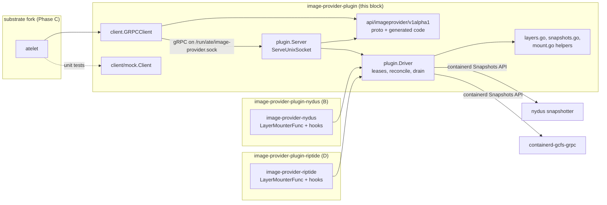
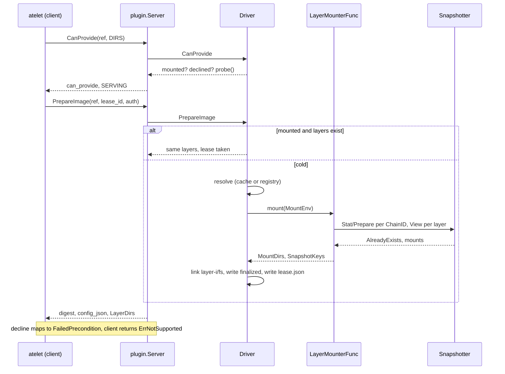
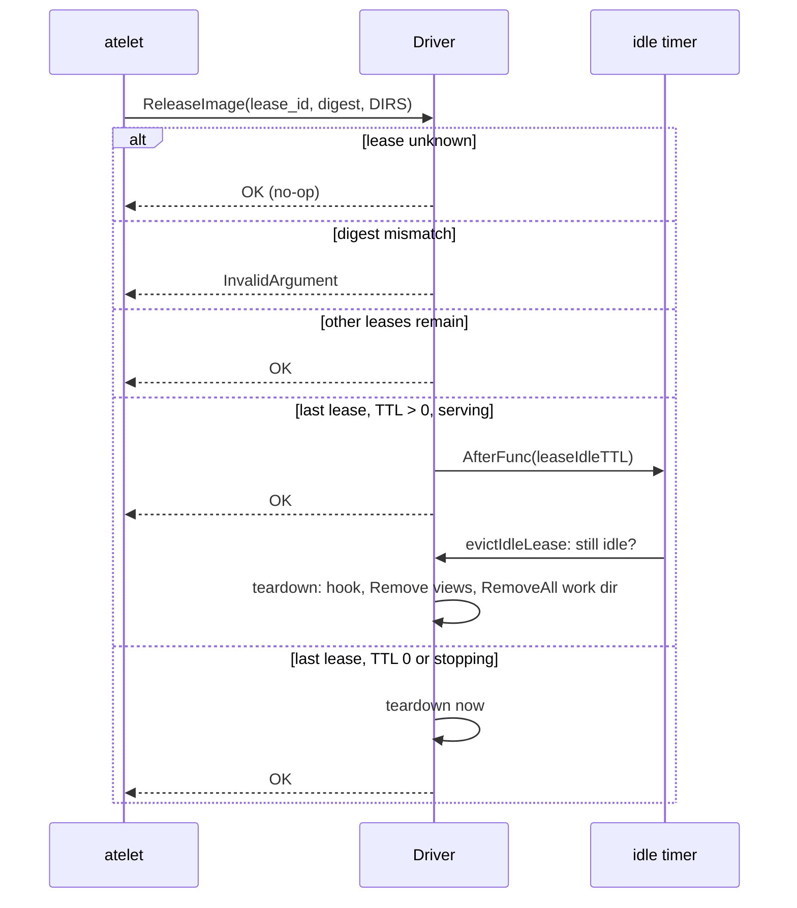
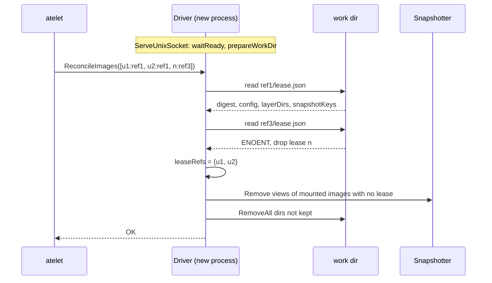
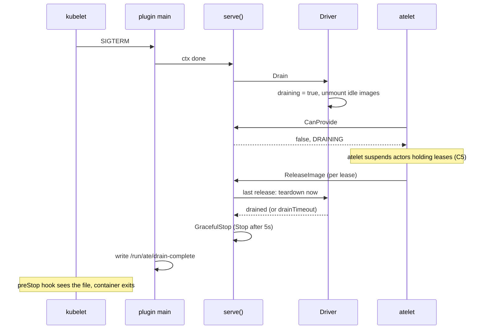

# Design: `image-provider-plugin` library (Phase A)

Target repo: `github.com/ai-on-gke/image-provider-plugin`. Staged at `repos/image-provider-plugin/` on branch `image-provider-plugin`. Commits A0 to A12 (A6 retired). This doc describes the code at `aae771b3b`.

Read first, not repeated here: [README.md](../../repos/image-provider-plugin/README.md) and [docs/overview.md](../../repos/image-provider-plugin/docs/overview.md).

## 1. Summary

The library defines the `imageprovider.v1alpha1.ImageProviderPlugin` gRPC API that atelet uses to get an image's layers from a node-local plugin instead of pulling the image. It ships a Go client for atelet (`client`, `client/mock`) and a server-side package (`plugin`) that the Nydus and Riptide plugins build on. `plugin.Driver` holds the lease logic every plugin needs: coalesced preparation, caller-named leases, idle unmount, `lease.json` persistence, reconcile after restart, decline caching, startup probe and drain on shutdown. A plugin supplies only the provider-specific snapshotter work, through a `LayerMounterFunc` and a few hooks. Only `LAYER_FORM_DIRS` is served today. The EROFS and rootfs forms exist in the API only.

## 2. Background and motivation

atelet starts actors from images it pulls into its own image cache. A full pull is slow for large images. Lazy-loading snapshotters (Nydus, Riptide/GCFS) can mount an image's layers before the data arrives. The prototype (`oci-image-plugin-bench` @ `07d01f3c5`) wired them into atelet through `api/imageplugin/v1` and a shared `image-plugin/pkg/plugin` package. The check-in splits that into:

- this library, owned by one engineer, tagged `v0.1.0` after A12;
- the Nydus plugin (Phase B) and the Riptide plugin (Phase D), which import it;
- atelet changes in the substrate fork (Phase C), which import `client`.

Keeping the API and lease logic in one repo means atelet and every plugin agree on lease semantics, and a plugin author writes only the snapshotter glue.

## 3. Goals / Non-goals

Goals:
- A versioned, additive-only API between atelet and a plugin on a Unix socket.
- Retry-safe leases named by the caller, so atelet can retry `PrepareImage` and `ReleaseImage` and rebuild state with `ReconcileImages`.
- A plugin restart or atelet restart must not unmount layers a running actor uses.
- A plugin rollout must not pull layers out from under running actors (drain).
- A plugin that cannot serve an image declines it fast, so atelet falls back to its cache.

Non-goals:
- Serving `LAYER_FORM_EROFS` or `LAYER_FORM_ROOTFS`. The API keeps them for a later microVM or Ray caller. `Server` rejects them.
- Deployment manifests. Each plugin repo ships its own DaemonSet.
- Registry auth policy. The plugin uses the credentials atelet sends, or a keychain.
- Using `extensions`. Upstream never reads or sets them.

Library scope rule (from [CHECKIN_PLAN.md](../../repos/CHECKIN_PLAN.md#L19)): the library holds only code that every plugin can use. Code one plugin needs lives in that plugin's repo. That retired A6 (`DockerConfigSyncer`) and moved `DockerConfigSyncer`, `UnpackLayerTarToDir` and `ExtractActiveMountDir` to B1. Today some exported helpers have one caller each (see section 11).

## 4. Design overview



Each plugin is a DaemonSet pod that builds a `Driver` with its options and calls `ServeUnixSocket`. atelet mounts `/run/ate` from the node and uses the plugin while the socket exists. The worker pods stack the returned layer dirs as overlayfs lowerdirs. The work dir must be under `/var/lib/ate`, which the worker pods mount.

## 5. Detailed design

### 5.1 API: `imageprovider.v1alpha1`

File: [image_provider.proto](../../repos/image-provider-plugin/api/imageprovider/v1alpha1/image_provider.proto). Go package `imageprovider`. Code is generated by `go generate ./...` ([generate.go](../../repos/image-provider-plugin/api/imageprovider/v1alpha1/generate.go), [buf.gen.yaml](../../repos/image-provider-plugin/buf.gen.yaml)) with tools pinned under `hack/tools`. [hack/verify/codegen.sh](../../repos/image-provider-plugin/hack/verify/codegen.sh) fails CI if the generated code is stale.

RPCs ([service](../../repos/image-provider-plugin/api/imageprovider/v1alpha1/image_provider.proto#L38-L67)):

| RPC | Purpose | Key errors |
|---|---|---|
| `CanProvide` | Is the plugin healthy and able to serve this image in this form. Also returns `PluginState`. | none defined |
| `PrepareImage` | Prepare layers, take the lease `lease_id`, return ordered layers. | `FailedPrecondition` to decline, `AlreadyExists` for a lease reused on another image or form |
| `ReleaseImage` | Release one lease. Unknown lease succeeds. | `InvalidArgument` if digest or form does not match |
| `ReconcileImages` | Replace the plugin's leases with the ones surviving workloads hold. | none defined |

[`LayerForm`](../../repos/image-provider-plugin/api/imageprovider/v1alpha1/image_provider.proto#L70-L87): `UNSPECIFIED` (treated as `DIRS`), `DIRS`, `EROFS`, `ROOTFS`. [`PrepareImageResponse.layers`](../../repos/image-provider-plugin/api/imageprovider/v1alpha1/image_provider.proto#L202-L211) is a oneof with one arm per form: `LayerDirs`, `ErofsLayers`, `Rootfs`. A caller rejects a response whose arm does not match the form it asked for. `required_erofs_digests` is valid only with `EROFS`.

[`PluginState`](../../repos/image-provider-plugin/api/imageprovider/v1alpha1/image_provider.proto#L115-L125): `SERVING` or `DRAINING`. `UNSPECIFIED` and unknown values mean "do not use the plugin, and do not evict workloads".

`RegistryAuth` marks secret fields with `debug_redact = true` ([L91-L98](../../repos/image-provider-plugin/api/imageprovider/v1alpha1/image_provider.proto#L91-L98)). C1 pins these in atelet's `protoredact_test.go`.

Lease semantics:
- The caller names each lease with `lease_id` ([L152-L154](../../repos/image-provider-plugin/api/imageprovider/v1alpha1/image_provider.proto#L152-L154)). atelet uses `<actor UID>/<container>[/<volume>]`.
- `PrepareImage` with a held `lease_id` and the same `image_ref` returns the image again and takes no second lease. So a retry is safe.
- `ReleaseImage` carries `lease_id`, `image_digest` and `form` ([L217-L230](../../repos/image-provider-plugin/api/imageprovider/v1alpha1/image_provider.proto#L217-L230)). Releasing an unknown lease succeeds, so a retry is safe.
- [`ActiveLease`](../../repos/image-provider-plugin/api/imageprovider/v1alpha1/image_provider.proto#L239-L257) names a lease by ID, ref, digest, form and, for EROFS, file digests. It does not carry host paths, since the plugin owns them.

`extensions` (`repeated google.protobuf.Any`) is on every request, response and list item (`ActiveLease`). It is for customized forks only. Upstream code never sets, reads, stores or forwards it. A fork must check that a response carries the extensions it asked for, because an upstream receiver drops them silently.

### 5.2 `client` and `client/mock`

[client.go](../../repos/image-provider-plugin/client/client.go) is what atelet imports. It hides the proto behind Go types: [`PrepareRequest`, `PrepareResult`, `ReleaseRequest`, `ActiveLease`](../../repos/image-provider-plugin/client/client.go#L74-L121) and the [`Client`](../../repos/image-provider-plugin/client/client.go#L124-L132) interface.

[`GRPCClient`](../../repos/image-provider-plugin/client/client.go#L136-L169):
- Always sends `LAYER_FORM_DIRS`.
- Dials lazily. Insecure transport credentials on a Unix socket.
- [`CanProvide`](../../repos/image-provider-plugin/client/client.go#L233-L250) returns `(false, nil)` if the socket file is missing, so atelet notices install and removal without restart. It returns true only if `can_provide` and state is `SERVING`.
- [`State`](../../repos/image-provider-plugin/client/client.go#L254-L264) sends an empty `CanProvide` and returns the state. Missing socket gives `UNSPECIFIED`.
- [`PrepareImage`](../../repos/image-provider-plugin/client/client.go#L269-L304) maps `FailedPrecondition` and `Unimplemented` to [`ErrNotSupported`](../../repos/image-provider-plugin/client/client.go#L44). It rejects a response without the `layer_dirs` arm.
- [`resolveAuth`](../../repos/image-provider-plugin/client/client.go#L189-L227) uses `req.AuthConfig`, else a keychain from the context (`WithKeychainContext`), else anonymous.
- [`IsSocketAvailable`](../../repos/image-provider-plugin/client/client.go#L350-L359) checks the path is a socket.

[`mock.Client`](../../repos/image-provider-plugin/client/mock/mock.go#L28-L43) records calls and runs optional `*Func` fields. Defaults: `CanProvide` true, `State` `SERVING`, `PrepareImage` returns `ErrNotSupported`, release and reconcile succeed.

### 5.3 `plugin`: what a plugin author writes

`Driver` is a concrete struct, not an interface. A plugin author does not implement it. They construct it with [`NewDriver(name, defaultSocket, snapshotterName, opts...)`](../../repos/image-provider-plugin/plugin/driver.go#L297-L342) and plug in behavior through options ([L127-L221](../../repos/image-provider-plugin/plugin/driver.go#L127-L221)):

| Extension point | Type | Used by |
|---|---|---|
| `WithLayerMounter` | [`LayerMounterFunc`](../../repos/image-provider-plugin/plugin/driver.go#L107-L109) gets a [`MountEnv`](../../repos/image-provider-plugin/plugin/driver.go#L78-L90), returns [`MountedLayers`](../../repos/image-provider-plugin/plugin/driver.go#L92-L105). Default `StandardMountLayers`. | Nydus, Riptide (wraps the default) |
| `WithProbeHook` | `ProbeHookFunc`, extra health check | Nydus, Riptide |
| `WithWarmHitHook` | `WarmHitHookFunc`, runs on reuse of a mounted image | Nydus, Riptide |
| `WithWorkDirTeardownHook` | `WorkDirTeardownHookFunc`, runs before the work dir is removed | Nydus |
| `WithImageResolver` | `ImageResolverFunc`, replaces registry lookup | Nydus |
| `WithKeychain`, `WithSnapshotsClient` | test and auth wiring | tests |
| Tunables | `WithSocketPath`, `WithWorkDir`, `WithNamespace`, `WithSnapshotterName`, `WithListableTimeout`, `WithLeaseIdleTTL`, `WithDeclineTTL`, `WithStartupTimeout`, `WithDrainTimeout` | both mains |

Defaults ([L37-L69](../../repos/image-provider-plugin/plugin/driver.go#L37-L69)): work dir `/var/lib/ate/image-plugin-cache/<name>`, namespace `default`, listable timeout 10s, idle TTL 10m, decline TTL 10m, probe timeout 500ms, startup timeout 2m, drain timeout 30m.

Then the plugin calls [`ServeUnixSocket`](../../repos/image-provider-plugin/plugin/server.go#L200-L226) with a context that ends on SIGTERM. The library does not install a signal handler. The README example uses `signal.NotifyContext`.

### 5.4 Layer, snapshot and mount helpers

[layers.go](../../repos/image-provider-plugin/plugin/layers.go):
- [`ComputeChainIDs`](../../repos/image-provider-plugin/plugin/layers.go#L36-L54): OCI ChainIDs from DiffIDs.
- [`SanitizePathKey`](../../repos/image-provider-plugin/plugin/layers.go#L56-L62): first 16 bytes of sha256(ref), hex. Fixed length keeps `lowerdir+` values under the kernel's 256-byte cap.
- [`CanonicalImageRef`](../../repos/image-provider-plugin/plugin/layers.go#L64-L74): `<repo>@<digest>` for tag refs.
- [`RemoteOptions`](../../repos/image-provider-plugin/plugin/layers.go#L76-L104): request credentials first, then the keychain, then default and Google keychains.

[snapshots.go](../../repos/image-provider-plugin/plugin/snapshots.go) wraps `github.com/containerd/containerd/api/services/snapshots/v1`: [`StandardCRILayerLabels`](../../repos/image-provider-plugin/plugin/snapshots.go#L29-L43), [`HasSnapshot`](../../repos/image-provider-plugin/plugin/snapshots.go#L45-L60), [`RemoveSnapshot`](../../repos/image-provider-plugin/plugin/snapshots.go#L62-L76) (logs, ignores `NotFound`), [`ViewLayerMounts`](../../repos/image-provider-plugin/plugin/snapshots.go#L78-L96), and [`ExtractMountDir`](../../repos/image-provider-plugin/plugin/snapshots.go#L98-L120) (bind source, or first overlay lowerdir).

[`StandardMountLayers`](../../repos/image-provider-plugin/plugin/mount.go#L30-L73) is the default mounter. For each layer, under a per-ChainID lock ([`AcquireChainLock`](../../repos/image-provider-plugin/plugin/driver.go#L363-L375)), [`prepareRemoteLayer`](../../repos/image-provider-plugin/plugin/mount.go#L75-L109) stats the ChainID. If missing, it calls `Prepare` with the CRI remote-snapshot labels:
- `AlreadyExists`: the snapshotter committed the layer remotely. Good.
- `OK`: the snapshotter wants the layer downloaded. It removes the prep key and returns `ErrNotSupported`. This is the decline of an unstreamable image.
- other: removes the prep key, returns the error.

It then takes one read-only `View` per layer in parallel and returns the mount dirs and view keys.

### 5.5 Driver state and `PrepareImage`

[`Driver`](../../repos/image-provider-plugin/plugin/driver.go#L248-L292) state under one mutex `mu`:
- `leases map[ref]*imageLease`: one mounted image per ref, not per lease. Name kept from the prototype.
- `leaseRefs map[leaseID]ref`: the leases held.
- `inflight map[ref]*inflightPrep`: a preparation or teardown in progress.
- `resolvedMeta map[ref]`: cached resolution. A tag resolves once per driver.
- `declined map[ref]expiry`.
- `draining`, `closed`, `drained` channel.

Image identity is the ref string, so `app:v1` and `app@sha256:...` are two images with two work dirs.

[`PrepareImage`](../../repos/image-provider-plugin/plugin/lease.go#L48-L133) loops under `mu`:
1. Stopping (closed or draining): `ErrNotSupported`.
2. Lease held for another ref: `errLeaseConflict`.
3. Flight in progress for ref: wait, then loop.
4. Image mounted and all `layer-<i>/fs` exist: take the lease ([`acquireLeaseLocked`](../../repos/image-provider-plugin/plugin/lease.go#L135-L146)), run the warm-hit hook, return. If layers are missing, prepare again.
5. Declined within TTL: `ErrNotSupported`.

Otherwise it records the lease, opens a flight, and runs [`prepareImageCold`](../../repos/image-provider-plugin/plugin/lease.go#L180-L289) without the lock. On failure it drops the lease unless it was held before, and records a decline for `ErrNotSupported`.



Cold path details:
- [`linkLayers`](../../repos/image-provider-plugin/plugin/lease.go#L291-L336) waits for each mount dir to be listable ([`probeListable`](../../repos/image-provider-plugin/plugin/lease.go#L338-L362), backoff up to 50ms), then symlinks it as `<workDir>/<key>/layer-<i>/fs` and writes `finalized`.
- Any failure rolls back through [`teardownWorkDir`](../../repos/image-provider-plugin/plugin/lease.go#L449-L477): teardown hook, remove view keys, remove committed keys child first, `RemoveAll` the work dir.
- If an older mounted entry for ref lost its layers, its view keys are removed after the new one is installed.

### 5.6 `ReleaseImage` and idle unmount

[`ReleaseImage`](../../repos/image-provider-plugin/plugin/lease.go#L364-L418): unknown lease returns nil. It waits for a flight on the ref. A digest mismatch returns `errLeaseMismatch`. Otherwise it deletes the lease. If it was the image's last lease, it arms an idle timer for `leaseIdleTTL`. If the TTL is zero or the driver is stopping, it tears down now. [`evictIdleLease`](../../repos/image-provider-plugin/plugin/lease.go#L479-L499) re-checks that nothing re-leased the image before teardown. Teardown marks the ref in flight ([`beginLeaseTeardownLocked`](../../repos/image-provider-plugin/plugin/lease.go#L420-L433)), so a concurrent `PrepareImage` waits and then prepares fresh.

The driver ignores `form`. [`Server.ReleaseImage`](../../repos/image-provider-plugin/plugin/server.go#L147-L168) checks it: a non-dirs form on a held lease is `InvalidArgument`, on an unknown lease is success.



### 5.7 Lease persistence and reconcile after restart

Lease IDs live only in memory. Per image, [`writeLeaseMetadata`](../../repos/image-provider-plugin/plugin/reconcile.go#L57-L63) writes `lease.json` (mode 0600) with [`persistedLease`](../../repos/image-provider-plugin/plugin/reconcile.go#L45-L55):

```json
{"imageRef": "...", "digest": "sha256:...", "config": {...},
 "diffIDs": [...], "layerDigests": [...],
 "snapshotKeys": [...], "layerDirs": [".../layer-0", ...]}
```

On-disk layout is in [overview.md](../../repos/image-provider-plugin/docs/overview.md). The work dir root holds a `version` file. At startup, [`prepareWorkDir`](../../repos/image-provider-plugin/plugin/reconcile.go#L194-L219) clears every image dir if the version is missing or differs from `workDirLayoutVersion` (`"1"`).

[`ReconcileImages`](../../repos/image-provider-plugin/plugin/reconcile.go#L77-L173):
1. Build the new `leaseRefs` from `active`, skipping entries without ID or ref.
2. Keep the existing leases on refs with a flight in progress, and their work dirs.
3. For each other ref: reuse the mounted entry, or restore it from `lease.json`. If that fails, drop the leases on it.
4. Replace `leaseRefs`. Tear down mounted images no lease uses.
5. [`sweepOrphanWorkDirs`](../../repos/image-provider-plugin/plugin/reconcile.go#L221-L245) removes other dirs under the work dir, with the snapshots their `lease.json` lists.

When a flight ends, [`dropImagelessLeasesLocked`](../../repos/image-provider-plugin/plugin/reconcile.go#L175-L187) drops leases on a ref that has no image.



`ActiveLease.image_digest` is ignored. The restored lease takes its digest from `lease.json`.

### 5.8 Probe and decline

[`Driver.CanProvide`](../../repos/image-provider-plugin/plugin/probe.go#L34-L70): false while stopping. True if the image is mounted with layers present. False if declined within the TTL. Otherwise it runs [`probe`](../../repos/image-provider-plugin/plugin/probe.go#L86-L121) with a 500ms timeout: `Stat` of `ate-image-provider-probe` (`OK` or `NotFound` pass) plus the probe hook. Until the first `PrepareImage`, `probe` dials a fresh connection each time, so a connection stuck in reconnect backoff does not fail later checks. [`waitReady`](../../repos/image-provider-plugin/plugin/probe.go#L123-L160) polls `probe` every 200ms up to the startup timeout before the socket is created.

[`Server.CanProvide`](../../repos/image-provider-plugin/plugin/server.go#L61-L80) also returns false for a non-dirs form and sets `DRAINING` when draining. It ignores `auth`.

### 5.9 Drain on shutdown

[`StartDrain`](../../repos/image-provider-plugin/plugin/drain.go#L56-L80) sets `draining`. `CanProvide` returns false, `PrepareImage` declines, idle images are torn down now, and each image in use is torn down at its last release. [`Drain`](../../repos/image-provider-plugin/plugin/drain.go#L82-L115) waits on `drained` (closed by [`notifyDrainedLocked`](../../repos/image-provider-plugin/plugin/drain.go#L47-L54) when `leaseRefs` is empty), the drain timeout, or ctx.

[`serve`](../../repos/image-provider-plugin/plugin/server.go#L244-L281) keeps serving while it drains, so releases still arrive. After `Drain` it calls `GracefulStop`, and `Stop` after 5s. `ServeUnixSocket` then writes the drain-complete file for the `preStop` hook. It writes the file even if the drain timed out.



[`Close`](../../repos/image-provider-plugin/plugin/lease.go#L501-L516) stops idle timers and closes the snapshotter connection. It leaves images mounted for the next process to reconcile.

### 5.10 gRPC server and Unix socket

- [`Server`](../../repos/image-provider-plugin/plugin/server.go#L50-L59) maps driver errors: `ErrNotSupported` to `FailedPrecondition`, `errLeaseConflict` to `AlreadyExists`, `errLeaseMismatch` to `InvalidArgument`, others to `Internal`.
- Non-dirs `PrepareImage` returns `Unimplemented`, or `AlreadyExists` if the lease is held ([L99-L108](../../repos/image-provider-plugin/plugin/server.go#L99-L108)).
- [`ReconcileImages`](../../repos/image-provider-plugin/plugin/server.go#L170-L193) skips non-dirs leases with a warning.
- [`ListenUnixSocket`](../../repos/image-provider-plugin/plugin/server.go#L228-L242) creates the parent dir (0755), removes a stale socket, listens. The listener removes the file on close.
- [`ProbeUnixSocket`](../../repos/image-provider-plugin/plugin/server.go#L283-L305) is for a readiness probe. Both mains use it.
- Default socket `/run/ate/image-provider.sock` ([`client.DefaultSocketPath`](../../repos/image-provider-plugin/client/client.go#L38-L40)).

## 6. Failure modes and recovery

| Failure | Behavior |
|---|---|
| Snapshotter down at startup | `waitReady` blocks up to 2m, then `ServeUnixSocket` fails. No socket is created, so atelet uses its cache. |
| Snapshotter down later | `CanProvide` probe fails in 500ms and returns false. atelet falls back. |
| Snapshotter cannot stream an image | `Prepare` returns `OK`, image declined, remembered 10m. |
| Mounter or link fails mid-prepare | Rollback removes views, committed keys and the work dir. Lease dropped. |
| Layers vanish under a mounted image (FUSE daemon died) | Next `PrepareImage` sees missing `fs`, prepares again, old views removed. `CanProvide` probes instead of returning true. Running actors on the old mounts are not notified. |
| Plugin crash or restart | Mounts stay. New process keeps the work dir if the layout version matches. atelet's `ReconcileImages` restores leased images from `lease.json` and removes the rest. Until reconcile, `ReleaseImage` of a lost lease is a no-op. |
| atelet restart | atelet sends `ReconcileImages`. Images no actor holds are torn down. |
| Reconcile races a prepare or teardown | Leases on the in-flight ref are kept, then dropped when the flight ends with no image. See section 11 for the teardown case. |
| Drain timeout passes | Server stops with leases held. Mounts stay. drain-complete is still written. The next pod reconciles. |
| `lease.json` corrupt or missing | That image's leases are dropped on reconcile and its dir is swept. A running actor on it loses its layers. |
| Layout version bump | All image dirs cleared at startup. Safe only if the previous pod drained. |
| Teardown errors | `RemoveSnapshot` and `RemoveAll` failures are logged, not returned. Leaked snapshots are not retried. |

## 7. Security considerations

- **Socket permissions.** `ListenUnixSocket` does not chmod the socket. Mode follows the process umask, and the parent dir is 0755. Connecting needs write permission, so with the usual 022 umask only the owner (root in the DaemonSet) can connect. There is no peer-credential check or authn on the socket. Anyone who can write the socket can prepare, release or reconcile away any lease. Access control is the `/run/ate` hostPath.
- **Path handling.** Image dirs are `sha256(ref)[:16]` hex, so a ref cannot traverse. Lease IDs are map keys only and never touch the filesystem. `RemoveAll` on a work dir does not follow the `fs` symlinks. If a mounter mounts inside the work dir and the teardown hook fails to unmount, `RemoveAll` would walk into the mount. Mounts are read-only, so this should fail rather than delete data.
- **Trust of `lease.json`.** Reconcile trusts `layerDirs` and `snapshotKeys` from the file. It is root-owned with mode 0600 under the work dir. Anyone who can write it can make the plugin return arbitrary host paths to atelet or remove arbitrary snapshot keys.
- **Trust of plugin output by atelet.** The client does not check that returned layer dirs are under `/var/lib/ate`. That check, if wanted, belongs in atelet (C2).
- **Credentials.** `RegistryAuth` secrets are `debug_redact`. The driver does not log them or write them to `lease.json`. They are used once for resolution and passed to the mounter.
- **Cross-tenant image reuse.** A mounted image, and a cached resolution, are reused for any caller without a registry auth check. A caller without pull access gets a private image another actor pulled on the same node. This matches containerd with `IfNotPresent`. The design should state whether that is acceptable for Substrate's multi-tenant model.
- **No new crypto or JOSE.** Only sha256 for path keys and ChainIDs.

## 8. Compatibility and version skew

- `v1alpha1` signals the API may still change. The plan is to tag the library `v0.1.0` after A12.
- [overview.md](../../repos/image-provider-plugin/docs/overview.md) says the API changes only by adding fields, so atelet and the plugin can each run newer than the other. Proto3 unknown fields and enum values make that work on the wire.
- Unknown `PluginState` values mean "do not use, do not evict". So a new state cannot cause evictions on an old atelet.
- Unknown `LayerForm`: the current server returns false from `CanProvide` and `Unimplemented` from `PrepareImage`. The client maps `Unimplemented` to `ErrNotSupported`, so atelet falls back.
- `extensions` lets forks add data without changing the upstream schema. Upstream drops it, so forks must detect a missing reply extension.
- atelet only uses the plugin while the socket exists, so plugins install, upgrade and uninstall without restarting atelet.
- On-disk skew between plugin versions is handled by `workDirLayoutVersion`. A bump clears image dirs at startup. `persistedLease` adds fields with `omitempty`, so adding a field does not need a bump.
- atelet and plugin pods share only the socket, `/var/lib/ate` layer paths and this API. That matches the substrate rule of opaque components.

## 9. Testing

`go test -race ./...` passes on this branch. CI ([ci.yaml](../../repos/image-provider-plugin/.github/workflows/ci.yaml)) runs [hack/test.sh](../../repos/image-provider-plugin/hack/test.sh) and [hack/verify-all.sh](../../repos/image-provider-plugin/hack/verify-all.sh) (gofmt, golangci-lint, shellcheck, boilerplate, go mod tidy, codegen).

| File | Covers |
|---|---|
| [client_test.go](../../repos/image-provider-plugin/client/client_test.go) | `CanProvide` state handling, missing socket, prepare success and error mapping, wrong oneof arm, release and reconcile wire fields |
| [layers_test.go](../../repos/image-provider-plugin/plugin/layers_test.go), [snapshots_test.go](../../repos/image-provider-plugin/plugin/snapshots_test.go) | path key, ChainIDs, canonical ref, mount dir extraction, CRI labels, snapshot helpers against [fake_snapshots_test.go](../../repos/image-provider-plugin/plugin/fake_snapshots_test.go) |
| [driver_test.go](../../repos/image-provider-plugin/plugin/driver_test.go) | lease lifecycle and retry, conflict and mismatch, idle TTL (synctest), coalescing, rollback, missing layers |
| [probe_test.go](../../repos/image-provider-plugin/plugin/probe_test.go) | decline TTL, health check, socket check, `waitReady` |
| [reconcile_test.go](../../repos/image-provider-plugin/plugin/reconcile_test.go) | restart takeover, reconcile during failed prepare, during teardown, layout version |
| [drain_test.go](../../repos/image-provider-plugin/plugin/drain_test.go) | drain, drain after failed prepare, timeout |
| [server_test.go](../../repos/image-provider-plugin/plugin/server_test.go) | end to end over a real socket: lifecycle, reconcile, error-code table, drain on shutdown, drain-complete file, startup wait |

Gaps:
- No test runs against a real snapshotter or a real FUSE mount. The Nydus and Riptide repos and e2e cover that.
- `client/mock` has no tests. It is small and exercised by atelet tests in C2.
- No test for a corrupt `lease.json` or for `sweepOrphanWorkDirs` removing snapshots from a stale dir.
- No test for warm-hit and teardown hooks being called.
- `server_test.go` `waitFor` polls with `time.Sleep` and a 10s wall-clock deadline. AGENTS.md asks for no wall-clock waits.

## 10. Commit map

| # | SHA | Commit | Sections |
|---|---|---|---|
| A0 | `70b28726d` | Add module, license, lint config and CI | 9 (CI) |
| A1 | `de47b0ef8` | api: add the imageprovider.v1alpha1 ImageProviderPlugin API | 5.1, 8 |
| A2 | `3c910be88` | client: add a gRPC client for ImageProviderPlugin | 5.2 |
| A3 | `00621d788` | client/mock: add a configurable mock client | 5.2 |
| A4 | `09bcdd613` | plugin: add layer helpers | 5.4 |
| A5 | `e1205f7a4` | plugin: add containerd snapshot mount helpers | 5.4 |
| A7 | `5a54288d9` | plugin: add Driver with image leases | 5.3, 5.4 (`StandardMountLayers`), 5.5, 5.6 |
| A8 | `9fc83ee0d` | plugin: decline unstreamable images and probe the provider at startup | 5.8 |
| A9 | `61c4e65c3` | plugin: persist leases and reconcile them after a restart | 5.7 |
| A10 | `77fbbe9e8` | plugin: drain leases on SIGTERM | 5.9 |
| A11 | `7cc45ce11` | plugin: add the gRPC server and unix socket helpers | 5.10, 5.9 (`serve`) |
| A12 | `aae771b3b` | docs: add the README and the API overview | links only |

Suggested review order: A1 (the contract), then A7 and A9 together (lease state machine and its persistence), then A11 (error mapping), A10, A8, A2, A4, A5, A3, A0, A12. A7 is the largest at about 1000 lines including tests. Review it with `lease.go` open beside `reconcile.go` from A9, since A9 changes the prepare and release paths.

## 11. Open questions / review TODOs

1. **Proto vs driver on lost leases.** The `ReleaseImageRequest` comment says a plugin that lost its leases uses `image_digest` and `form` to find the layers. The driver ignores an unknown lease and relies on `ReconcileImages`. Either change the comment to "may" or implement it.
2. **Reconcile during teardown.** `TestDriverReconcileDuringTeardown` (A9) pins that a lease atelet reports on an image being torn down is dropped when teardown ends. The actor that holds it has lost its layers. Is dropping it right, or should the driver prepare the image again?
3. **`ActiveLease.image_digest` is ignored.** Restore trusts `lease.json`. Should a digest mismatch drop the lease?
4. **Tag resolution is cached for the driver's life.** `resolvedMeta` never expires, so a moved tag is not seen until the plugin restarts. Intended?
5. **Cross-tenant reuse without auth** (section 7). Needs a decision for multi-tenant nodes.
6. **Non-dirs `PrepareImage` returns `Unimplemented`.** The proto says decline with `FailedPrecondition`. The client maps both, and the README documents both. Pick one in the proto comment.
7. **Exports with one caller.** `WithWorkDirTeardownHook`, `WithImageResolver`, `ViewLayerMounts`, `HasSnapshot`, `RemoveSnapshot`, `StandardCRILayerLabels`, `SanitizePathKey`, `AcquireChainLock` are used only by Nydus. `WithKeychain` only by a Riptide test. `NewServer` and `ListenUnixSocket` only by a Nydus test. `CanonicalImageRef` and `ComputeChainIDs` have no external caller. Check against the library scope rule and "don't add exports for later".
8. **Keychain order differs.** `Driver.Keychain()` tries Google then default. `RemoteOptions` with a nil keychain tries default then Google. Align them.
9. **Work dir name.** `DefaultBaseWorkDir` is still `/var/lib/ate/image-plugin-cache`, against the rename to `image-provider` everywhere. The Riptide plan uses the same path, so renaming touches D too.
10. **Socket mode.** Set an explicit mode on the socket rather than rely on umask.
11. **Drain-complete on timeout.** The file is written even when leases remain. The `preStop` hook cannot tell a clean drain from a timeout.
12. **`leases` naming.** `Driver.leases` maps a ref to a mounted image, and `leaseRefs` holds the leases. Renaming `leases` to `images` would make the code easier to read.
