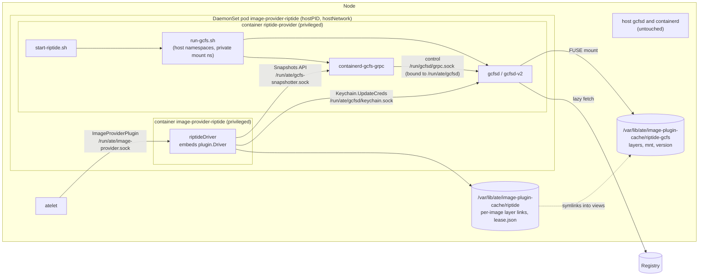
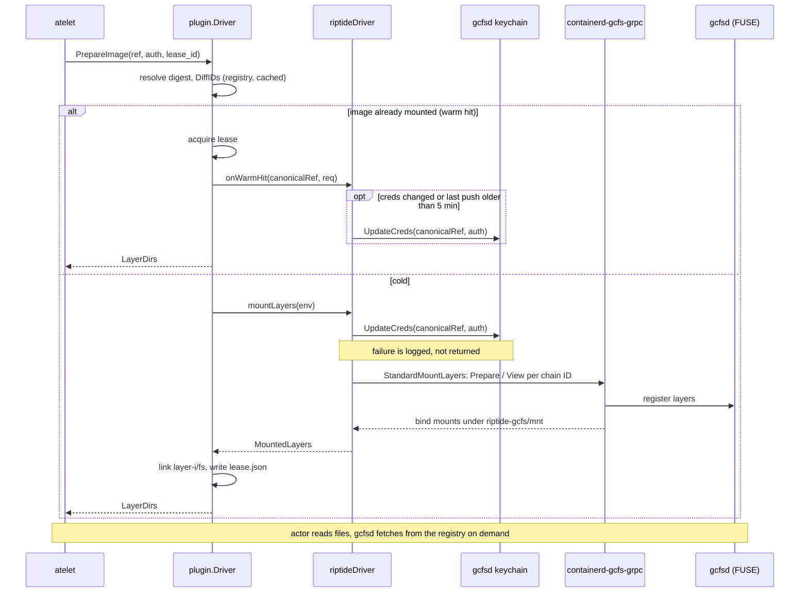
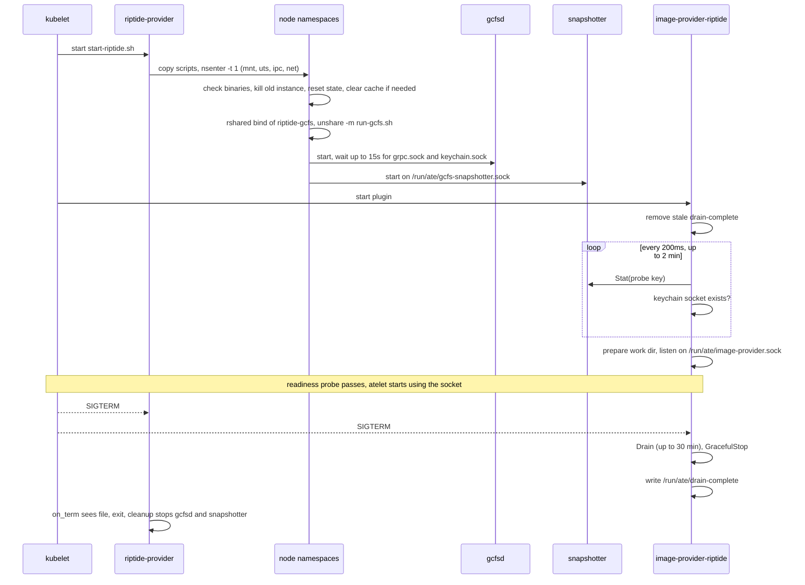

# Design: Riptide image provider plugin (Phase D)

Repo: `repos/image-provider-plugin-riptide` on branch `image-provider-plugin`. Target: google3 `riptide/image_provider_plugin` (path TBD). Module path `github.com/ai-on-gke/image-provider-plugin-riptide` is a placeholder.

Existing docs: [README.md](../../repos/image-provider-plugin-riptide/README.md), library [overview.md](../../repos/image-provider-plugin/docs/overview.md), substrate [image-provider.md](../../docs/guides/image-provider.md).

## 1. Summary

`image-provider-riptide` is an image provider plugin that streams actor images with Riptide, the GKE image streaming stack. It runs as one DaemonSet in `ate-system`. Each pod runs its own gcfsd and `containerd-gcfs-grpc` snapshotter, separate from the host's, plus the plugin process. The plugin is a thin layer over the library's `plugin.Driver`. It adds one thing: it pushes each image's registry credentials to gcfsd's keychain service before gcfsd fetches layers. A helper, `riptide-bin-image`, packages custom gcfsd builds and writes a kustomize patch that installs them.

## 2. Background and motivation

atelet starts an actor only after its image is on disk. For large agent images the pull dominates cold start. Riptide avoids the full pull. gcfsd serves layer contents over FUSE and fetches file data from the registry as it is read. `containerd-gcfs-grpc` exposes those FUSE trees as containerd remote snapshots.

GKE already ships these binaries on every node, but host image streaming serves the host containerd. Substrate's atelet does not use the host containerd for actor rootfs. It asks an image provider plugin for per-layer directories over `ImageProviderPlugin` (see the library [overview.md](../../repos/image-provider-plugin/docs/overview.md)). This plugin bridges the two: it drives a private gcfsd and snapshotter and hands atelet the mounted layer directories.

## 3. Goals / Non-goals

Goals:
- Serve `PrepareImage` for any image the snapshotter can stream, with lazy fetching.
- Work on stock GKE nodes with the preloaded binaries and no node changes.
- Keep state apart from host containerd and host gcfsd, under `/var/lib/ate/image-plugin-cache/riptide-gcfs`.
- Keep the layer cache warm across pod restarts.
- Allow custom gcfsd and snapshotter builds without rebuilding the plugin.
- Keep images readable until atelet has released its leases on shutdown.

Non-goals:
- The Memorystore arm (`riptide-ms.yaml`). It is excluded from the check-in.
- Non-GKE clusters. The DaemonSet needs `${KUBE_HOME}/bin` binaries or a custom build.
- Sharing the host's gcfsd, or branching on whether host image streaming is on.
- Removing credentials from gcfsd (`RemoveCreds` is generated but unused).
- Benchmarks, and read-ahead tuning beyond the fixed flags in `run-gcfs.sh`.

## 4. Design overview



Where it sits:
- The library ([`plugin.NewDriver`](../../repos/image-provider-plugin/plugin/driver.go#L297-L342)) does leases, coalescing, idle TTL, decline cache, persistence, drain and the gRPC server. This repo plugs in through three options: [`WithLayerMounter`, `WithWarmHitHook`, `WithProbeHook`](../../repos/image-provider-plugin/plugin/driver.go#L179-L203).
- atelet only sees the plugin socket. It knows nothing about gcfsd.
- gcfsd's sockets live under `/run/ate/gcfsd`. `run-gcfs.sh` bind-mounts that over `/run/gcfsd` in a private mount namespace, so the host gcfsd keeps its own `/run/gcfsd`.

## 5. Detailed design

### 5.1 Plugin driver (D2)

Files: [riptide.go](../../repos/image-provider-plugin-riptide/cmd/image-provider-riptide/riptide.go), [main.go](../../repos/image-provider-plugin-riptide/cmd/image-provider-riptide/main.go).

[`riptideDriver`](../../repos/image-provider-plugin-riptide/cmd/image-provider-riptide/riptide.go#L74-L86) embeds `*plugin.Driver` and adds a keychain client and a `pushed` map.

[`newRiptideDriver`](../../repos/image-provider-plugin-riptide/cmd/image-provider-riptide/riptide.go#L88-L121):
- Dials `unix://<KeychainSocket>` with insecure transport credentials, unless `config.KeychainClient` is set (tests).
- Calls `plugin.NewDriver("riptide", "/run/ate/gcfs-snapshotter.sock", "gcfs", ...)` with its three hooks first, then `cfg.DriverOpts`. Caller options win.
- Default work dir comes from the library: `/var/lib/ate/image-plugin-cache/riptide` ([`DefaultBaseWorkDir`](../../repos/image-provider-plugin/plugin/driver.go#L40)).

Hooks:

| Hook | Function | Behavior |
|---|---|---|
| Layer mounter | [`mountLayers`](../../repos/image-provider-plugin-riptide/cmd/image-provider-riptide/riptide.go#L138-L141) | `pushCreds(force=true)`, then `plugin.StandardMountLayers`. No Riptide-specific snapshot logic. |
| Warm hit | [`onWarmHit`](../../repos/image-provider-plugin-riptide/cmd/image-provider-riptide/riptide.go#L143-L145) | `pushCreds(force=false)`. Runs after the library has already granted the lease ([lease.go](../../repos/image-provider-plugin/plugin/lease.go#L87-L95)). |
| Probe | [`probe`](../../repos/image-provider-plugin-riptide/cmd/image-provider-riptide/riptide.go#L123-L136) | Fails unless the keychain path exists and is a socket. Runs after the library's snapshotter `Stat` check ([probe.go](../../repos/image-provider-plugin/plugin/probe.go#L88-L121)), so it gates startup, `CanProvide` and the readiness probe. |

`main.go` flags map one-to-one to library options ([main.go#L32-L72](../../repos/image-provider-plugin-riptide/cmd/image-provider-riptide/main.go#L32-L72)). Riptide adds `--keychain-socket` and defaults `--snapshotter-name=gcfs`. `--probe` runs `plugin.ProbeUnixSocket` for the readiness probe. Serving is `plugin.ServeUnixSocket` ([main.go#L83](../../repos/image-provider-plugin-riptide/cmd/image-provider-riptide/main.go#L83)).

### 5.2 Keychain proto and credential flow (D1, D2)

[keychain.proto](../../repos/image-provider-plugin-riptide/internal/proto/riptidekeychain/keychain.proto) is a client-side copy of gcfsd's service. The package `cloud.containers.riptide.fuse.keychain` and message names must match gcfsd's, since gRPC routes by full method name. `Keychain` has `UpdateCreds` and `RemoveCreds`. Only `UpdateCreds` is called. Code is generated with `go generate ./...` ([generate.go](../../repos/image-provider-plugin-riptide/internal/proto/riptidekeychain/generate.go), [update-codegen.sh](../../repos/image-provider-plugin-riptide/hack/update-codegen.sh)), and `hack/verify/codegen.sh` checks it is current.

gcfsd runs with `--enable_pull_secret_keychain` ([run-gcfs.sh#L60](../../repos/image-provider-plugin-riptide/manifests/scripts/run-gcfs.sh#L60)). It fetches layers with the credentials pushed for the image.

[`resolveAuth`](../../repos/image-provider-plugin-riptide/cmd/image-provider-riptide/riptide.go#L156-L208) picks credentials:
1. The request's `AuthConfig`, if it has any secret field. `ServerAddress` defaults to the ref's registry.
2. Otherwise `Driver.Keychain()`: the `WithKeychain` keychain, or Google plus default keychains ([driver.go#L351-L356](../../repos/image-provider-plugin/plugin/driver.go#L351-L356)). On GKE the Google keychain yields the node service account token.
3. `nil` for anonymous, unparsable refs, or keychain errors. Errors are logged.

[`pushCreds`](../../repos/image-provider-plugin-riptide/cmd/image-provider-riptide/riptide.go#L225-L266):
- Keys the push by the canonical ref `repo@sha256:...`, not the tag.
- On a warm hit, skips the RPC if the SHA-256 of the auth fields is unchanged and the last push is under `credsPushTTL` (5 min). A cold mount always pushes.
- Bounds the RPC with `updateCredsTimeout` (5 s).
- Logs and swallows failures. Public images still work. A private image then fails when gcfsd reads it.
- Keeps only the digest and time in memory, not the secret. Prunes expired entries on each successful push.



### 5.3 Snapshotter interaction

The plugin uses the stock library mounter. `containerd-gcfs-grpc` commits each layer remotely (Prepare returns `AlreadyExists`) and returns bind mounts from View. The test fake [`fakeGCFSSnapshots`](../../repos/image-provider-plugin-riptide/cmd/image-provider-riptide/riptide_test.go#L52-L103) models this. Requests carry snapshotter name `gcfs` and containerd namespace `default`. If the snapshotter declines an image, the library's decline cache and atelet's fallback apply. Riptide adds no handling.

### 5.4 Manifests (D3)

[kustomization.yaml](../../repos/image-provider-plugin-riptide/manifests/kustomization.yaml): namespace `ate-system`, adds label `ate.dev/image-provider: riptide` to the selector, and generates ConfigMap `image-provider-riptide-scripts` from the two scripts.

[riptide.yaml](../../repos/image-provider-plugin-riptide/manifests/riptide.yaml):
- DaemonSet `image-provider-riptide`, `hostPID`, `hostNetwork`, `terminationGracePeriodSeconds: 3600`, `maxUnavailable: 10%`, tolerates `ate.dev/sandboxClass` ([L36-L55](../../repos/image-provider-plugin-riptide/manifests/riptide.yaml#L36-L55)).
- `riptide-provider`: `debian:13-slim` pinned by digest, privileged, runs `/scripts/start-riptide.sh`. Mounts `/run/ate` and `/var/lib/ate` (Bidirectional) from the host ([L57-L90](../../repos/image-provider-plugin-riptide/manifests/riptide.yaml#L57-L90)).
- `image-provider-riptide`: ko image, privileged, root. Mounts `/run/ate` and `/var/lib/ate` (HostToContainer). Readiness runs `--probe` every 2 s ([L91-L115](../../repos/image-provider-plugin-riptide/manifests/riptide.yaml#L91-L115)).

[start-riptide.sh](../../repos/image-provider-plugin-riptide/manifests/scripts/start-riptide.sh):
- Copies both scripts to `/run/ate/riptide-scripts` and re-execs itself with `nsenter -t 1 -m -u -i -n` so the binaries run against node libraries ([L43-L48](../../repos/image-provider-plugin-riptide/manifests/scripts/start-riptide.sh#L43-L48)).
- Picks `gcfsd` or `gcfsd-v2` and the bin dir, and fails if either binary is not executable ([L50-L63](../../repos/image-provider-plugin-riptide/manifests/scripts/start-riptide.sh#L50-L63)).
- Kills earlier instances whose cmdline contains the state root ([L65-L73](../../repos/image-provider-plugin-riptide/manifests/scripts/start-riptide.sh#L65-L73)).
- Keeps `snapshotter/layers`. Clears it if `CLEAR_CACHE_ON_START=true` or the SHA-256 of the two binaries differs from `riptide-gcfs/version`. Always clears gcfsd view state, `metadata.db`, `snapshots`, the plugin work dir, stale sockets and `drain-complete` ([L77-L101](../../repos/image-provider-plugin-riptide/manifests/scripts/start-riptide.sh#L77-L101)). The comment explains why: restored views make the snapshotter fall back to local snapshots.
- Makes the state root an rshared bind mount, then `unshare -m` into `run-gcfs.sh` ([L103-L110](../../repos/image-provider-plugin-riptide/manifests/scripts/start-riptide.sh#L103-L110)).

[run-gcfs.sh](../../repos/image-provider-plugin-riptide/manifests/scripts/run-gcfs.sh):
- Binds `/run/ate/gcfsd` over `/run/gcfsd` privately ([L47-L49](../../repos/image-provider-plugin-riptide/manifests/scripts/run-gcfs.sh#L47-L49)).
- Builds gcfsd and snapshotter flags "as GKE uses" ([L51-L92](../../repos/image-provider-plugin-riptide/manifests/scripts/run-gcfs.sh#L51-L92)). gcfsd listens on host port `11254`.
- Starts gcfsd with `GOGC=10`, waits up to 15 s for its control and keychain sockets, then starts the snapshotter anyway ([L115-L133](../../repos/image-provider-plugin-riptide/manifests/scripts/run-gcfs.sh#L115-L133)).
- Exits when either process exits (`wait -n`). The EXIT trap stops both, lazily unmounts, and removes sockets.
- On TERM or INT it polls for `/run/ate/drain-complete` every 0.5 s, then exits ([L105-L113](../../repos/image-provider-plugin-riptide/manifests/scripts/run-gcfs.sh#L105-L113)).



### 5.5 Env settings

Set on `riptide-provider` ([riptide.yaml#L61-L80](../../repos/image-provider-plugin-riptide/manifests/riptide.yaml#L61-L80)).

| Variable | Manifest value | Script default if unset | Read by | Effect |
|---|---|---|---|---|
| `KUBE_HOME` | `/home/kubernetes` | none (nounset fails) | both scripts | Preloaded bin dir, metrics ADC files. |
| `RIPTIDE_BIN_DIR` | commented out | `${KUBE_HOME}/bin` | start-riptide.sh | Source of gcfsd, gcfsd-v2, `containerd-gcfs-grpc`. Must be on an exec mount. |
| `ENABLE_GCFS_V2_API` | `true` | `false` | both | Runs `gcfsd-v2` and passes `--enable-v2` to the snapshotter. |
| `ENABLE_GCFS_LAYER_CACHING` | `true` | `false` | run-gcfs.sh | Adds `--layer_cache_dir=riptide-gcfs/snapshotter/layers`. |
| `ENABLE_USERNAMESPACE_SUPPORT` | `false` | `false` | run-gcfs.sh | With v2, adds `--enable_id_mapping`. |
| `CLEAR_CACHE_ON_START` | `false` | `false` | start-riptide.sh | `true` deletes the layer cache at every start. |
| `GCFSD_CACHE_SIZE_MIB` | commented out | gcfsd default | run-gcfs.sh | Split evenly into `--max_content_cache_size_mb` and `--max_large_files_cache_size_mb`. |

The script defaults differ from the manifest for `ENABLE_GCFS_V2_API` and `ENABLE_GCFS_LAYER_CACHING`. The README table lists the manifest values.

### 5.6 riptide-bin-image and its patch (D4)

[main.go](../../repos/image-provider-plugin-riptide/cmd/riptide-bin-image/main.go) flags: `--gcfsd`, `--snapshotter`, `--repo` (all required), `--v1`, `--patch-out`.

[`run`](../../repos/image-provider-plugin-riptide/cmd/riptide-bin-image/main.go#L106-L168):
1. [`binariesArch`](../../repos/image-provider-plugin-riptide/cmd/riptide-bin-image/main.go#L172-L204) requires both files to be ELF executables of the same arch, amd64 or arm64.
2. Fetches busybox 1.37.0, pinned by digest, for that platform.
3. Appends one [reproducible layer](../../repos/image-provider-plugin-riptide/cmd/riptide-bin-image/main.go#L209-L264): `/install-riptide-bins.sh` and `/riptide/{gcfsd-v2|gcfsd, containerd-gcfs-grpc}`, mode 0755, mtime epoch.
4. Pushes with the default plus Google keychains and prints `repo@sha256:...`.
5. With `--patch-out`, writes the [`daemonSetPatch`](../../repos/image-provider-plugin-riptide/cmd/riptide-bin-image/main.go#L270-L305).

The patch is a strategic merge patch. Output for a pushed image (keys sorted by `sigs.k8s.io/yaml`):

```yaml
apiVersion: apps/v1
kind: DaemonSet
metadata:
  name: image-provider-riptide
spec:
  template:
    spec:
      containers:
      - env:
        - name: RIPTIDE_BIN_DIR
          value: /home/kubernetes/bin/ate-riptide
        name: riptide-provider
      initContainers:
      - command:
        - /bin/sh
        - /install-riptide-bins.sh
        image: REGION-docker.pkg.dev/PROJECT/REPO/riptide-bins@sha256:...
        name: install-riptide-bins
        volumeMounts:
        - mountPath: /host-bin
          name: kube-home-bin
      volumes:
      - hostPath:
          path: /home/kubernetes/bin
          type: Directory
        name: kube-home-bin
```

[install.sh](../../repos/image-provider-plugin-riptide/cmd/riptide-bin-image/install.sh) copies each file to `.<name>.tmp` and renames it, to avoid "text file busy". The README shows the overlay that applies the patch. The patch does not set `ENABLE_GCFS_V2_API`. With `--v1`, the user must also set it to `false`, or `start-riptide.sh` fails on the missing `gcfsd-v2`.

New binaries change `cache_version`, so the first start with them clears the layer cache.

## 6. Failure modes and recovery

| Failure | What happens | Recovery |
|---|---|---|
| Binary missing or not executable | `start-riptide.sh` exits 1. The plugin's startup check fails after 2 min and it exits. | Both containers crash-loop. With no plugin socket, atelet uses its image cache (see substrate [image-provider.md](../../docs/guides/image-provider.md)). |
| gcfsd or snapshotter exits | `wait -n` returns. The EXIT trap stops the other and lazily unmounts. The container restarts and wipes views and the plugin work dir. | The plugin container keeps running. Its leased images now have missing layer links, so the next `PrepareImage` mounts them again ([lease.go#L87-L101](../../repos/image-provider-plugin/plugin/lease.go#L87-L101)). Running actors on the old FUSE mount get read errors. |
| gcfsd slow to start (over 15 s) | The snapshotter starts before gcfsd sockets exist. | The plugin probe keeps failing until both sockets exist, up to its 2 min startup timeout. |
| `UpdateCreds` fails or times out | Logged. The mount proceeds. | Public images work. A private image fails inside the actor at first read. The next cold mount, or a warm hit after 5 min, retries. |
| Plugin container restarts alone | gcfsd keeps serving. | The library reloads `lease.json` and reconciles with atelet ([reconcile.go](../../repos/image-provider-plugin/plugin/reconcile.go)). |
| Whole pod restarts | `start-riptide.sh` deletes the plugin work dir, including `lease.json`. | The plugin starts with no leases. atelet's reconcile handles leases the plugin does not know (substrate C4). The layer cache survives unless the binaries changed. |
| SIGTERM | The plugin drains up to 30 min ([drain.go#L84](../../repos/image-provider-plugin/plugin/drain.go#L84)), then writes `drain-complete` even on timeout ([server.go#L200-L226](../../repos/image-provider-plugin/plugin/server.go#L200-L226)). gcfsd stops after that. | If the plugin dies before writing the file, `run-gcfs.sh` waits until kubelet kills it at 3600 s. |
| Leftover processes from an earlier instance | Killed with `SIGKILL` if their cmdline has the state root. | Only the current `gcfsd_name` variant is matched. After switching `ENABLE_GCFS_V2_API`, a leftover of the other variant survives. |
| Corrupt or stale layer cache | Cleared when the binaries change. | Set `CLEAR_CACHE_ON_START=true` and restart. |

## 7. Security considerations

- Privilege. Both containers are privileged in a `hostPID`, `hostNetwork` pod. `riptide-provider` enters PID 1's namespaces, so it is node root. A host image-streaming daemon needs this for FUSE and mount propagation. The pod must stay in `ate-system` under its default-deny network policies.
- Host mounts. `/var/lib/ate` (Bidirectional) and `/run/ate` are shared with atelet. Anything with `/run/ate` access can call the plugin, the snapshotter and gcfsd's keychain over unauthenticated unix sockets. Actors run in gVisor or microVM sandboxes and do not see these paths. The init container from the D4 patch writes to the host's `/home/kubernetes/bin`.
- Credentials.
  - Request credentials come from atelet. Without them the plugin falls back to the node service account through the Google keychain. Reviewers should confirm this matches atelet's own image cache behavior.
  - gcfsd keeps pushed credentials in memory until it restarts. `RemoveCreds` is never called.
  - The plugin stores only a SHA-256 of the auth fields. Logs show the canonical ref and server, not secrets.
  - Credentials are keyed per image digest, not per tenant. On a warm hit the library grants the lease before the hook runs and ignores the hook. So a caller can get an already-mounted image without its own credentials being checked against the registry. This is a library property that Riptide inherits. See open questions.
- Supply chain.
  - The plugin image is built from source with ko. `debian:13-slim` and busybox are pinned by digest.
  - Default binaries are GKE's own, on the node image.
  - Custom binaries run as node root. `riptide-bin-image` checks only ELF type and arch, not provenance. The patch pins the image by digest. Whoever can push to `--repo` controls what runs on every node.
  - `RIPTIDE_BIN_DIR` can point at any node directory.

## 8. Compatibility and version skew

- GKE binaries. The default uses whatever gcfsd, gcfsd-v2 and `containerd-gcfs-grpc` the node image ships. The flags in `run-gcfs.sh` copy GKE's. A GKE release that renames or drops a flag makes gcfsd or the snapshotter exit at start, and the pod crash-loops. There is no version check.
- `KUBE_HOME` is fixed at `/home/kubernetes`. The metrics ADC files under it (including GKE's `gcfs_snaphotter_...` spelling) are used only if present.
- Host coexistence. State, mounts and sockets are separate from the host's. gcfsd binds host port `11254` on the host network. If host image streaming is on, the host gcfsd may use the same port. This needs a check on a node with image streaming on (see open questions).
- Keychain proto. The copy must stay wire-compatible with gcfsd. Field numbers and the package name are the contract.
- Library version. Staging uses `replace github.com/ai-on-gke/image-provider-plugin => ../image-provider-plugin` ([go.mod](../../repos/image-provider-plugin-riptide/go.mod)). On export it becomes `v0.1.0`. The plugin uses `NewDriver`, `MountEnv`, `StandardMountLayers`, the three hooks, `Keychain`, `ServeUnixSocket`, `ProbeUnixSocket` and the `Default*` constants. atelet and plugin skew is governed by the `v1alpha1` API and the drain-complete contract, both in the library.
- google3 import. The library must land in `third_party` first. The GitHub workflow, the `hack/tools/*` go.mod pins, the module path and the copied proto all need a google3 equivalent. In google3 the plugin could depend on gcfsd's real keychain proto instead of the copy.
- Arch. `riptide-bin-image` supports amd64 and arm64. The DaemonSet has no arch node selector.

## 9. Testing

Unit tests (pass locally with `go test ./...`):

| Test | Covers |
|---|---|
| [`TestPushCreds`](../../repos/image-provider-plugin-riptide/cmd/image-provider-riptide/riptide_test.go#L130-L214) | Full `PrepareImage` through the real `plugin.Driver` with a fake snapshotter and keychain. Rows: warm hit with same creds skips, warm hit with new creds pushes, request creds win over keychain, keychain fallback, anonymous pushes nothing. Checks the canonical ref key. |
| [`TestProbeKeychainSocket`](../../repos/image-provider-plugin-riptide/cmd/image-provider-riptide/riptide_test.go#L216-L258) | Probe fails with no path or a regular file, and passes with a socket. |
| [`TestDaemonSetPatch`](../../repos/image-provider-plugin-riptide/cmd/riptide-bin-image/main_test.go#L36-L116) | Applies the patch to the real `riptide.yaml` with `strategicpatch`. Breaks if names drift. |
| [`TestElfArch`](../../repos/image-provider-plugin-riptide/cmd/riptide-bin-image/main_test.go#L118-L152) | ELF detection. Skips the positive row off linux amd64/arm64. |
| [`TestBinariesLayer`](../../repos/image-provider-plugin-riptide/cmd/riptide-bin-image/main_test.go#L154-L227) | Layer contents, modes, and a stable digest. |

Static checks in `hack/verify`: gofmt, golangci-lint, shellcheck, boilerplate, `go mod tidy`, codegen, kustomize build.

Gaps:
- No test for the 5 min TTL expiry, `UpdateCreds` failure, or timeout.
- Scripts have only shellcheck. Cache-clear logic, process matching and the drain wait are untested.
- No e2e in this repo. The plan schedules Riptide e2e on GKE for M4. It should cover cold and warm `PrepareImage`, a private Artifact Registry image, pod restart, and SIGTERM drain.
- `riptide-bin-image` push and the init container are not tested end to end.

## 10. Commit map

| # | SHA | Commit | Sections | Lines added |
|---|---|---|---|---|
| D0 | `4b3b9e2b9` | Add module, license, lint config and CI | 8, 9 (static checks) | 2003 (mostly tool go.sum) |
| D1 | `8c7e9edcb` | proto: add the gcfsd keychain client proto | 5.2 | 1163 (60-line proto, rest generated or pins) |
| D2 | `da6477188` | riptide: add the Riptide plugin | 5.1, 5.2, 5.3, 6, 9 | 663 |
| D3 | `61e80e42a` | manifests: add the Riptide DaemonSet | 4, 5.4, 5.5, 6, 7 | 406 |
| D4 | `e62c41e10` | riptide: add riptide-bin-image to package custom binaries | 5.6, 7, 11 | 695 |
| D5 | `c0f3c6d6c` | docs: add the README with setup and run instructions | user-facing summary of all | 127 |

Suggested review order:
1. D2, with D1 beside it. It is the only Go logic on the request path. Start at `newRiptideDriver` and `pushCreds`.
2. D3. Read `start-riptide.sh`, then `run-gcfs.sh`, with sections 5.4 and 6.
3. D4. Settle the TODO before reviewing details.
4. D5. Check it against D3 and D4.
5. D0. Skim. It mirrors the library's A0.

## 11. Open questions / review TODOs

1. D4 TODO: keep both `RIPTIDE_BIN_DIR` and `riptide-bin-image`, or only `RIPTIDE_BIN_DIR` and leave installing custom binaries to users. Dropping D4 removes about 560 lines of Go and shell plus the k8s API dependencies in `go.mod`.
2. Host port `11254`: does it collide with the host gcfsd when GKE image streaming is on? The README says both setups work.
3. Warm hits grant a mounted image without checking the caller's credentials. Is that acceptable on multi-tenant nodes, or should the library check registry access first?
4. When the request has no credentials, the plugin pushes the node service account's. Should it push nothing instead?
5. Should a failed `UpdateCreds` decline the image (so atelet falls back) instead of failing late inside the actor?
6. `RemoveCreds` is unused. Call it when an image's last lease ends, or drop it from the proto copy?
7. google3: depend on gcfsd's real keychain proto instead of the copy? Two protos with the same package in one binary would conflict.
8. google3: what replaces the GitHub workflow, the `hack/tools` pins and `ko` builds?
9. Should `run-gcfs.sh` fail if the gcfsd sockets do not appear within 15 s, instead of starting the snapshotter anyway?
10. Should `start-riptide.sh` kill leftovers of both `gcfsd` and `gcfsd-v2`?
11. Should the drain wait in `run-gcfs.sh` have its own timeout below the 3600 s grace period?
12. Should `riptide-bin-image --v1` also set `ENABLE_GCFS_V2_API=false` in its patch?
